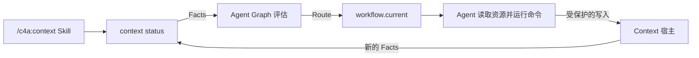

# 在 Context 中的应用

<!-- context:section id="why" -->
Context 是最大的公开 Agent Graph 采用者，它展示了什么时候值得引入 Graph。它的生命周期很长且有状态：来源必须确定范围并完成采集，一个 Indexer 生命周期要把每项已授权的输入转化为当前的候选批次，人工 Gate 可能让运行暂停，已批准的知识还必须完成收尾、校验、翻译、版本化和构建。如果只用普通 Skill，就要把这些全部塞进提示词，而且仍然无法证明哪些事情已经发生过。

Context 并不能证明每个 Skill 都需要 Graph。它证明的是：当一个 Skill 背后是一个涉及外部 Facts、多个 Gate、重复批次并且确实需要恢复能力的工作流时，Graph 会有帮助。Agent Graph 不抽取代码、不解读文档，也不批准知识；Context 仍然是宿主。
<!-- /context:section -->

<!-- context:section id="layers" -->
## 谁负责什么



| 层 | 在 Context 中的职责 |
| --- | --- |
| Skill | 被发现，以及一份简短的 Route 消费契约 |
| Context 宿主 | 观察文件和外部系统、执行命令、实施授权、记录证据 |
| Provider | 绑定 `workspace` Graph、入口、Action、资源和原因码目录 |
| Graph | 描述合法的生命周期状态、依赖、Gate、循环和终止结果 |
| Route | 暴露一个当前动作、它所需的资源及其完成契约 |
| Facts 与 Outcome | 证明实际发生了什么；会话中的声明不能作为完成证据 |

`context status` 是观察边界：它检查知识工作区，向 Agent Graph 提供 Facts，并返回 `workflow.current`，其中包含选中的 Route、原因码、命令计划、Gate，以及当下需要的资源。从 Context 一侧看这个循环，见 [工作流执行](../context/workflow-execution.md)。
<!-- /context:section -->

<!-- context:section id="entry" -->
## 一个轻量的公开入口

知识生产只有一个公开的 Agent 入口：`/c4a:context`。它的第一次 `context entry` 调用会判断是初始化、知识工作区迁移还是普通的继续，然后把控制权交给 `workflow.current`。插件的其他公开 Skill——用于规划的 `context-plan`、用于查询的 `context-inspect-search` 和用于同仓库内容的 `context-repo-content`——自身不推进生命周期，而是把规划和已接受的知识建议交回这个入口。入口正文只描述如何开始以及如何消费 Route；阶段流程、schema、来源视图、审核契约和知识包指引都放在可独立寻址的工作流资源中。

这就是规模化的 [技能与 Provider](skills-and-providers.md) 模式：一个小而稳定的外壳，后面是由 Graph 逐块选取的大量指令。细节并没有被概括掉——而是被拆分、按需选取并可校验，而不是每轮都全部加载。
<!-- /context:section -->

<!-- context:section id="workflow" -->
## 已发布的工作流

整个集成都公开在 Context 仓库的 `packages/context-cli/context-workflow/` 下：

| 路径 | 内容 |
| --- | --- |
| `provider.yaml` | Provider `c4a/context`，绑定 `workspace` 与 `indexer` 两个 Graph、Action、Resource 和入口 |
| `graphs/workspace.yaml` | 静态的顶层生命周期，从任务开始，经过采集、Indexer 生命周期、审核、收尾、知识包输出、翻译、版本，直到构建 |
| `graphs/indexer.yaml` | 唯一的 Indexer 生命周期：需求确认、Provider 选择、授权工作集、分区编写、对账、布局和候选编译 |
| `actions/` | 可执行契约：runner、宿主命令或 handler、effect、授权边界和预期 Outcome |
| `resources/` | 流程、用于人工决策的对话文件、实时知识工作区视图、语义参考、诊断和手册 |
| `codes.yaml` | Route 码和诊断码的稳定含义 |
| `tests/` | 基于 Facts 的路由选择测试，无需 Agent 或模型即可运行 |

顶层的 `run-indexer-lifecycle` Action 是一个 Agent Action，它把索引工作交给 Indexer Graph，只有当 `indexer.lifecycle_current` 为 true 时才算满足。重复的来源和分区不需要重复的 Graph 定义：知识工作区 Graph 只有稳定的状态，例如“仍有采集目标”，由运行时 Facts 指明当前工作集。
<!-- /context:section -->

<!-- context:section id="managed" -->
## 托管模式就是委托的 Gate

Context 把无人值守的体验称为*托管模式*。这是宿主的概念，而不是 Agent Graph 的字段：宿主把它映射为会话范围的授权以及每个 Gate 的 `delegated` 策略。最终的知识审核体现了这种结构：

```yaml
- id: review-current-batch
  kind: gate
  reasonCode: route.review.decision-required
  inspectionAction: actions/inspect-review.yaml
  resolutionAction: actions/apply-confirmed-review.yaml
  delegated:
    inspection: skip
    resolutionAction: actions/apply-managed-review.yaml
    resources:
      required:
        - resources/views/review-current.yaml
  gate:
    id: knowledge-review
    authority: context.knowledge-review
    delegatable: true
  satisfiedBy:
    - path: gates.knowledge_review_resolved
      equals: true
```

没有该授权时，Route 会停下来等人处理。如果本次会话授予了 `context.knowledge-review`，同一个 Gate 就会通过宿主 handler `context.review.approve-current` 解决。路由测试 `tests/managed-review.yaml` 正是锁定了这一点：在授权存在时，它期望 `primaryNode: review-current-batch`、`gateResolution: session-authority` 以及该解决 handler。会话授权永远不会变成永久的项目配置，需要语义判断或不安全修复的 Route 仍然会停下。
<!-- /context:section -->

<!-- context:section id="idempotent" -->
## 幂等的继续

再次调用 Skill 不会重放每条指令，也不会重复每次写入。在 Provider 产物包、Facts 和 Outcome 都相同的情况下，Agent Graph 会选出同一个 Route，未变化的资源回执也会保持相同的读取状态。Context 把会修改状态的命令绑定到选中的工作流修订号（revision），并检查其外部证据：已由知识工作区 Facts 满足的工作会被跳过，过期的命令会被拒绝，而不会作用到更新后的状态上。

边界是明确的。Agent Graph 让评估可重复并暴露完成契约；Context 宿主让每个文件系统操作都是原子的、受保护的，或可证明为无操作。Agent Graph 本身不会让任意脚本变得幂等——见 [运行与恢复](runs-and-recovery.md)。
<!-- /context:section -->

<!-- context:section id="replay" -->
## 记录与回放

开启 Context 调试模式后，宿主会记录 CLI 调用边界和 Agent Graph 评估。回放可以展示：每次 Fact 变化时选中了哪个 Route，多来源循环在哪里推进、完成了多少轮，授权或审核 Gate 何时暂停了进度，每次转换依据的是哪个原因码，以及最终知识包是如何得到的。

[交互式回放](https://context4ai.github.io/context/case-studies/workflow/?lang=en) 由一份脱敏的 Context 记录规范化而来；它的 **Workspace graph** 控件绘制出静态契约，每一步都把对应的 Action 和 Resource 链接回工作流文件。这类路由轨迹能暴露浪费的循环、重复的资源读取、不完整的恢复路径和有误导性的状态优先级，这些观察会转化为新的路由测试和 Graph 修改——也就是 [为什么是 Graph Engineering](why-graph-engineering.md) 中描述的改进循环。
<!-- /context:section -->

<!-- context:section id="this-site" -->
## 本站如何用 Context 生产

本文档站本身就是一个 Context 知识工作区，通过同一个 `/c4a:context` 入口和工作流生产。

- **知识工作区。** Portal 仓库根目录就是知识工作区：`package.json` 声明它，`src/index.ts` 登记来源和输出，`src/indexers.yaml` 说明每个读者群体的需求，`src/knowledge-map.yaml` 保存导航。
- **来源。** 三个社区仓库，各自固定到一个提交（Context 先固定在 `v0.7.60`，最后一个阶段前更新到 `v0.7.61`；Agent Graph 为 `v0.3.0`；Source Graph 固定到一个没有发行号的提交），另有五篇脱敏笔记，内容涉及使用经验、实测压缩效果、检索评估、知识服务 Agent 设计和常见问题。维护者在登记每篇笔记前都做了审阅。
- **规划。** 由于来源横跨三个仓库，生产从一次 `context-plan` 调研和一份 PLAN 报告开始，报告把站点拆分为六个阶段——快速上手与 Context 内部机制；来源、生产、审核、更新和查询指南；输出、Indexer、知识服务、知识工作区维护、实践和 Context 参考；Source Graph；Agent Graph；以及“更多”菜单和首页链接——另加一轮修订，新增七个页面并统一了命名和链接。
- **每个阶段。** `task prepare` 和 `task resume` 开启新的生产阶段；Agent 按读者问题分批编写文章，每个章节都附带指向来源行或笔记的引用，提交时会检查格式、链接和引用。
- **审核。** 每个阶段都会生成一份 HTML 审核报告，批准前检查是否有未放入导航的页面以及无法渲染的图表。维护者审核了前两个阶段，之后把审核委托给 Agent；Agent 对照来源逐篇检查文章，发现事实偏差时用 `revise` 修正已批准页面。
- **翻译与版本。** 已批准的文章和导航标题由多个并行的子 Agent 翻译为简体中文，并由脚本确认章节标记、代码块、链接和行内代码均未改变。每个阶段在构建站点和知识包之前，都会记录一个知识工作区版本和 Changelog 条目，从 0.1.0 开始递增。

这次运行中的几点观察：

- 一个公开入口承载了所有阶段。每次中断或开启新会话后，Agent 都从 `context status` 返回的 Route 继续，而不是依赖会话记忆。
- 有几份草稿与源代码不一致——例如超时返回哪个错误码，或匿名限流统计的是什么。章节引用让这些检查可以逐节进行，每处问题都在提交前修正。
- 修订已批准页面时只改动受影响的章节，而不是重写整篇文章。
- 把 Context 来源从 `v0.7.60` 更新到 `v0.7.61` 时没有重新开始生产：`context verify` 列出引用的源码区域发生变化或位置移动的页面，`context update` 把它们作为候选，由 Agent 逐页判断是否需要修订。“更多”菜单中的页面也作为同一次更新的新主题写成。
<!-- /context:section -->
