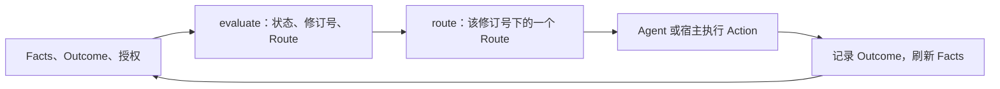

# 核心模型

<!-- context:section id="loop" -->
Agent Graph 把静态的工作契约和当前状态转换为一个合法的下一步。每次交互都遵循同一个循环：



评估和 Route 解析都是只读且确定性的：相同的定义和输入会得到相同的修订号（revision）、相同的 Route 和相同的顺序。Agent Graph 本身不执行任何东西；它只返回要运行什么、要读取什么。
<!-- /context:section -->

<!-- context:section id="provider-graph" -->
## Provider 与 Graph

**Provider** 是一个独立版本化的信任与发布边界。它的清单（`agent-graph.provider.v1`）显式列出 Graph 文件——不会通过扫描发现任何东西——此外还有可选的 Code Catalog 以及所支持的工具链版本范围。引用始终限定在 Provider 根目录内，多个 Provider 彼此隔离。

**Graph**（`agent-graph.graph.v1`）是一份确定性的路由定义：具名的 `entrypoints`、节点和边。它的拓扑是静态的。目标名称、日期、阶段或队列项属于 Facts，由稳定的 Host Action 解析出具体目标，因此 Provider 永远不会因为参数变化而重新生成节点。每个 Graph 至少声明一个 Terminal（终止节点）。

| 节点类型 | 必需字段 | 含义 |
| --- | --- | --- |
| `action` | `action` | 由命令、脚本、Agent Skill 或宿主 handler 完成的工作 |
| `gate` | `gate` | 需要用户或会话授权的决定 |
| `subgraph` | `graph`, `entry` | 进入同一 Provider 中的另一个 Graph |
| `terminal` | `terminalOutcome` | 以显式 Outcome 结束当前帧 |

Action 和 Gate 节点必须带有以 `route.` 开头的 `reasonCode`——一个稳定的、供机器读取的说明，解释为什么提供这个 Route。`priority` 用于给同时合法的 Route 排序；它从不决定语义上是否合适。`join: all`（默认值）要求所有入边都匹配，`join: any` 只要求一条匹配。
<!-- /context:section -->

<!-- context:section id="facts" -->
## Facts

Facts 是由 Provider 集成或宿主提供的观察状态。节点用一个刻意保持精简的数据模型来检验它们，而不是用表达式：

```yaml
requiresFacts:
  - path: sources.registered
    equals: true
satisfiedBy:
  - path: artifact.digest
    exists: true
```

`path` 是点分路径查找，其中数字段用于索引数组（`items.0.digest`）；每项检查只能且必须包含 `exists` 或 `equals` 之一，取值为标量。不支持 JavaScript、模板展开或 shell 求值。

- `requiresFacts` 让节点只在当前状态满足时才合法；若某项检查不通过，节点为 `blocked`，并附带 `required-fact-missing` 诊断。
- `satisfiedBy` 无需重放即可证明节点已完成。匹配的事实会让节点成为 `completed`，即使没有 Run 记录；而如果记录了 `completed` 却没有这些事实，结果会变为 `unverified`。

对话中的声称永远不会产生事实。
<!-- /context:section -->

<!-- context:section id="outcomes" -->
## Outcome 与边

Outcome 是节点的类型化结果：

```text
completed partial failed unverified skipped pending blocked waiting-user
```

它们不是彼此的别名：`partial`、`unverified` 和 `skipped` 永远不会被悄悄当作 `completed`，因为正是这些差异让图能够恢复。每条边都会列出允许它通行的 Outcome（默认为 `[completed]`）：

| 边类型 | 含义 |
| --- | --- |
| `flow` | 一般的控制转移 |
| `consumes` | 目标消费源节点产出的产物 |
| `requires` | 源节点是目标的前置条件 |
| `gatedBy` | 由一个 Gate 源节点决定目标的策略边界 |
| `repeat` | 匹配的结果会重新激活一个 Action 或 Gate，进入下一次迭代 |

除 repeat 以外的所有类型都使用同一条可达性规则；类型记录的是因果意图，供检查、测试和宿主策略使用。边不携带值或产物——宿主持久化输出，并把引用或摘要值发布为 Facts。非 repeat 边必须构成无环图，因此每个循环都是显式的 `repeat`。扇出和扇入描述的是合法的可达性，而不是并行执行。
<!-- /context:section -->

<!-- context:section id="evaluation" -->
## Evaluation 如何计算

评估器从 Entry 节点出发，反复确定每个已到达节点的 Outcome——先看 `satisfiedBy` 事实，再看已记录的 Outcome，否则为 `pending`——并沿着所有 Outcome 匹配的边前进，同时遵循 `join` 并重新激活 `repeat` 目标。Subgraph 节点就地评估其子 Graph，并采用子 Graph 的终止 Outcome。随后：

- 处于 pending 的 Action 成为 **immediate** 候选；
- 处于 pending 的 Gate 成为 **requires-user** 候选；如果输入带有它的可委托授权，则成为 immediate 候选；
- 如果恰好到达一个终止 Outcome，当前帧为 `complete`；终止 Outcome 冲突时为 `error`（`terminal-outcome-ambiguous`）；没有任何可达节点时为 `blocked`，并附带 `no-route`。

候选先按可用性排序（先 immediate，后 requires-user），再按 `priority` 从高到低，最后按 Route ID 排序。`agent-graph.evaluation.v1` 结果包含一个 `statusCode`（`actionable`、`waiting-user`、`blocked`、`complete` 或 `error`）、一个可选的终止 `outcome`、一个 `primaryRoute` 和最多三个 `alternativeRoutes`——每个都带有 `reasonCode`、可选的 Catalog `hint` 和一个标签——以及精简的诊断。当还有更多备选项时，会通过 `route-alternatives-truncated` info 诊断报告。

`revision` 是以下内容的摘要值：所选 Graph 在同一 Provider 内的依赖闭包、facts、规范化后的 outcomes 以及 authorities。Outcome 记录上的时间戳，以及只被无关 Graph 使用的文件，都不会改变它。
<!-- /context:section -->

<!-- context:section id="route" -->
## Route

`route` 把 Evaluation 中的一个 Route ID 解析为一份 `agent-graph.route.v1` 计划：

| 字段 | 内容 |
| --- | --- |
| `revision`, `routeId` | 它所属的 Evaluation；Route ID 由该修订号派生 |
| `graph`, `node`, `callPath` | 这一步所在的位置，包括 Subgraph 路径 |
| `statusCode`, `reasonCode`, `hint`, `availability` | 为什么以及以何种方式提供 |
| `action` | Action 的标识、runner 和 effect |
| `commandPlan` | 确切的命令、脚本调用或宿主 handler，以及它的工作目录 |
| `resources` | 必需和推荐的位置，每个都保留完整的 file、Graph-action 或 Host-action 位置信封，并带有 `readState`，取值为 `current` 或 `read-required` |
| `gate` | 针对 Gate：授权、解决方式，以及独立的检查 Action 和决议 Action |
| `afterAction` | `recordNode`——要记录的状态键——以及 `evaluate: true` |

如果调用方传入 Evaluation 的修订号而状态已经变化，解析会以 `route-revision-stale` 失败；已不再可用的 Route ID 会以 `route-stale` 失败。`agent` Action 使用的 Agent Skill 会被添加为第一个必需资源。文档正文从不内嵌；Route 只指向文件和摘要值。
<!-- /context:section -->

<!-- context:section id="gates" -->
## Gate 与授权

```yaml
kind: gate
reasonCode: route.review.approval-required
gate:
  id: result-review
  prompt: Review the prepared result.
  authority: review
  delegatable: true
inspectionAction: actions/inspect-review.yaml
resolutionAction: actions/apply-review.yaml
delegated:
  inspection: skip
  resolutionAction: actions/accept-review.yaml
  resources: { required: [], recommended: [] }
```

没有匹配的授权时，Route 为 `waiting-user`，其普通 `commandPlan` 为空。可选的只读 **检查 Action（inspection Action）** 为决定准备证据，并在 Gate 等待期间保持可用。可选的 **决议 Action（resolution Action）**（effect 为 `write` 或 `external`）负责落实决定，但在用户确认之前，宿主不得运行它。当 `delegatable` 为 true 且当前评估或 Run 带有所指定的授权时，Gate 会以 `resolution: session-authority` 变为可执行；此时 `delegated` 策略可以跳过检查、换用另一个决议 Action，并替换 Gate 的资源。

授权属于当前输入或 Run，从不属于 Provider 定义。它只能解决可委托的 Gate，永远不会满足事实，也不会绕过校验。Context 的全托管模式正是建立在这一机制之上，参见[在 Context 中的应用](agent-graph-in-context.md)。
<!-- /context:section -->

<!-- context:section id="reasons" -->
## 解释每一步

每个 Route 都带有一个机器稳定的 `reasonCode`。Provider 可以添加 Code Catalog（`agent-graph.code-catalog.v1`）：其中 `route-reason` 条目为每个原因码提供简短摘要和可选的说明文档，`diagnostic` 条目为产品状况命名并给出严重级别。一旦存在 Catalog，所有 Action 和 Gate 的原因码都必须列在其中，从而让原因成为一个封闭且有文档的集合。宿主和 Agent 根据 schema、状态码、原因码和诊断码分支，从不依据人类可读的描述。

每个对象的确切字段见[规范](../../product/reference/agent-graph/specification.md)；Run 如何持久化 Outcome 见[运行与恢复](runs-and-recovery.md)。
<!-- /context:section -->
