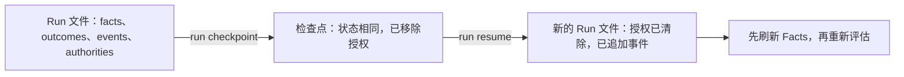

# 运行与恢复

<!-- context:section id="facts-first" -->
## 事实优先，历史其次

最可靠的状态是真实系统本身。当宿主能够观察到已经发生的事情——一个产物摘要值、一个来源修订号、一份测试回执、一个已部署的版本——它就把这些值作为 Facts 传入，评估完全不需要存储任何状态：

```bash
agent-graph evaluate build --manifest provider.yaml --facts @observed-facts.json --format json
```

这样的事实在重启后依然有效，而且自身就能让过期的工作失效。当可信度取决于由谁观察到某个值时，Fact 还会携带观察者的身份和健康状况（例如 `sourceRevision`、`available`、`fresh`）。宿主应用自己的时钟、租约或健康策略，并发布稳定的状态；Agent Graph 从不读取挂钟时间。由于整个 Facts 对象都参与修订号（revision）的计算，替换观察者或某个值变为过期，都会让已经解析出的 Route 失效，而无需改动 Graph。

只有在你需要执行历史、长任务的检查点、无法从外部观察到的 Outcome，或重复迭代时，才使用 **Run**。
<!-- /context:section -->

<!-- context:section id="run" -->
## Run

Run（`agent-graph.run.v1`）是可选的、由宿主拥有的执行记忆，保存在一个 JSON 文件中：

| 字段 | 内容 |
| --- | --- |
| `provider`, `graph`, `entry`, `workspace` | Run 执行的对象 |
| `facts` | 提供给路由的 Facts |
| `outcomes` | 每个完全限定状态键对应的最新 Outcome 记录 |
| `authorities` | 当前授予的会话授权 |
| `events` | 只追加、带编号的事件，例如 `run.started`、`node.outcome-recorded`、`facts.updated`、`run.checkpointed`、`run.resumed` |

```bash
agent-graph run start monitor --manifest provider.yaml --state .runtime/monitor.json --workspace .
agent-graph route monitor --manifest provider.yaml --state .runtime/monitor.json --format json
agent-graph run record monitor/poll partial --state .runtime/monitor.json
```

执行完一个 Action 后，用 Route 中给出的 `afterAction.recordNode` 键原样记录它的 Outcome——例如 `monitor/poll` 这样的键，嵌套时会加上 Subgraph 调用路径作为前缀。Outcome 对每个键只保留最新一条记录，而事件会保留每一次迭代。`run start`、`checkpoint` 和 `resume` 都拒绝覆盖已存在的文件，每次写入都会按 Run schema 校验并以原子方式写入。没有默认目录：Run 存放在哪里由宿主决定。
<!-- /context:section -->

<!-- context:section id="loops" -->
## 循环

```yaml
edges:
  - { from: poll, to: poll, kind: repeat, outcomes: [partial] }
  - { from: poll, to: done, outcomes: [completed] }
```

记录 `partial` 会重新激活 `poll`；记录 `completed` 则到达 Terminal（终止节点）。Agent Graph 不会忙等、休眠，也不会自己运行循环：由 Agent 或宿主决定何时执行每个 Route，并可按自己的时间或预算策略停止。传输重试、模型重试和工作流 Outcome 是不同的东西——重试耗尽应记录为 `failed` 或 `unverified`，绝不能记录为 `completed`。
<!-- /context:section -->

<!-- context:section id="failure" -->
## 部分完成与失败路径

恢复通过显式的 Outcome 和边来建模，而不是藏在文字描述里：

```yaml
edges:
  - { from: verify, to: done, outcomes: [completed] }
  - { from: verify, to: repair, outcomes: [failed, unverified] }
```

当部分必需工作成功、部分失败时，使用 `partial`；数量和回执写进事件详情或 Facts，而路由仍然依据 Outcome。绝不要丢掉失败项，再把其余部分当作一个完整批次上报。当结果必须可证明时，添加 `satisfiedBy`：记录了成功但缺少证明时会评估为 `unverified`，因此在“已完成”和“已证明”之间发生崩溃或交接时，会确定性地路由到校验或修复。
<!-- /context:section -->

<!-- context:section id="checkpoint" -->
## 检查点与恢复



```bash
agent-graph run checkpoint --state .runtime/monitor.json --to .runtime/checkpoints/before-handoff.json
agent-graph run resume .runtime/checkpoints/before-handoff.json --state .runtime/resumed.json
```

检查点是去掉了会话授权、经过校验的 Run 副本。恢复会把它复制到新路径，再次清除授权，追加 `run.resumed`，并基于**当前**的 Provider 定义进行评估。授权必须重新显式授予，因此检查点永远不会变成一种永久的无人值守模式。暂停期间 Facts 可能已经变化，所以宿主要先刷新它们；`satisfiedBy` 检查会重新执行。检查点是执行记忆，而不是事实锚点。
<!-- /context:section -->

<!-- context:section id="stale" -->
## 拒绝过期计划

每个 Evaluation 都有一个由 Graph 闭包、Facts、Outcome 和授权派生出的修订号，每个 Route ID 又由该修订号派生。Agent 在解析时传入修订号：

```bash
agent-graph route main <route-id> --revision <revision> --format json
```

如果在此期间任何相关内容发生了变化，解析会以 `route-revision-stale` 失败；已不再可用的 Route 会以 `route-stale` 失败。此时 Agent 应重新评估，而不是执行一份基于旧状态计算出的计划。宿主会把同样的思路延伸到自己的写命令上——Context 把每个会修改状态的命令绑定到选中它的工作流修订号，参见 [在 Context 中的应用](agent-graph-in-context.md)。
<!-- /context:section -->

<!-- context:section id="authority" -->
## 会话授权

授权可以只授予一次评估（`--authority release.approve`），也可以为宿主定义的会话设置在 Run 上（`run authority --set release.approve`）。用户的委托结束时由宿主清除授权，`run resume` 也会自动清除。授权只能解决标记为 `delegatable` 的 Gate，永远不会绕过 Fact 检查、schema 校验、结果校验或不可委托的 Gate。
<!-- /context:section -->

<!-- context:section id="host" -->
## 宿主负责的部分

Agent Graph 选出一个合法 Route；它并不拥有执行该 Route 所用的资源。在一个进程中运行多个 Action 的宿主，应为每个 Action 提供一个执行作用域，用于管理子进程、定时器、临时文件、锁和监听器，并在发布该 Action 的回执或再次评估之前按相反顺序关闭。这个作用域不是事务：持久性的结果仍需要各自的修订号检查、原子提交和校验，并以 Facts 的形式发布。

宿主物化的资源同样如此：宿主根据计算出的输入摘要值校验结果信封，将其作为 Run Fact 或在自己的存储中持久化，恢复时只有在摘要值仍然匹配时才复用；不匹配时必须走显式的 `failed` 或 `unverified` 路径，而不是悄悄重新执行。Run 文件、检查点和缓存可以放在宿主选择的任何位置——产品运行时目录、被忽略的知识工作区文件夹、任务存储或临时位置。Provider 产物包保持只读，物化的资源是缓存条目，删除后必须能够重新生成。
<!-- /context:section -->
