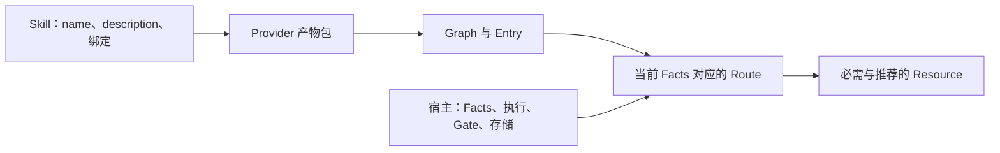

# 技能与 Provider

<!-- context:section id="layers" -->
Agent Graph 是对 Agent Skills 的扩展，而不是替代。集成中的每个部分只负责一件事：



| 部分 | 职责 |
| --- | --- |
| Skill | 声明该能力何时适用，并绑定 Provider、Graph 与 Entry |
| Provider 产物包 | 定义静态的合法工作、Resource、Gate、原因码和路由测试 |
| 宿主 | 解析产物包、观察 Facts、持久化状态、物化动态 Resource、运行 Host Action、执行 Gate |
| Agent | 消费选中的 Route，读取必需的 Resource，完成工作并报告 Outcome |
| Agent Graph | 校验契约，并确定性地评估和解析 Route |
<!-- /context:section -->

<!-- context:section id="binding" -->
## 绑定 Skill

宿主仍然依据 Skill 的 `name` 和 `description` 判断它是否匹配某个请求。一旦选中，三个元数据字段共同构成一个机器可读的绑定：

```yaml
---
name: release-package
description: Inspect, review, and release a package through the installed workflow.
metadata:
  agent-graph: path:../../release-graph/provider.yaml
  agent-graph.graph: release
  agent-graph.entry: default
---
```

| 字段 | 用途 |
| --- | --- |
| `agent-graph` | 定位 Provider |
| `agent-graph.graph` | 选择其中的一个 Graph |
| `agent-graph.entry` | 选择该 Graph 中的一个公开入口 |

三个字段都必填，并且一起校验；Agent 从不根据文字描述推断 Graph 或 Entry。Skill 正文只保留启动契约：评估所绑定的 Graph，解析 Route，读取每个标记为 `read-required` 的必需资源，在未解决的 Gate 处停下，记录明确的 Outcome，然后再次评估。阶段流程、schema 和生成的上下文都作为 Route 资源保留，而不是复制进 Skill。
<!-- /context:section -->

<!-- context:section id="locators" -->
## 定位 Provider

- **`path:<relative-path>`** 从该 `SKILL.md` 所在目录解析，而不是从进程工作目录解析，指向源码清单或构建出的 `manifest.json`。Provider 目录可以任意命名。
- **`provider:<id>`** 把定位委托给宿主注册表或产物包解析器，例如一个把 `company/release` 映射到已安装 `manifest.json` 的注册表文件。

注册表归宿主所有。Skill 不得硬编码 npm 前缀、插件缓存版本或本机路径，也不存在全局的 `~/.agent-graph` 或项目级的 `.agent-graph` 目录。宿主另行决定从哪里解析产物包、Run 文件存放在哪里（`--state`）以及动态资源缓存在哪里（`--cache`）。
<!-- /context:section -->

<!-- context:section id="sharing" -->
## 一个 Provider，多个 Skill

多个 Skill 可以共享一个 Provider，并选择不同的 Graph 或 Entry；Graph 文件、流程和 schema 保持单一来源，共享某个 Action 或 Resource 也不会产生执行依赖。一个宿主也可以安装多个 Provider：它们的身份和状态按 Provider ID 相互隔离，清单从不合并，当前 Skill 选择自己的 Provider，并且在版本 1 中 Subgraph 不能调用另一个 Provider。每个插件发布自己的产物包，而不是修改共享清单。

Graph 保持静态，工作保持动态。不必为每个模块、文档或日期建一个节点，而是由一个稳定的 Host Action（例如 `handler: batch.process-next`）接收评估时使用的同一份 Facts，自行解析出具体目标；随后宿主刷新 Facts 并再次评估。
<!-- /context:section -->

<!-- context:section id="resources" -->
## Resource

较长的材料放在 Resource 中，声明在需要它的节点上。同一个 Route 中可以出现三种相互独立的协议：

| 协议 | 是什么 | 如何交付 |
| --- | --- | --- |
| 文件（`agent-graph.resource-location.file.v1`） | 静态的流程、诊断、模板、schema 和 Skill；Markdown 在 frontmatter 中携带 `id`、`kind` 和 `media-type`，其他格式使用一个小型描述文件 | 已安装的绝对路径、媒体类型和内容摘要 |
| Graph Action（`agent-graph.resource.graph-action.v1`） | 一个动态上下文视图，其物化器是只读的命令或脚本 Action | 一个绑定到 Route 修订号（revision）的不透明物化请求；只有宿主调用 `resource materialize` 时才运行 |
| Host Action（`agent-graph.resource.host-action.v1`） | 由集成宿主通过稳定的 handler 生成的资源，带有版本化的输入与输出 schema | handler、输入 schema 和规范化的输入值；Agent Graph 计算输入摘要并校验返回的封装 |

规范性指令属于流程；生成的或从工作区派生的证据则不属于。Route 只返回位置和摘要，从不返回文档正文，因此日常输出永远不会意外变成提示词。
<!-- /context:section -->

<!-- context:section id="materialize" -->
## 物化上下文视图

评估和路由解析从不运行物化器。`resource materialize` 使用所选 Route 的修订号显式运行物化器，把 stdout 写入宿主所选缓存中按内容寻址的文件（按媒体类型为 `<digest>.json`、`.md`、`.txt` 或 `.bin`），同时写一份记录修订号和摘要的回执，并返回一个宿主可用来检查是否过期的位置。

进程会得到 `AGENT_GRAPH_PROVIDER_ROOT`、`AGENT_GRAPH_WORKSPACE`、`AGENT_GRAPH_REVISION` 和 `AGENT_GRAPH_INPUT`（JSON），此外只继承最小的环境——`PATH`、临时目录、区域设置和时区变量及其 Windows 对应变量。SDK 宿主可以显式添加变量。默认限制为 30 秒超时、10 MiB stdout 和 1 MiB stderr；超过任一限制都会终止进程，且不写回执。`effect: read` 是一种声明的契约，而不是沙箱，因此宿主需要自行隔离不受信任的 Provider 代码。

对于 Host Action 资源，物化会返回 `materializer-host-required`：宿主调用 handler，回传计算出的输入摘要，恰好返回一个内联值或一个受管资源引用，按 Provider 的输出 schema 校验内容，并在提供给 Agent 之前持久化。
<!-- /context:section -->

<!-- context:section id="receipts" -->
## 读取回执

为避免重复读取未变化的材料，宿主在解析 Route 时可以附上当前会话的 `agent-graph.resource-read-receipts.v1` 集合。之后每个 Route 资源都会得到一个 `readState`：

- `current`——有匹配的回执：静态文件要求 ID 相同且摘要完全一致，动态视图要求 ID 相同且对应所选 Route 的修订号；
- `read-required`——其他所有情况，包括没有回执或回执已过期。

只有在 Agent 确实读过该内容且内容仍在会话中时，才能签发回执。回执的作用范围限定在一个 Provider，从不存入 Run 或检查点，也不是 Facts、Outcome、授权或 Action 已完成的证明——它们只用于省去冗余读取。
<!-- /context:section -->

<!-- context:section id="sdk" -->
## 一个轻量宿主

```ts
import { evaluateGraph, loadProvider, resolveRoute, resolveSkillBinding } from "@c4a/agent-graph";

const binding = await resolveSkillBinding(skillPath, { registry });
const provider = await loadProvider(binding.manifestPath);
const { evaluation } = evaluateGraph(provider, binding.graph, binding.entry, currentState);
if (evaluation.primaryRoute) {
  const route = await resolveRoute(provider, binding.graph, binding.entry,
    evaluation.primaryRoute.routeId, currentState, evaluation.revision);
  // Present the route's resources and action to the Agent; do not execute implicitly.
}
```

进程内的 Node.js 宿主使用 SDK；宿主运行在其他运行时或需要进程边界时使用 JSON CLI。两者读取同一批文件。只有明确命名的编写、Run、构建和物化函数才会写入内容。完整的导出列表见 [CLI 与 SDK](../../product/reference/agent-graph/cli-and-sdk.md)。
<!-- /context:section -->
