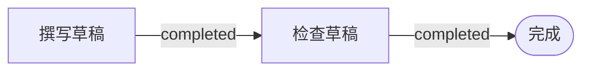

# 为什么是 Graph Engineering

<!-- context:section id="what" -->
Agent Graph 是面向 Agent Skill 的工作契约层。你把工作流描述成一张由合法步骤组成的小图；运行时，它读取当前的 **Facts**，告诉 Agent 下一步做什么、这一步要读哪些文件，以及什么能证明这一步已经完成。它从不调用模型、不分配 Agent 身份、不搬运共享状态，也不调度 worker——它协调的是工作，而不是 Agent。现有的 Agent 和宿主消费它给出的 Route，并保留各自的执行边界。

Agent Graph 以 `@c4a/agent-graph` 发布：包含带 JSON Schema 的版本化文件规范、一个 Node.js SDK，以及用于编写、检查、测试、构建和恢复工作流的 `agent-graph` CLI。Context 的整套知识工作流都运行在它之上，参见[在 Context 中的应用](agent-graph-in-context.md)。

接下来可以阅读：

- **工作原理：**[核心模型](core-model.md)、[运行与恢复](runs-and-recovery.md)、[技能与 Provider](skills-and-providers.md)。
- **指南：**[快速上手](../../sop/agent-graph/getting-started.md)、[编写 Graph](../../sop/agent-graph/authoring-graphs.md)、[测试与发布](../../sop/agent-graph/testing-and-publishing.md)。
- **参考：**[规范](../../product/reference/agent-graph/specification.md)、[CLI 与 SDK](../../product/reference/agent-graph/cli-and-sdk.md)、[版本迁移](../../product/reference/agent-graph/migration.md)。
<!-- /context:section -->

<!-- context:section id="problem" -->
## 问题所在

Agent 通常知道得足够多。长任务中更难的问题在于：**此刻**适用的是哪一部分，下一步哪个动作合法，什么能证明这个动作已经完成，以及中断后从哪里恢复。把提示词写得更长并不能可靠地解决这些问题：把复杂 Skill 写在一份文档里，拓扑是扁平的，所有规则彼此相邻，往往被一起加载，Agent 只能从对话中推断当前所处的阶段。这样的工作流也很难在不运行完整模型行为的情况下进行测试。

> 上下文应当被发现，而不是被堆积。计划是显式的；路径则依据当前的现实来选择。
<!-- /context:section -->

<!-- context:section id="example" -->
## 一个小例子

某个 Agent 只有一项工作：写草稿、检查草稿、结束。

宿主可以观察到两个事实：`draft.saved = true` 和 `review.passed = false`。草稿已经存在，但尚未通过检查，所以 Agent Graph 返回 **检查草稿** 作为当前 Route。这里没有任何东西是从对话中猜出来的：当 `review.passed` 变为 `true` 时，下一次评估会到达 **完成**；只要它仍为 `false`，Route 就停留在 **检查草稿**。

这个例子由四个概念支撑：**Graph** 描述合法的顺序，**Facts** 描述当前为真的状态，**Route** 是根据这些 Facts 选出的下一个合法步骤，**Action** 告诉 Agent 或宿主如何执行它。真实的工作流会加入必需文件、人工 Gate、显式 Outcome、分支选择和恢复路径，但这个循环本身不变。
<!-- /context:section -->

<!-- context:section id="principles" -->
## Graph Engineering 原则

“Graph Engineering”是一个新兴的架构标签，而不是官方协议或某个单一实现；以这个名义发表的内容涵盖反馈与审计循环、持久化的多 Agent 组织，以及动态生成的任务图。Agent Graph 吸收了其中的工程原则，但并不占用这个术语，并把问题收窄为：*如何让 Agent 发现下一个合法动作以及它所需的那部分上下文，同时让长工作流保持可观察、可测试、可恢复？*

- **从提示词到拓扑。** 提示词工程改进的是单次交互，上下文工程塑造的是单次交互能看到什么。Graph Engineering 进一步关注信息、授权、动作、证据和反馈如何在多次交互之间流动。图本身并不增加上下文；它划出边界，让 Agent 在 Route 选定之后只加载一小块相关内容。
- **现实留在优化器之外。** Agent Graph 区分 **facts**（来自 Provider 或宿主的可观察状态）、**outcomes**（一次动作尝试的显式结果）和 **instructions**（操作步骤）。指令不能断言事实；如果记录了成功但缺少节点要求的证据，结果会变为 `unverified`。来源摘要值、构建回执、测试结果和限定范围的审核决定是典型的外部锚点；另一个模型表示同意是有用的证据，但不是锚点。
- **契约，而不是散文画成的图。** 只有可独立执行、受 Gate 控制、可恢复、可重复或可测试的步骤才会成为节点；说明性内容留在文件中。每个元素都带有边界契约——Action 带有它的 runner 和 effect，Gate 带有由谁决定，节点带有它需要的事实以及证明其完成的事实——因此可视化的图是可执行契约的一个视图。
- **由循环组成的图。** 审核、修复、轮询和重新规划循环都是显式的 `repeat` 边，带有类型化的 Outcome 和停止条件。每次迭代都是一个 Route，每个结果都是一个事件，因此宿主可以设置检查点、执行预算限制，或把工作交给另一个 Agent。
- **稳定的组织，动态的工作。** Graph 描述的是稳定的工作类别；当前目标、日期和队列项是由稳定的 Host Action 解析出的 Facts，因此 Graph 永远不必为每次运行而重写。
- **把渐进式披露做成结构。** 一个精简的 Skill 只承载引导循环，评估只返回摘要，每个 Route 只以带摘要值的文件位置形式返回自己的资源，从不返回文档正文。
- **可观察，但不强制运行时。** 评估可以是无状态的；可选的 Run 会在宿主选定的路径上记录事件和 Outcome。
- **先可测试，再谈自主。** Route 测试断言某个已知状态会暴露哪一步，无需调用模型。
<!-- /context:section -->

<!-- context:section id="mapping" -->
## 原则如何落地为实现

| 原则 | Agent Graph 实现 |
| --- | --- |
| 外部现实 | 受限的 Fact 检查与 `satisfiedBy` |
| 边界契约 | 对象字段封闭的严格 JSON Schema |
| 类型化反馈 | 八种互不相同的 Outcome |
| 渐进式上下文 | 必需和推荐的文件 Resource 位置 |
| 显式授权 | Gate 加上会话范围的授权输入 |
| 恢复 | 失败边与 repeat 边、Run 事件、检查点与恢复 |
| 可解释性 | 确定性的 Evaluation 与 Route、检查、摘要值 |
| 稳定的原因 | Route 原因码加可选的 Code Catalog |
| 可测试性 | 声明式的状态到 Route 用例 |
| 可移植性 | 相对 Provider 引用与宿主选择的存储 |
| 供应链清晰度 | Action effect、可达文件产物包、内容摘要值 |

第 1 版刻意**不**提供：任意表达式、自修改的图、跨 Provider 调用、模型调用或多 Agent 编排、并行执行、由边携带的产物或共享可变状态、调度器或持久化定时器、对命令或第三方 Skill 的自动信任，以及对 Agent 输出正确性的语义证明。这些限制让它保持为一套标准和工具链，而不是又一个包罗万象的 Agent 框架。
<!-- /context:section -->

<!-- context:section id="when" -->
## 何时使用

并不是每个 Skill 都需要 Graph。简短的单会话任务就留在 `SKILL.md` 里。当宿主能提供可信的外部事实，且工作确实需要可验证的完成、跨会话恢复，或可测试的路由和人工 Gate 时，再采用 Agent Graph。它在以下场景中收益明显：

- **知识量大但不想用巨型提示词**——操作步骤、Schema 和手册都保留为文件，只在某个 Route 需要时才加载；
- **跨越会话边界的长任务**——Facts 和 Outcome 能重建工作进行到了哪里；可选的 Run 再加上事件和检查点；
- **能随情况调整但不跑偏的计划**——Graph 固定合法的选择和停止条件，由当前证据来挑选路径；
- **在模型行为之前先测试**——引用、环、资源边界和预期 Route 都可以在不调用模型的情况下检查。

Agent Graph 不会改写自己的计划。运行时路由遵循证据；人根据事件、诊断和 Route 测试来改进 Graph。只安装 CLI 并不能让 Agent 遵循工作流：Provider 定义契约，Skill 让它可被发现，宿主提供事实、执行 Gate 并记录 Outcome。在[编写 Graph](../../sop/agent-graph/authoring-graphs.md) 中选择你的起点。
<!-- /context:section -->
