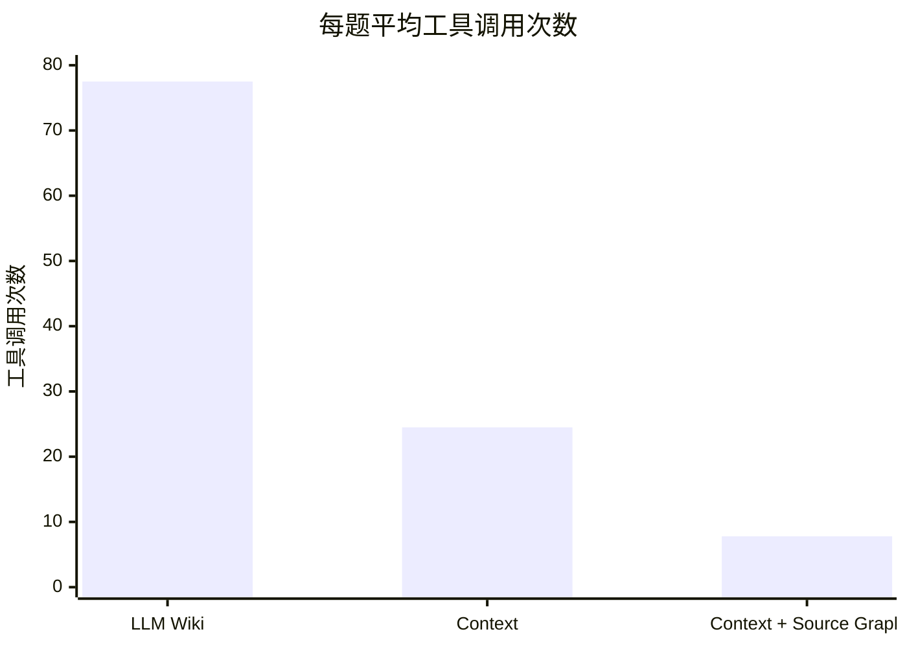

# 知识检索测评

<!-- context:section id="summary" -->
## 结果速览

让 Agent 阅读整理好的知识，而不是直接翻原始材料，能不能更好地回答真实的研发问题？为了回答这个问题，我们从一个大型生产级全栈 Monorepo 中取了 24 个真实研发问题，让 Agent 在不同配置下作答，并按事先写好的判据逐题评分。

结论可以分成三点，本页后文会逐一给出证据：

1. **知识取代了盲目探索**。在同一模型下，基于 Context 知识作答的 Agent 完全解决了 21 题，基于 LLM Wiki 的是 19 题，而工具调用只有后者的三分之一左右。
2. **Source Graph 取代了本地准备**。改为按固定版本远程读取代码后，作答耗时缩短了三分之一，质量不变。
3. **在同一份知识上，不同模型在速度和成本上的差距远大于质量上的差距**。七轮不同模型的运行都完全解决了 21 到 24 题，平均耗时却从约 1 分钟到约 5 分钟不等。

综合起来，Context 加 Source Graph 的作答耗时不到 LLM Wiki 的一半，预估成本约为其九分之一：

| | LLM Wiki | Context | Context + Source Graph |
| --- | ---: | ---: | ---: |
| 作答模型 | GPT 5.6 SOL | GPT 5.6 SOL | Claude Opus 5.5 |
| 完全解决 | 19 / 24 | 21 / 24 | 23 / 24 |
| 平均耗时 | 223.2 秒 | 157.1 秒 | 93.2 秒 |
| 平均工具调用 | 77.5 次 | 24.5 次 | 7.8 次 |
| 单题预估费用 | 约 \$2.45 | \$0.77 | \$0.27 |

最后一列同时换用了更快的模型。下面几节会把知识、Source Graph 和模型各自的作用拆开来看。
<!-- /context:section -->

<!-- context:section id="setup" -->
## 测评是怎么做的

24 道题都来自真实的研发提问，并在第一轮运行前冻结：

| 题型 | 题数 |
| --- | ---: |
| 接口与页面定位 | 7 |
| 业务交互规则 | 5 |
| 接口与参数 | 4 |
| 权限与角色 | 3 |
| 版本与调用关系 | 3 |
| 调试与环境 | 2 |

每一轮运行都对每道题作答一次，每题使用新的会话，只发送原题。评审由模型（GPT-6 Astra Ultra）完成：它不知道答案来自哪种配置，按判据把每个回答评为完全解决、部分解决、实质错误或未作答，没有经过人工校准。耗时按端到端计算，即从提问到调用方看到完整回答，统计平均值、中位数（P50）和 P90。工具调用只统计 Agent 可见的调用。由于题目难度不同，每组对比还会单独看该组所有运行都完全解决的题目。

没有一轮运行拿到了逐题的完整账单，所以费用都是估算。GPT 5.6 SOL、Grok 4.7 和本地读取的 Claude Opus 5.5 是逐个还原模型请求，再按厂商标准 API 单价计价，不计缓存折扣；LLM Wiki 和 Claude Opus 5.5 加 Source Graph 两轮，则按工具调用次数从前面几轮等比例推算。Muse Wonder 和 DeepSeek 按实际消耗的 Token 计价，前者用预算单价，后者用真实账单的平均单价。自部署的 Qwen 没有 API 支出。

本测评衡量的是用已部署的知识**作答**，知识的生产和更新还没有测评过。想用自己的问题做类似的评测，请看[评测知识库效果](../../sop/practices/evaluating-your-knowledge-base.md)和[测评评分与计时标准](../../sop/practices/evaluation-standard.md)。
<!-- /context:section -->

<!-- context:section id="retrieval" -->
## 知识和 Source Graph 各自起了什么作用

请从左往右读这张表：每一步主要只改变一件事，只有第三步换了模型。

| | LLM Wiki | Context | Context，换模型 | Context + Source Graph |
| --- | ---: | ---: | ---: | ---: |
| 改变了什么 | 起点 | LLM Wiki → Context | GPT 5.6 SOL → Claude Opus 5.5 | 本地读取 → Source Graph |
| 完全解决 | 19 | 21 | 23 | 23 |
| 部分解决 / 实质错误 | 2 / 3 | 2 / 1 | 0 / 1 | 0 / 1 |
| 平均 / P50 / P90 耗时 | 223.2 / 137.2 / 464.7 秒 | 157.1 / 136.8 / 256.2 秒 | 139.3 / 141.4 / 188.7 秒 | 93.2 / 89.0 / 123.0 秒 |
| 平均工具调用 | 77.5 次 | 24.5 次 | 11.6 次 | 7.8 次 |

**从 LLM Wiki 到 Context**。使用 LLM Wiki 时，Agent 在 24 道题里一共执行了约 1,800 次 Shell 命令、搜索和文件读取；换成 Context 后只需要约 590 次，因为知识已经告诉它该去哪里找。目标地址根本不在宿主仓库里时，知识直接给出了“页面 → 远程 SDK → 接口”这条链路；遇到新旧版本差异类的问题，知识也记录了对比的是哪两个提交。在 LLM Wiki、Context 和 Context 加 Source Graph 都完全解决的 17 道题上，平均耗时分别是 232.6 秒、160.7 秒和 93.5 秒，可见差距并不只是因为题目难易不同。

**从本地读取到 Source Graph**。两轮都使用 Claude Opus 5.5 时，接入 Source Graph 后仍完全解决 23 题，平均耗时缩短 33.1%。原来用于准备仓库、执行 Shell 命令、搜索和读文件的 256 次本地调用，被 164 次远程读取取代。其中有 8 次远程调用没有通过参数校验，Agent 都自行恢复了。

中间换模型的那一步同样有影响：在同一份知识上，Claude Opus 5.5 比 GPT 5.6 SOL 多完全解决 2 题，工具调用减少一半。下一节专门比较模型。
<!-- /context:section -->

<!-- context:section id="models" -->
## 在同一份知识上比较模型

下面七轮运行都基于同一份 Context 知识回答这 24 道题。它们在模型、读取代码的方式和 Agent 的运行位置上各不相同，所以表格按检索方式和运行环境分组。之后的新测评会作为新的一行加入这张表。

| 运行 | 日期 | 完全解决 | 部分 / 错误 | 平均 / P50 / P90 耗时 | 工具调用 | 单题费用 |
| --- | --- | ---: | ---: | --- | ---: | ---: |
| **本地读取，托管 Agent 平台** | | | | | | |
| GPT 5.6 SOL | 2026-09-22 | 21 | 2 / 1 | 157.1 / 136.8 / 256.2 秒 | 24.5 | \$0.77 |
| Grok 4.7 | 2026-09-24 | 23 | 0 / 1 | 304.0 / 314.2 / 465.9 秒 | 40.3 | \$0.99 |
| Claude Opus 5.5 | 2026-09-24 | 23 | 0 / 1 | 139.3 / 141.4 / 188.7 秒 | 11.6 | \$0.40 |
| **Source Graph，托管 Agent 平台** | | | | | | |
| Claude Opus 5.5 | 2026-10-03 | 23 | 0 / 1 | 93.2 / 89.0 / 123.0 秒 | 7.8 | \$0.27 |
| Muse Wonder | 2026-10-21 | 24 | 0 / 0 | 106.9 / 99.6 / 135.0 秒 | 11.7 | \$0.21 |
| **Source Graph，本地命令行 Agent** | | | | | | |
| DeepSeek V4.1 Flash 1017 | 2026-10-17 | 23 | 1 / 0 | 64.9 / 53.9 / 128.7 秒 | 20.0 | \$0.026 |
| Qwen 3.8 Flash Next，自部署（IQ3_S） | 2026-10-17 | 22 | 0 / 2 | 71.6 / 69.2 / 106.0 秒 | 24.7 | 无 API 支出 |

托管平台上的耗时包含 20–40 秒的会话启动等待，本地命令行运行没有这段等待。只看七轮都完全解决的 18 道题，结论也不变：

| 运行 | 平均耗时 | P90 | 工具调用 |
| --- | ---: | ---: | ---: |
| GPT 5.6 SOL，本地读取 | 164.4 秒 | 258.8 秒 | 25.9 |
| Grok 4.7，本地读取 | 312.4 秒 | 493.7 秒 | 41.4 |
| Claude Opus 5.5，本地读取 | 144.1 秒 | 205.9 秒 | 12.1 |
| Claude Opus 5.5 + Source Graph | 90.0 秒 | 117.8 秒 | 7.8 |
| Muse Wonder + Source Graph | 101.9 秒 | 122.4 秒 | 10.8 |
| DeepSeek V4.1 Flash 1017 + Source Graph | 68.4 秒 | 130.9 秒 | 22.7 |
| Qwen 3.8 Flash Next + Source Graph | 69.0 秒 | 106.0 秒 | 24.7 |

由此可以得出四点结论：

- **知识到位后，各模型的质量趋于一致**。每一轮都完全解决了 21 到 24 题，Muse Wonder 全部解决。Grok 4.7 和 Claude Opus 5.5 同样解决 23 题，耗时却约为后者的 2.2 倍，更长的探索并没有多解决问题。
- **低成本模型和自部署模型也能胜任问答**。DeepSeek V4.1 Flash 1017 完全解决 23 题，费用约为 Claude Opus 5.5 加 Source Graph 的十分之一。量化后自部署的 Qwen 完全解决 22 题，没有 API 支出；硬件和运行成本没有计入，按同基座模型的公开托管价格计算，每题约 \$0.10。
- **提高推理强度并没有带来收益**。同一个 DeepSeek 模型把推理强度从 high 调到 max 后，少解决了 1 题，耗时增加 20.8%，费用增加 66.7%。
- **解决数相同，不代表回答相同**。Grok 4.7、Claude Opus 5.5 和 DeepSeek 都解决了 23 题，但答错的题各不相同；同样正确的回答，路径也可能差别很大：某道题上，一个模型用了 493.7 秒和 75 次工具调用，另一个只用了 176.4 秒和 18 次。

不同工作该选哪类模型，请看[模型选择](../../sop/practices/choosing-models.md)。
<!-- /context:section -->

<!-- context:section id="attribution" -->
## 出错的原因与改进方向

为数不多的错误回答都能找到明确的原因，每一条也对应着改进办法：

- **搜索范围判断错误**。在稀疏检出的工作树里，调用方所在的目录并没有检出，局部搜索的结果却被当成了“仓库里没有任何地方使用目标”的证据。下结论说某样东西没被使用之前，先确认实际检出了哪些内容。
- **条件被过度概括**。知识里写明了直接调用对应某个地区、动态表单按字段判断，回答却把前一条规则套用到了所有请求。合并或概括知识时，必须保留其中的分支条件。
- **有针对性的核查补上了缺口**。首轮漏掉父页面分支条件的那道题，后续几轮都追查到了父页面的组件选择，纠正了结论。

还有一部分时间花在了与作答无关的事情上。被直接调用时，Agent 仍然在为聊天渠道准备回复卡片：一轮中有 54 次相关调用，另一轮有 149 次，占其全部工具调用的 15.4%。在没有回复渠道的会话里跳过这一步可以省下时间，缩短托管会话 20–40 秒的启动等待也是如此。
<!-- /context:section -->

<!-- context:section id="limits" -->
## 这些结果不能说明什么

- **稳定性**。每轮运行中每道题只作答一次，而且后面几轮使用的是已经见过的题目。
- **模型本身的影响**。每一轮都是一套完整的配置：除了模型，运行日期、Context 版本、Agent 环境、系统提示、并发和超时设置也不相同。本地命令行运行按每题选中的那次作答计时，不含失败的尝试；DeepSeek 有一题采用了指定的复测结果，Qwen 则混合使用了 64K 和 128K 两种上下文窗口。
- **经过校准的评分**。所有回答都由同一个模型评审，没有经过人工校准。
- **实际支出**。费用均为估算。按相同单价（输入 \$4、输出 \$20 / 百万 Token）计算，每题 Token 从 LLM Wiki 的约 56.7 万降到 Context 加 Source Graph 的约 6.3 万，降低 88.9%。

知识体积是另一项指标：知识约为来源体积的 1/115，但这本身并不代表质量。详见[写给 Agent 的知识](../knowledge/knowledge-for-agents.md)。
<!-- /context:section -->
