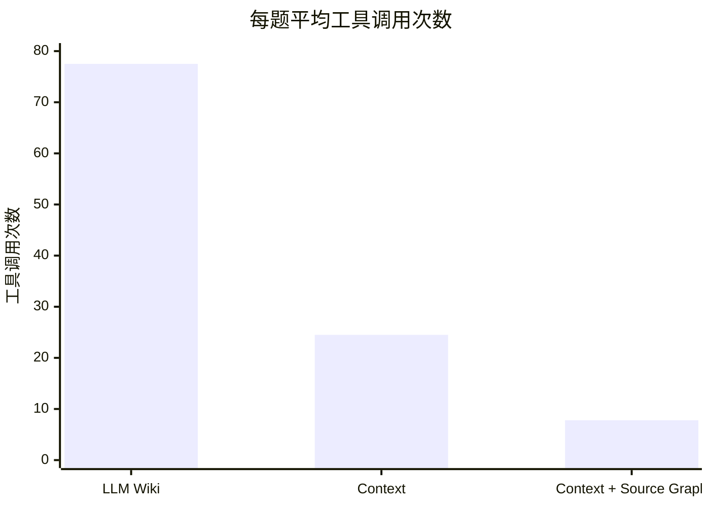

# 知识检索测评

<!-- context:section id="summary" -->
## 结果概览

在来自一个大型生产级全栈 monorepo 的 24 个真实开发者问题上，基于 Context 知识作答的 Agent 比使用 LLM Wiki 的 Agent 完全解决的问题更多、速度更快，工具调用也少得多。再加上 Source Graph 远程读取代码后，耗时和工具调用进一步下降。

| 指标 | LLM Wiki | Context | Context + Source Graph |
| --- | ---: | ---: | ---: |
| 作答模型 | GPT 5.6 SOL | GPT 5.6 SOL | Claude Opus 5.5 |
| 完全解决 | 19（79.2%） | 21（87.5%） | 23（95.8%） |
| 部分解决 / 实质错误 | 2 / 3 | 2 / 1 | 0 / 1 |
| 平均端到端耗时 | 223.2 s | 157.1 s | 93.2 s |
| P50 / P90 | 137.2 / 464.7 s | 136.8 / 256.2 s | 89.0 / 123.0 s |
| 平均工具调用次数 | 77.5 | 24.5 | 7.8 |

LLM Wiki 和 Context 使用同一模型，可以直接比较。第三种配置同时更换了模型；下文的同模型对比单独考察了 Source Graph 的作用。
<!-- /context:section -->

<!-- context:section id="setup" -->
## 对比了什么

| 配置 | 知识与检索方式 |
| --- | --- |
| LLM Wiki | 一次性生成的 LLM Wiki；Agent 在本地搜索和读取文件 |
| Context | Context 知识包；Agent 在本地检索 |
| Context + Source Graph | Context 知识包；通过 Source Graph 按固定版本远程读取代码 |

本测评衡量的是使用已部署知识**作答**的效果。知识生产，即生产和更新知识的质量、耗时、审核工作量与成本，尚未测评。
<!-- /context:section -->

<!-- context:section id="questions" -->
## 问题与评分

这 24 个问题来自真实的开发者提问，并在任何一次运行之前就已固定。每种配置对每个问题各回答一次。

| 问题类型 | 数量 |
| --- | ---: |
| 定位接口和页面 | 7 |
| 业务交互规则 | 5 |
| 接口与参数 | 4 |
| 权限与角色 | 3 |
| 版本与调用关系 | 3 |
| 调试与环境 | 2 |

- 每个问题都预先写好评判标准；答案分为完全解决、部分解决、实质错误和未作答。
- 评分由模型（GPT-6 Astra Ultra）完成，评分时不知道答案来自哪种配置，未经人工校准。
- 耗时是调用方看到完整答案为止的端到端时间，统计平均值、P50 和 P90（最近秩法）。
- 工具调用只统计 Agent 可见的调用。
<!-- /context:section -->

<!-- context:section id="common" -->
## 三种配置都解决的 17 个问题

为排除问题难度的差异，单独比较了所有配置都完全解决的 17 个问题：

| 指标 | LLM Wiki | Context | Context + Source Graph |
| --- | ---: | ---: | ---: |
| 平均端到端耗时 | 232.6 s | 160.7 s | 93.5 s |
| P90 | 534.5 s | 258.8 s | 123.2 s |
| 平均工具调用次数 | 78.3 | 24.9 | 8.0 |
<!-- /context:section -->

<!-- context:section id="same-model" -->
## 同一模型下的 Source Graph

两次运行都使用 Claude Opus 5.5 时，本地检索的 Context 完全解决了 24 个问题中的 23 个，平均耗时 139.3 s，P90 为 188.7 s，平均 11.6 次工具调用。加上 Source Graph 后仍完全解决 23 个，平均耗时减少 33.1%：用于仓库准备、Shell、搜索和读文件的 256 次本地调用被 164 次远程检索取代。有 8 次远程调用未通过参数校验，Agent 都自行恢复了。

在相同的知识和检索方式下，另一个模型（Grok 4.7）同样完全解决了 23 个问题，但平均耗时 304.0 s，约为前者的 2.2 倍。在质量相同时，模型选择对耗时影响很大。
<!-- /context:section -->

<!-- context:section id="observations" -->
## 从轨迹中看到的

- 当宿主仓库中不包含目标地址时，知识直接给出了“页面 → 远程 SDK → 接口”这条链路，Agent 无需在多个仓库中盲目搜索。
- 关于版本差异的问题，首先要明确“与哪个版本比较”；知识中记录了其来源的固定提交和比较范围。
- 少数错误源于知识遗漏了某个组件的分支条件并过度概括。这类缺口应转化为修订任务。
- 工具调用从 77.5 次降到 24.5 次，再降到 7.8 次：知识减少了盲目探索，远程检索取代了本地仓库准备和文件读取。
<!-- /context:section -->

<!-- context:section id="cost" -->
## 成本估算

每个问题的 token 用量从约 567,000 降到约 63,000。按标准 API 价格（每百万 token 输入 \$4、输出 \$20，不计缓存折扣）计算，约为 \$2.45 → \$0.27，降低 88.9%。首次运行和更换模型的运行通过回放请求估算；LLM Wiki 和最新一次运行根据工具调用次数外推。
<!-- /context:section -->

<!-- context:section id="limits" -->
## 这项对比的局限

- 每个问题只运行了一次，无法据此判断稳定性。
- 对比的是整套配置：LLM Wiki 和 Context 运行在不同的 Agent 环境中，系统提示词也不同；Context + Source Graph 还更换了模型和 Context 版本、运行日期、并发和超时限制，而且是在已见过的问题上做的回归，只有一个评分者。
- 端到端耗时包含环境启动和轮询粒度带来的时间，不包含配额排队。
- 成本如上所述，只是估算。

体积缩减是另一种衡量：知识的体积约为其来源的 1/115，但这本身并不能说明质量。参见[写给 Agent 的知识](../knowledge/knowledge-for-agents.md)。
<!-- /context:section -->
