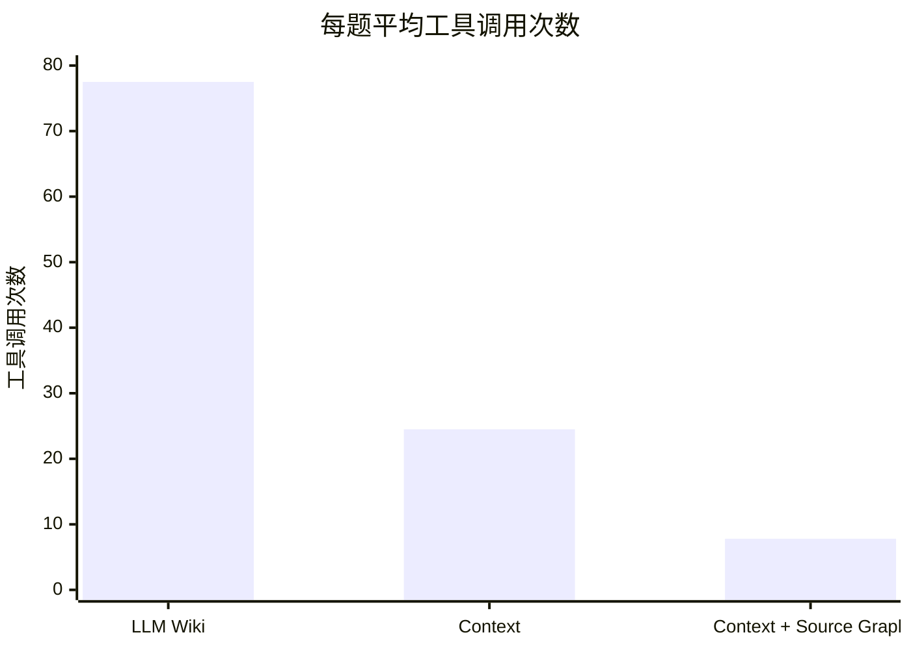

# 知识检索测评

<!-- context:section id="summary" -->
## 结果概览

在来自一个大型生产级全栈 monorepo 的 24 个真实开发者问题上，基于 Context 知识作答的 Agent 比使用 LLM Wiki 的 Agent 完全解决的问题更多、速度更快，工具调用也少得多。再加上 Source Graph 远程读取代码后，耗时和工具调用进一步下降。

最亮眼的数字属于 **Context + Source Graph**：与 LLM Wiki 相比，它的作答时间不到一半（平均 93.2 s 对 223.2 s），估算成本约为九分之一（每题约 \$0.27 对 \$2.45；见下文“成本估算”）。其中一部分提升来自表格下方说明的模型更换。

| 指标 | LLM Wiki | Context | Context + Source Graph |
| --- | ---: | ---: | ---: |
| 作答模型 | GPT 5.6 SOL | GPT 5.6 SOL | Claude Opus 5.5 |
| 完全解决 | 19（79.2%） | 21（87.5%） | 23（95.8%） |
| 部分解决 / 实质错误 | 2 / 3 | 2 / 1 | 0 / 1 |
| 平均端到端耗时 | 223.2 s | 157.1 s | 93.2 s |
| P50 / P90 | 137.2 / 464.7 s | 136.8 / 256.2 s | 89.0 / 123.0 s |
| 平均工具调用次数 | 77.5 | 24.5 | 7.8 |

LLM Wiki 和 Context 使用同一模型，可以直接比较。第三种配置同时更换了模型；下文的同模型对比单独考察了 Source Graph 的作用。

测评方法遵循 [评测知识库效果](../../sop/practices/evaluating-your-knowledge-base.md)；判分和计时规则见 [测评评分与计时标准](../../sop/practices/evaluation-standard.md)。
<!-- /context:section -->

<!-- context:section id="setup" -->
## 对比了什么

主表格中比较了三种配置：

| 配置 | 知识与检索方式 |
| --- | --- |
| LLM Wiki | 一次性生成的 LLM Wiki；Agent 在本地搜索和读取文件 |
| Context | Context 知识包；Agent 在本地检索 |
| Context + Source Graph | Context 知识包；通过 Source Graph 按固定版本远程读取代码 |

另有两次运行使用同样的 Context 知识和本地检索，但换了模型：一次是 Claude Opus 5.5，用于把 Source Graph 的作用与模型更换区分开（见下文“同一模型下的 Source Graph”）；另一次是 Grok 4.7。它们与第一次 Context 运行一起构成下文的模型对比。以上是较早的五次运行。下文后续补充的 Muse Wonder 对照增加了一个搭配 Source Graph 的模型候选，不替换原有的本地检索结果。

本测评衡量的是使用已部署知识**作答**的效果。知识生产，即生产和更新知识的质量、耗时、审核工作量与成本，尚未测评。
<!-- /context:section -->

<!-- context:section id="questions" -->
## 问题与评分

这 24 个问题来自真实的开发者提问，并在任何一次运行之前就已固定。较早的每种配置对每个问题各回答一次；后续的 Muse 对照在下文单独说明。

| 问题类型 | 数量 |
| --- | ---: |
| 定位接口和页面 | 7 |
| 业务交互规则 | 5 |
| 接口与参数 | 4 |
| 权限与角色 | 3 |
| 版本与调用关系 | 3 |
| 调试与环境 | 2 |

- 每个问题都预先写好评判标准；答案分为完全解决、部分解决、实质错误和未作答。
- 评分由模型（GPT-6 Astra Ultra）完成，评分时不知道答案来自哪种配置，未经人工校准。
- 耗时是调用方看到完整答案为止的端到端时间，统计平均值、P50 和 P90（最近秩法）。
- 工具调用只统计 Agent 可见的调用。
<!-- /context:section -->

<!-- context:section id="common" -->
## 三种配置都解决的 17 个问题

为排除问题难度的差异，单独比较了主表格中所有配置都完全解决的 17 个问题：

| 指标 | LLM Wiki | Context | Context + Source Graph |
| --- | ---: | ---: | ---: |
| 平均端到端耗时 | 232.6 s | 160.7 s | 93.5 s |
| P90 | 534.5 s | 258.8 s | 123.2 s |
| 平均工具调用次数 | 78.3 | 24.9 | 8.0 |
<!-- /context:section -->

<!-- context:section id="same-model" -->
## 同一模型下的 Source Graph

两次运行都使用 Claude Opus 5.5 时，本地检索的 Context 完全解决了 24 个问题中的 23 个，平均耗时 139.3 s，P90 为 188.7 s，平均 11.6 次工具调用。加上 Source Graph 后仍完全解决 23 个，平均耗时减少 33.1%：用于仓库准备、Shell、搜索和读文件的 256 次本地调用被 164 次远程检索取代。有 8 次远程调用未通过参数校验，Agent 都自行恢复了。

在相同的知识和检索方式下，另一个模型（Grok 4.7）同样完全解决了 23 个问题，但平均耗时 304.0 s，约为前者的 2.2 倍。在质量相同时，模型选择对耗时影响很大。
<!-- /context:section -->

<!-- context:section id="models" -->
## 同一知识配置下的三个模型

在托管 Agent 平台上使用同一个 Context 知识包、同样的 24 个问题，每题运行一次，并由同一个模型评审匿名判分：

| 指标 | GPT 5.6 SOL（首轮） | Grok 4.7 | Claude Opus 5.5 |
| --- | ---: | ---: | ---: |
| 完全解决 | 21（87.5%） | 23（95.8%） | 23（95.8%） |
| 部分解决 / 实质错误 | 2 / 1 | 0 / 1 | 0 / 1 |
| 平均 / P50 / P90 端到端耗时 | 157.1 / 136.8 / 256.2 s | 304.0 / 314.2 / 465.9 s | 139.3 / 141.4 / 188.7 s |
| 平均可见工具调用次数 | 24.5 | 40.3 | 11.6 |
| 平均观测启动时间 | 31.8 s | 34.4 s | 40.0 s |

- 在**三个模型都完全解决的 20 个问题**上，平均端到端耗时分别为 162.8 s、312.7 s 和 142.3 s，工具调用分别为 25.4、41.3 和 12.2 次。
- 与首轮相比，Claude Opus 5.5 在 24 个问题中的 18 个上更快，P90 降低 26.3%，工具调用减少 52.6%。Grok 4.7 在全部 24 个问题上都更慢，工具调用多 64.0%；更长的调查过程并没有提高完全解决率。
- **完全解决数相同不代表回答相同**。两款较新的模型各自修复了首轮的部分缺口，也各自引入了一个不同的错误。
- **同一个结论可以经由差别很大的路径得到**。某个问题上两个模型都答对了：一个用了 493.7 s 和 75 次调用，另一个用了 176.4 s 和 18 次。
<!-- /context:section -->

<!-- context:section id="muse-source-graph" -->
## Muse Wonder 与 Opus 搭配 Source Graph

**在本轮 24 道开发者知识问答中，Muse Wonder + Source Graph 与 Claude Opus 5.5 + Source Graph 整体表现接近：Muse 多完全解决一题，Opus 响应稍快。**

| 指标 | Muse Wonder + Source Graph | Claude Opus 5.5 + Source Graph |
| --- | ---: | ---: |
| 完全解决率 | **100%（24/24）** | 95.8%（23/24） |
| 平均答复耗时 | 106.9 秒 | **93.2 秒** |
| P90 耗时 | 135.0 秒 | **123.0 秒** |
| 平均工具调用 | 11.7 次 | 7.8 次 |
| 单题预估费用 | $0.210 | $0.272 |

Muse 平均每题慢约 **14 秒（15%）**，但本轮全部完成了原问要求，可以作为这类知识检索与代码问答场景的候选模型。Muse 实测平均 **38.8 万 Token/题**；费用是估算参考。

结论仅限于这组 24 题。运行环境与配置存在差异，不能据此证明模型普遍等效、跨场景表现稳定或实际成本更低。请用自己的问题集比较候选模型，同时检查答案质量、平均与 P90 耗时以及工具调用。
<!-- /context:section -->

<!-- context:section id="observations" -->
## 从轨迹中看到的

- 当宿主仓库中不包含目标地址时，知识直接给出了“页面 → 远程 SDK → 接口”这条链路，Agent 无需在多个仓库中盲目搜索。
- 关于版本差异的问题，首先要明确“与哪个版本比较”；知识中记录了其来源的固定提交和比较范围。
- 少数错误源于知识遗漏了某个组件的分支条件并过度概括。这类缺口应转化为修订任务。
- 工具调用从 77.5 次降到 24.5 次，再降到 7.8 次：知识减少了盲目探索，远程检索取代了本地仓库准备和文件读取。
<!-- /context:section -->

<!-- context:section id="attribution" -->
## 错误和开销从哪里来

- **搜索范围判断错误**。在稀疏检出的工作树里，调用方所在的目录没有被检出，局部搜索的结果却被当成了整个仓库都没有引用目标的证据。读过源码不等于搜遍了源码；在得出任何全仓否定结论之前，先确认检出范围。
- **条件被泛化**。知识写明了直接调用对应的某个地区，也保留了动态表单按字段调用的情况；回答却把前者推广到所有请求，源码中另一个地区的字段就是反例。降档是因为错误的断言，而不是因为没有展示过程。
- **有针对性的源码核查奏效**。在首轮漏掉父页分支条件的那道题上，后两个模型都追踪到了父页的组件选择和历史数据切换，纠正了结论。
- **渠道准备**。被直接调用时，被测配置仍执行了为聊天渠道回复卡片准备的步骤：首轮 24 个问题中共有 54 次可见的相关调用；另一个模型每道题都解析链接并检查渠道上下文，去重后有 149 次调用，占其工具调用的 15.4%。这些调用并不代表发送了卡片，其耗时也没有单独分离。在入口处裁掉回复卡片的准备，就能去掉与作答无关的步骤。
- **等待启动**。在托管平台上，从提交到首次观察到“运行中”约需 32 s，其中包含轮询粒度。
<!-- /context:section -->

<!-- context:section id="startup-estimate" -->
## 条件估算：更快的启动

这是**条件估算**，不是实测。把首轮每道题实测的启动时间替换为假设的目标值，其余各阶段保持不变：

估算 E2E = 实测 E2E − 实测启动时间 + 假设的启动目标

| 假设启动时间 | 平均 | P50 | P90 |
| ---: | ---: | ---: | ---: |
| 5 s | 130.4 s | 105.5 s | 229.9 s |
| 10 s | 135.4 s | 110.5 s | 234.9 s |

这样的目标能否达到，需要在相同问题和配置上重新测量。
<!-- /context:section -->

<!-- context:section id="priorities" -->
## 接下来要改进的

- 在断定仓库里没有任何地方用到某样东西之前，先确认检出范围。
- 合并或概括知识时保留分支条件。
- 在没有回复渠道的直接会话中跳过回复卡片的准备。
<!-- /context:section -->

<!-- context:section id="cost" -->
## 成本估算

每个问题的 token 用量从使用 LLM Wiki 时的约 567,000 降到使用 Context + Source Graph 时的约 63,000。按标准 API 价格（每百万 token 输入 \$4、输出 \$20，不计缓存折扣）计算，约为 \$2.45 → \$0.27，降低 88.9%，约为原成本的九分之一。首次运行和更换模型的运行通过回放请求估算；LLM Wiki 和最新一次运行根据工具调用次数外推。
<!-- /context:section -->

<!-- context:section id="limits" -->
## 这项对比的局限

- 较早的运行中，每个问题只运行一次。无论这些运行还是后续 24 题的 Muse 对照，都不能证明跨场景的稳定性。
- 对比的是整套配置：LLM Wiki 和 Context 运行在不同的 Agent 环境中，系统提示词也不同；Context + Source Graph 还更换了模型和 Context 版本、运行日期、并发和超时限制，而且是在已见过的问题上做的回归，只有一个评分者。
- 端到端耗时包含环境启动和轮询粒度带来的时间，不包含配额排队。
- 成本如上所述，只是估算。
- 在三个模型的对比中，后两轮每个模型最多允许 4 个问题并发；首轮最多 2 个，且部分是串行的。日期、Skill、运行环境以及部分读取的版本也不相同，因此并非所有差异都来自模型本身。

体积缩减是另一种衡量：知识的体积约为其来源的 1/115，但这本身并不能说明质量。参见 [写给 Agent 的知识](../knowledge/knowledge-for-agents.md)。
<!-- /context:section -->
