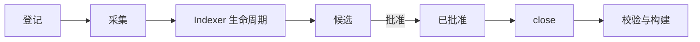

# 知识生命周期

<!-- context:section id="stages" -->
## 从来源到知识包

| 阶段 | 发生了什么 | 保障了什么 |
| --- | --- | --- |
| 登记 | 把一个仓库模块、文档目录或在线文档记录为来源边界 | 来源身份和权限边界；登记并不授予读取边界之外内容的权限 |
| 采集 | 把文档正文和内嵌资源保存为快照；仓库按固定提交读取 | 完整的正文、资源和指纹，便于后续检查发现过期输入 |
| Indexer 生命周期 | 确认需求，批准计划和开工报告，然后由 Indexer 技能分阶段撰写文章 | 每个小节都绑定到来源的确切位置 |
| 审核 | 你看到当前整批候选，并选择批准、拒绝或要求修订 | 批准以原子方式应用；被拒绝的内容保留最小指纹，不会被再次提出 |
| close（归档） | 根据已批准的页面及其关联重建 `knowledge/structure.yaml` | 知识地图与已批准页面一致，且不改写正文 |
| 校验与构建 | 检查来源引用、frontmatter、结构和资源，然后产出知识包和站点 | 分发的文件通过构建清单对应回已批准的知识 |

之后当某个已登记的仓库前移到超过已批准知识处理时所用的 commit 时，工作区路由会在其他事项等待你之前先运行 `context update --pending`。它只询问引用文字发生变化的页面，并在这次更新完成决定之前保留原先的已处理版本。
<!-- /context:section -->

<!-- context:section id="indexer" -->
## Indexer 生命周期内部

顶层工作流只有一个生产步骤 `run-indexer-lifecycle`，它把工作交给嵌套的 Indexer 图：

1. **需求。** 读者目的、问题和授权来源记录在 `src/indexers.yaml` 中。
2. **规划。** Agent 进行调研，并按批次写出文章计划。
3. **开工报告。** 计划提交给人确认；托管权限不能免除必需的决定。
4. **分阶段撰写。** 每个任务产出一篇文章及其引用；CLI 检查每个被引用的来源都已为该任务授权。
5. **缺口与修复。** 缺失的证据会转为进一步调研或修复，而不是编造答案。

代码、Markdown、笔记和会话摘要最终都汇入同一个当前候选批次，由一次内容审核统一收录。详见 [Indexer 体系](../knowledge/indexer-system.md)。
<!-- /context:section -->

<!-- context:section id="state" -->
## 状态存放在哪里

| 位置 | 生命周期 |
| --- | --- |
| `sources/` | 项目状态：登记信息和采集到的证据 |
| `.tmp/context-runtime/lifecycle/` | 可丢弃：结构草稿和当前候选台账，close 成功后删除 |
| `knowledge/` | 项目状态：已批准的页面和 `structure.yaml` |
| `dist/` | 可复现的构建产出 |

候选 ID 属于工作流状态，永远不会成为已批准知识的身份；已批准的 Markdown 在 frontmatter 和小节元数据中保存自己的稳定身份。
<!-- /context:section -->

<!-- context:section id="after" -->
## 构建之后

构建完成的是当前已批准的状态，并不会冻结 Context 知识工作区。内容发生变化时，工作流会在构建之前记录一个新的知识工作区版本。之后，`context revise` 修正选定的页面，`context update` 处理选定来源的变更；两者都会再次经过审核和交付，并且只改动受影响的部分。详见 [知识的持续更新](../knowledge/keeping-knowledge-current.md) 和 [版本感知的知识](../knowledge/version-aware-knowledge.md)。
<!-- /context:section -->
