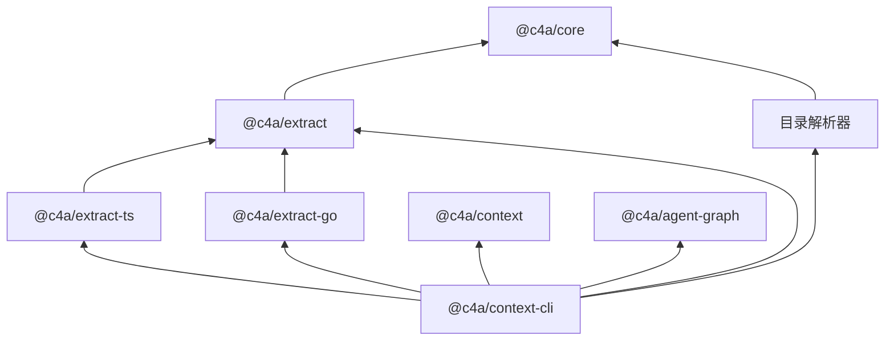

# 模块划分

<!-- context:section id="graph" -->
## 包依赖关系

箭头从一个包指向它所依赖的包；目录解析器包括 `extract-rush`、`-mdx`、`-proto`、`-thrift`、`-contract`、`-sql` 和 `-style`。用户只需安装 `@c4a/context-cli`，SDK、提取器和 Agent Graph 会随它一起安装。
<!-- /context:section -->

<!-- context:section id="packages" -->
## 各个包的职责

| 包 | 职责 |
| --- | --- |
| `@c4a/context` | 用于 Context 知识工作区 `src/index.ts` 的声明式 SDK：来源、阶段和知识包输出，以及带版本的 Indexer 契约 |
| `@c4a/context-cli` | `context` 命令：知识工作区生命周期、来源采集、校验、审核、close、构建、文档站点构建器、内置的工作流 Provider 和 Agent 插件 |
| `@c4a/core` | 共享的抽取类型、Schema 和工具函数 |
| `@c4a/extract` | 语言插件框架，以及抽取代码证据的仓库运行器 |
| `@c4a/extract-ts`、`@c4a/extract-go` | TypeScript/JavaScript 和 Go 抽取插件：符号、代码范围、导入和导出 |
| `@c4a/extract-rush`、`-mdx`、`-proto`、`-thrift`、`-contract`、`-sql`、`-style` | 轻量目录解析：Rush 工作区、MDX 组件、Protocol Buffers、Thrift、OpenAPI/GraphQL 契约、SQL 和 CSS/SCSS |
| `context-evidence-wasm` | 构建供 Source Graph 使用的可选插件 `context-evidence.sourcegraph.wasm` |
| `@c4a/agent-graph` | 外部的、不依赖模型的工作流契约运行时，仅供内置 Provider 使用 |

解析器包只产出结构化事实，从不写入已批准的知识。参见 [代码抽取](../knowledge/code-extraction.md)。
<!-- /context:section -->

<!-- context:section id="cli-inside" -->
## CLI 包内部

| 路径 | 内容 |
| --- | --- |
| `src/project/` | 知识工作区观测、来源、Indexer 生命周期、审核、close、验证和知识包构建 |
| `src/project/workflow/` | 观测 Facts，并把选中的图动作绑定到带修订号的命令 |
| `context-workflow/` | Provider 源码：图、动作、资源、Schema 和 Route 测试 |
| `plugins/context/`（仓库根目录） | Agent 插件唯一维护的源码：四个公开入口技能（`context`、`context-plan`、`context-inspect-search`、`context-repo-content`）、四个 Indexer Provider 技能和 `context-indexer-create`；各宿主的入口在构建时生成 |

构建只产出一个发行包：CLI 可执行文件、位于 `dist/providers/context` 的不可变 Provider、插件投影、Indexer 技能、图表查看器和证据插件。
<!-- /context:section -->

<!-- context:section id="blast" -->
## 改动会影响哪里

- 改动 `@c4a/context` 会影响知识工作区声明和阶段计划。
- 改动 `@c4a/context-cli` 会影响命令、Agent 工作流、知识工作区文件格式、审核行为和知识包输出。
- 改动 `@c4a/extract` 以及各提取器和目录包（`extract-ts`、`extract-go`、`extract-rush`、`-mdx`、`-proto`、`-thrift`、`-contract`、`-sql`、`-style`）只影响对应语言和格式的代码事实；参见 [代码提取](../knowledge/code-extraction.md)。
- 改动 `context-evidence-wasm` 只影响 Source Graph 如何为远程代码读取补充证据；本地检索和知识生产不受影响。
- Agent Graph 是固定版本的外部依赖；Provider 和宿主绑定由 Context 自己维护。
<!-- /context:section -->
