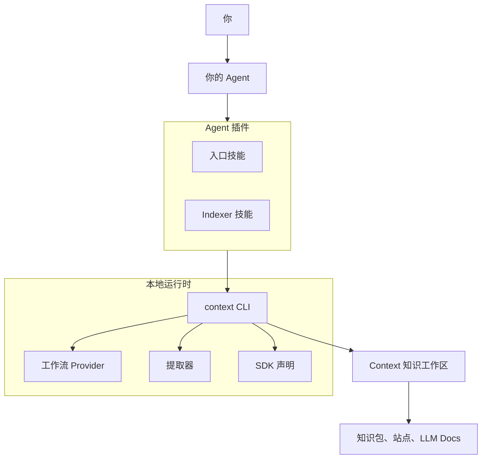

# 总体架构

<!-- context:section id="topology" -->
## 组成部分

| 组成部分 | 作用 |
| --- | --- |
| Agent 入口 | 轻量技能，告诉 Agent 如何开始或继续一个 Context 知识工作区，以及如何执行当前步骤 |
| Indexer 技能 | Provider 提供的技能，每种读取一类来源并写出有来源依据的文章 |
| `context` CLI | 观察知识工作区、采集来源、运行提取器、校验证据、应用审核结果并构建产出 |
| 工作流 Provider | 由 Agent Graph 求值的工作约定：合法步骤、Gate 和必读资料 |
| SDK（`@c4a/context`） | 知识工作区 `src/index.ts` 的声明接口：来源、阶段和知识包 |
| 提取器 | 解析器包，把代码和接口定义转换为结构化事实 |
| 证据插件 | 可选的 WebAssembly 插件，让 Source Graph 在读取代码时附上相关知识小节 |
<!-- /context:section -->

<!-- context:section id="local-first" -->
## 本地优先的设计

Context 没有服务器、守护进程、数据库、托管 API 或 Web 前端。CLI 读取声明的来源、写入知识工作区文件、校验不变量，并产出可移植的知识包。团队需要检查的一切都在知识工作区里，可以提交到 Git；托管的 Agent 或 Bot 运行的也是同一个 CLI。
<!-- /context:section -->

<!-- context:section id="division" -->
## 分工

Agent 负责语义工作：阅读证据、提出结构和内容、解释决策。CLI 负责确定性工作，从不调用 LLM。用户掌握目标、来源权限、结构选择和审核决定。正是这种分离让长流程可以重复执行——参见[为什么是工作流](why-a-workflow.md)。
<!-- /context:section -->

<!-- context:section id="flow" -->
## 一次请求如何流转

1. Agent 入口运行 `context entry`，由它判断是初始化、迁移位置还是进入当前工作流。
2. CLI 观察知识工作区的事实，向 Provider 请求当前 Route：步骤、阅读清单、可能的 Gate 以及确切的命令。
3. Agent 阅读、决策，并执行选定的一个动作。
4. 知识工作区发生变化，CLI 再次求值。

细节见[工作流运行](workflow-execution.md)；来源经历的各个阶段见[知识生命周期](knowledge-lifecycle.md)；包的边界见[模块划分](module-layout.md)。
<!-- /context:section -->
