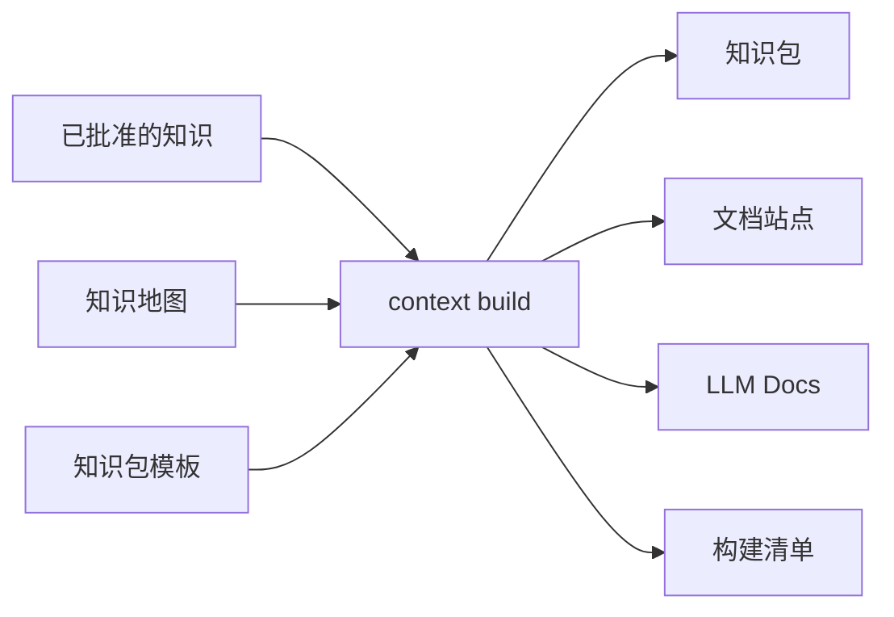

# 知识包与站点构建

<!-- context:section id="outputs" -->
## 一套知识，多种产物



构建只使用已批准且已 close 的知识。多种输出渠道可以组合；对于新的知识工作区，Agent 默认建议知识包加网站，LLM 文本是额外选项。每次构建都会产出一份清单，把分发出去的文件对应回知识工作区中已批准的知识。
<!-- /context:section -->

<!-- context:section id="kb" -->
## Agent 知识包

知识包使用扁平的根目录：

| 根目录 | 内部集合 |
| --- | --- |
| `wikis/` | `codegraph`、`business`、`product` |
| `guides/` | `architecture`、`sop`、`faq`、`decision`、`incident` |
| `rules/` | `standards`、`test` |
| `feats/` | `feats` |

默认的 `context-knowledge-query` 技能是面向 Agent 的入口，并且在每个 Context 知识包中都相同，因此安装一份即可服务项目能访问到的所有知识包。它从目录索引开始，沿清单中的关系记录查找，阅读候选页面并引用其标题；当知识包没有覆盖某个事实时，会报告缺口。各知识包特有的术语、同义词和入口页面放在该包的 `others/context/search-guide.md` 中，技能会先读取它。如果索引无法缩小范围，它会用自带的 `scripts/search.mjs` 在本地对 Markdown 分块排序。面向使用者的页面不包含 `sources` 和章节元数据；精确的出处保留在知识工作区中，可通过清单找到。
<!-- /context:section -->

<!-- context:section id="site" -->
## 文档站点

在知识包上启用 `site` 后，还会生成 `dist/<base>-site/`：一个包含文章页面、本地搜索、脚本和样式的静态站点。它在相邻的临时目录中构建，因此站点构建失败时会保留上一次的产物。

- **导航**来自已接受的 `src/knowledge-map.yaml`。条目绑定到文章身份，因此修改标签和分组不会改变 URL，同一篇文章也可以出现在多个位置。
- **首页**把第一级知识地图作为完整的站点地图。
- **主题**默认以浅色模式打开，直到读者切换；该选择会保存在浏览器中。
- **图表**用 Mermaid 编写，在浏览器中按站点主题渲染，并提供适应窗口、缩放、全屏和查看源码等控件。
- **来源图**位于每篇文章末尾：文章的章节居中，它们引用的文档环绕在周围，并按每份文档的出处分组；列表视图以同样的分组列出这些文档及其引用的行。仓库链接到记录的修订版本，文档链接到登记的 URL。设置 `site.sourceMap: false` 则改为显示普通的来源列表。
- **多语言**可通过 `site.locales` 添加；未翻译的页面显示原文并附带提示。

Context 不负责部署。可以用任意静态 HTTP 服务器预览，再用你自己的托管服务部署 `dist/<base>-site/` 中的内容。
<!-- /context:section -->

<!-- context:section id="llms" -->
## LLM Docs

`llmsPackage()` 生成一个文本包，可用于模型上下文、离线评估或下游导入：

```text
llms.txt                   # 知识地图索引
llms-full.txt              # 汇总后的已批准正文
llms/pages/<identity>.txt  # 单篇文章
```
<!-- /context:section -->

<!-- context:section id="custom" -->
## 定制分发，而不分叉知识

知识包模板决定分发形态，例如额外的 Agent 指令、静态文件和查询辅助工具，但永远不会取代已批准的知识成为事实来源。站点的展示源码，例如首页插槽、自定义页面和主题组件，放在 `src/site/` 下，与生成的知识分开。
<!-- /context:section -->
