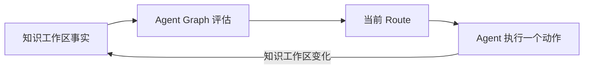

# 工作流运行

<!-- context:section id="loop" -->
## 评估循环

Context 不执行固定脚本。每当 Agent 询问下一步做什么，CLI 都会观测 Context 知识工作区，把观测结果转换为 **Facts**，再向工作流 Provider 请求当前的 **Route**。

Route 包含选中的步骤、原因码、Agent 动手前必须阅读的资源、尚未解决的 Gate，以及要执行的确切命令。只有 `workflow.current` 能选择下一个生命周期步骤；命令执行完后会把控制权交还给一次新的评估，而不是自己决定下一步。
<!-- /context:section -->

<!-- context:section id="graphs" -->
## 两张图

`packages/context-cli/context-workflow/` 中的 Provider 包含两张静态图：

| 图 | 覆盖范围 |
| --- | --- |
| `workspace` | 顶层生命周期：修复、来源边界、采集、Indexer 生命周期、审核、close、知识包输出、翻译、版本记录、构建和完成，以及回滚 |
| `indexer` | 需求、计划、开工报告、分阶段写作、缺口处理、来源更新和已批准页面的修订 |

顶层顺序由图的边固定：来源边界 → 采集 → `run-indexer-lifecycle` → 审核 → close → 知识包输出 → 版本 → 构建。节点描述的是稳定的任务类别，例如“还有采集目标未完成”；来源名称、日期和模块都是运行时事实，永远不会成为图节点。所以一张图就能服务所有知识工作区。
<!-- /context:section -->

<!-- context:section id="gates" -->
## Gate

有些节点是 **Gate**：它们等待一个决定。例如选择来源边界、授权文档采集、批准开工报告、审核当前批次以及选择知识包输出。

每个 Gate 都声明自己是否可委托。普通模式下由人来决定。当你在当前对话中明确授权全托管运行时，Agent 可以处理可委托的 Gate，例如应用一份它已检查过的审核结果；但标记为不可委托的 Gate 不行，比如需要做范围决策时的开工报告。托管授权仅限当前对话，不能授权新的来源边界，也不能放行失败的校验或验证。
<!-- /context:section -->

<!-- context:section id="revision" -->
## 修订号与过期命令

每条写命令都绑定到产生它的那次观测的修订号。如果知识工作区此后发生了变化（另一个动作执行了，或者某个文件被编辑了），这条命令会被拒绝，而不是被应用到更新后的状态上。必读资源通过摘要确认；动态视图与选中它们的修订号绑定。回执只证明 Agent 收到了某个资源，并不表示任务已完成。
<!-- /context:section -->

<!-- context:section id="resume" -->
## 恢复

只要 Provider 相同、观测到的 Facts 相同、记录的结果相同，Agent Graph 就会选出相同的 Route。知识工作区事实已经满足的工作会被跳过或直接推进。因此，无论是中断、重试还是新开对话，都会从可观测的状态收敛，而不是依赖对话记忆。CLI 保证每个文件系统操作要么是原子的，要么有保护，要么可证明是空操作；Agent Graph 则保证评估可重复。
<!-- /context:section -->

<!-- context:section id="improve" -->
## 工作流如何改进

Route 的选择无需模型即可测试：`context-workflow/tests/` 中存放从事实到 Route 的场景。开启调试模式后，Context 会记录 CLI 调用和图评估；回放可以看到每次事实变化时选中了哪个 Route、循环在哪里推进、Gate 在哪里暂停。从轨迹中发现的低效循环、重复读取或误导性优先级，会转化为新的 Route 测试和图改动。较长的操作流程放在独立的资源中，因此改进它们不必改动入口技能。
<!-- /context:section -->
