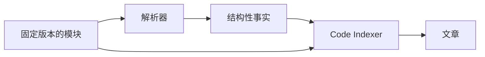

# 代码抽取

<!-- context:section id="role" -->
## 解析器产出事实，而不是知识

解析器包读取代码和接口定义，输出确定性的结构性事实：符号、源码范围、导入与导出、路由、契约。它们从不创建候选、写入 `knowledge/` 或控制审核。选定的 Indexer 结合这些事实和可读的源码进行解读，撰写面向读者的文章。

<!-- /context:section -->

<!-- context:section id="packages" -->
## 可用的解析器

| 包 | 结构性事实 |
| --- | --- |
| `@c4a/extract-ts` | TypeScript/JavaScript 符号、导出、导入、调用以及 React Router 路由 |
| `@c4a/extract-go` | Go 声明、导入、调用以及常见 HTTP 路由 |
| `@c4a/extract-rush` | Rush 项目、标签、入口、依赖和归属边界 |
| `@c4a/extract-thrift` | Thrift 服务、方法和声明的数据类型 |
| `@c4a/extract-proto` | Protobuf 消息、字段和服务定义 |
| `@c4a/extract-mdx` | Markdown/MDX 结构、组件引用、示例和源码范围 |
| `@c4a/extract-contract` | 支持的结构化 API 契约声明（OpenAPI、GraphQL） |
| `@c4a/extract-style` | 样式表声明和选择器 |
| `@c4a/extract-sql` | 支持的 SQL schema 声明 |
| `@c4a/extract` | 共享的抽取协议、插件运行器、扫描器和快照记录 |

它们都随 `@c4a/context-cli` 一起发布。
<!-- /context:section -->

<!-- context:section id="selection" -->
## 优先使用最小的解析器集合

解析是 Indexer 的实现细节，而不是 `src/index.ts` 中的独立阶段。顺序如下：

1. 确定目标边界和读者的问题；
2. 让 Indexer 检查语言、清单文件、入口、路由和契约；
3. 使用能覆盖这些问题的最小解析器集合；
4. 把解析器输出作为事实，基于事实和可读源码撰写文章。

在计划阶段，Code Indexer 不会为了确认某个功能是否存在而对整个仓库做解析；深度抽取属于撰写选定主题时的工作。
<!-- /context:section -->

<!-- context:section id="unsupported" -->
## 当某种技术尚不支持时

要区分解析器能力的限制和写作指引的缺失。配置可以选择已支持的行为，但说明和模板无法创造缺失的结构性事实。工作流会报告能力缺口以及可行的最小支持步骤；当某种技术在多个项目中都有用时，优先开发可复用的解析器，而不是项目本地的处理流水线。
<!-- /context:section -->
