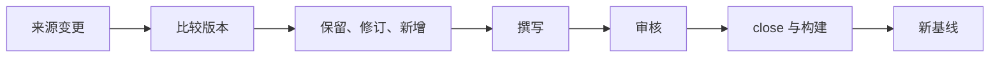

# 知识的持续更新

<!-- context:section id="flow" -->
## 更新循环

构建完成的是当前已批准的状态，并不会冻结 Context 知识工作区。当来源继续演进时，`context update` 会为选定的变更开启新一轮。工作流交给 Agent 固定的新旧来源版本、已确认的需求范围，以及引用了变更内容的页面列表。
<!-- /context:section -->

<!-- context:section id="decide" -->
## 决定改什么

列出的页面是待检查的候选，并不是要求全部重写。对每个页面，Agent 阅读其当前已批准的 Markdown 和变更内容，然后提交一个决定：不改，或给出具体的更正。无关内容和读者此前的改进都会保留。

仓库重新固定版本后，`context update --pending` 会缩小这份列表。只有引用文字发生变化或已无法读取的页面才会成为候选，受影响的章节列在 `changed_references` 中。其余所有引用该来源的页面列在 `scope_pages` 中：它们无需逐个决定，但当新增内容或共享变更影响到某个页面时（例如需要提到新导出的概览页），Agent 会附上修订说明把它一并提交。只有在这一次范围决定之后才会记录新的 commit，仅仅移动了位置的引用也在那时重新定位。

已有引用无法发现所有新主题，因此 Agent 还会检查新增内容和共享依赖，列出必要的**新页面**，每个新页面都带有路径、标题、已登记的来源和写作说明。新页面与修订一样经过撰写和审核。主题改名时在原处修订，而不是赋予新标识；主题下线时要说明消失了什么、影响哪些读者，而不是悄悄删除页面。
<!-- /context:section -->

<!-- context:section id="baseline" -->
## 推进基线

在所有请求的页面都已批准、close 并完成构建之前，CLI 会保留之前的已处理版本。如果临时进度丢失，下一次检查会从该版本重新开始，并保留已经批准的页面。保存的报告或获取回执并不能证明更新已经完成。

更新结算时，保持不变的页面会同步到新版本：

- 只是位置移动的引用会被重新定位。即使在全新克隆或另一台没有本地区域缓存的机器上也能做到：对于仓库来源，会从上一次结算的提交读取被引用的区域，并且只有在它仍与记录的摘要一致时才使用。
- 文本已改变或无法确认的引用保留原来的位置，并由完成结果在 `reference_warnings` 中列出。
- 同仓库内容（`repo-content:`）的引用会重新签名到当前仓库文本，因此之后 `verify` 不会再报告它们；如果其文本发生了变化，它们同样会列在 `reference_warnings` 中，所以要从这份回执中检查这些页面。
- 结构的输入哈希会基于改写后的引用重新计算，因此结算之后 `verify` 不会继续报告结构过期。

警告是对已接受决定的回执，而不是要求重新提交：更新完成后，对列出的页面中需要更正的逐一修订。参见 [版本感知的知识](version-aware-knowledge.md)。
<!-- /context:section -->

<!-- context:section id="scope" -->
## 让更新保持局部

对于一两份文档或边界清晰的模块，更新保持在局部：要新增或修订哪些文章，读者期望在哪里找到它们。它不会演变成整个知识工作区的分类调整或导航重设计。只恢复当前变更所需的来源；缺失的资料仍记为缺口，而不会被当作已调查过。
<!-- /context:section -->

<!-- context:section id="triggers" -->
## 更新的触发方式

| 触发条件 | 方式 |
| --- | --- |
| 来源发生变更 | 告诉 `/c4a:context` 新版本；它会针对选定范围运行 `context update` |
| 页面有错或不完整 | `context revise "<page>" --instruction "<correction>"` 会继续经过审核和交付；仅措辞修改时无需重新采集 |
| 无人值守或定时运行 | 获得授权的任务可以传入 `CONTEXT_RUN_POLICY`，将 `plan_review` 和 `knowledge_review` 设为 `ask` 或 `delegate`；仅限人工的 Gate 仍会停下 |

回答问题时发现的缺口也按同样方式处理：它们会变成针对受影响页面的修订任务。
<!-- /context:section -->
