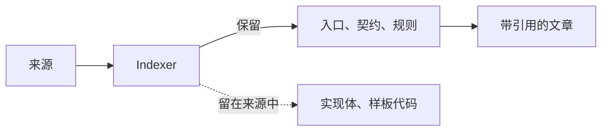

# 写给 Agent 的知识

<!-- context:section id="principle" -->
## 是索引，不是副本

需要回答问题的 Agent，要能快速知道**去哪里找**以及**什么是事实**。它不需要代码库的第二份副本，也不需要把每个函数都复述一遍的长篇精修文字。

因此，Context 把知识当作带有解释的索引：

- 每篇文章回答需求中约定的具体读者问题；
- 每条陈述都指向它所依据的确切来源区域；
- 来源本身保持原位，需要更多细节时可以在固定版本上阅读。

<!-- /context:section -->

<!-- context:section id="on-demand" -->
## 按需抽取

Indexer 不会从全量符号扫描或完整关系图开始。在计划阶段，它们先展示有用的骨架——目录、清单文件、注册点、公开入口——并提出读者主题。详细阅读发生在撰写各个主题时，范围以该主题所需为限。公开导出、已注册接口、定时任务、存储接口或生成的客户端等信号，提示的是读者问题，而不是必须产出的页面；明确避免一个符号一页。

符号数量不是质量指标。内部或超出范围的条目可以说明理由后略去；审核检查的是这些页面是否真正回答了读者的问题。
<!-- /context:section -->

<!-- context:section id="code-depth" -->
## 代码知识做到哪一层

代码知识是一张地图，不是副本。它分三层：

| 层 | 包含什么 | 什么时候写 |
| --- | --- | --- |
| 定位层 | 术语、仓库、模块，以及每个术语在哪里 | 预先写 |
| 契约层 | 入口、路由、IDL、服务标识和配置 | 预先写 |
| 实现层 | 某个具体行为实际怎么计算 | 不预先写；问题需要时在固定提交上读取 |

为什么不让 Agent 每次都重新读代码？没有前两层，它两眼一抹黑：不知道该打开哪个仓库、哪个模块，落到哪里多少有些随机。有了这两层，它知道术语以及它们对应的仓库和路径，每次搜索都会被拉向正确的模块，强模型和弱一点的模型都是如此。对耗时和工具调用的实测效果见[知识检索测评](../benchmark/knowledge-retrieval.md)。

难点在粒度。Code Indexer 停在骨架这一层（清单文件、注册点、公开入口、接口和路由），不逐个枚举符号，也不构建关系图。这也让保鲜成本很低：更新时只重看受来源变化影响的文章，见[知识的持续更新](keeping-knowledge-current.md)。

第一个知识库里如何一起划定代码和文档的范围，见[知识库冷启](../../sop/practices/cold-start.md)。如果读者主要是要*找到*东西（知识 Bot 或运维工作），可以要求单独写一篇导航文章，把术语映射到核实过的代码入口。
<!-- /context:section -->

<!-- context:section id="ratio" -->
## 能小多少

在一个大型生产级全栈 monorepo 中，可在本地统计的两个仓库共有约 33,700 个代码文件、584 万行代码（约 200 MB）；加上约 1,130 份文档快照（约 1.77 MB），最终形成 220 篇经过审核的文章，总计约 1.75 MB——大约是来源体量的 **1/115**。

这个数字有两点限制：

- 只统计了部分已登记的来源，因此实际比例更高；
- 该比例衡量的是体量，而不是覆盖度或质量。质量另行在[知识检索测评](../benchmark/knowledge-retrieval.md)中衡量。

这些知识并非无损，也不“覆盖全部代码”。它保留回答问题所需的事实，每条都带有指回代码行或文档章节的指针。参见[证据链与索引优先](evidence-chains.md)。
<!-- /context:section -->
