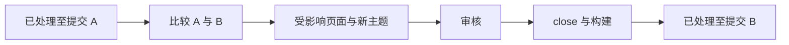

# 版本感知的知识

<!-- context:section id="pinned" -->
## 每个来源都有固定版本

只有知道知识描述的是来源的哪个版本，知识才可校验。Context 为每项输入都记录了这一点：

| 来源 | 固定方式 |
| --- | --- |
| 仓库模块 | 登记的提交；恢复 Context 知识工作区时检出该提交，绝不替换为更新的提交 |
| 在线或本地文档 | 带指纹的采集快照 |
| 笔记或会话摘要 | 保存的文件；会话相关的提交和合并请求保留在其 frontmatter 中 |

引用保存的是被引用提交中的真实仓库路径，即使该模块之后以不同路径重新登记也不受影响。
<!-- /context:section -->

<!-- context:section id="processed" -->
## 已处理的内容

`knowledge/structure.yaml` 中保存精简的 `processed_scopes`：针对每个需求、来源和模块范围，记录知识已经更新到的版本。来源更新从该版本开始；只有当范围内所有请求的页面都已批准、close 并完成构建后，已处理版本才会前移——部分更新或构建失败都会让它保持原样。如果临时进度丢失，下一次检查会从记录的版本重新开始，并保留已经批准的页面。

<!-- /context:section -->

<!-- context:section id="workspace-version" -->
## 知识工作区有自己的版本

除了来源版本，知识工作区本身在 `package.json` 中也带有一个 SemVer 版本号。每次交付完成时——在审核、close 和打包配置之后、最终构建之前——工作流会请 Agent 检查正式变更，并记录下一个版本号和简洁的 Changelog：

- **minor**：新增模块或扩大资料覆盖范围；
- **patch**：更正内容、更新已有模块以及调整导航；
- **major**：仅在明确指示时使用。

CLI 会同时更新 `package.json`、`changelog.yaml` 和 `CHANGELOG.md`。知识包和 LLM Docs 带有相同的版本和 Changelog，文档站点则在其 Changelog 页面展示历史。临时进度从不提升版本号，中间批次也不会各自获得版本号。
<!-- /context:section -->

<!-- context:section id="restore" -->
## 回退

由于知识工作区在 Git 中，可以恢复历史版本：Agent 把目标解析为具体的提交和路径范围，与当前文件比较，然后恢复选定的知识工作区文件和可用的来源。它不会重置整个仓库，也不会回退来源仓库。
<!-- /context:section -->
