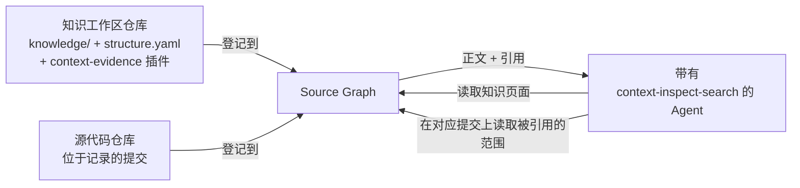

# 与 Context 协同

<!-- context:section id="goal" -->
Context 知识为每个章节记录了它依据哪些源文件和行范围写成，且每条都固定到一个提交。Source Graph 可以在任何符合条件的提交上读取任何已登记的仓库。两者结合后，Agent 无需克隆任何内容，就能从一个答案追溯到其背后的确切代码：读取知识页面，随正文一起拿到其记录的来源，再在记录的提交上读取这些来源。



实现这一点需要两部分：Context 放在知识工作区仓库中的 WebAssembly 插件，以及查询 Skill 使用 Source Graph 的访问策略。
<!-- /context:section -->

<!-- context:section id="plugin" -->
## 证据插件

Source Graph 允许仓库附带名为 `<name>.sourcegraph.wasm` 的插件。在处理 `read` 或 `read_many` 时，它会在被读取的同一提交上发现该仓库中的插件，并在普通读取成功后运行它们；插件的输出会追加到返回的文本中。插件没有网络、文件系统或进程访问权限——宿主会把插件读取的每个文件都限定在同一仓库、同一提交和同一可读范围内。

Context 的插件是 `context-evidence.sourcegraph.wasm`。对于返回结果中每个位于 `knowledge/` 下、以 `.md` 结尾的文件，它会：

1. 读取该提交上的完整文章，仅用于定位其中的 `<!-- context:section -->` 标记，然后选出与实际返回行有重叠的章节。
2. 在 `knowledge/structure.yaml`（记录每个章节引用的已批准结构）中查找这些章节。
3. 为该项追加一个去重后的 YAML `references:` 列表。带有完整提交且远端受支持的仓库引用，会变成固定到提交、带行锚点的网页 URL；其他引用保留其结构化字段。

如果任何一步失败，普通文本仍会照常返回，插件会附加诊断信息而不是引用。引用是记录下来的元数据，并不证明本次查询中重新读取过该来源。
<!-- /context:section -->

<!-- context:section id="install" -->
## 把插件放进仓库

当知识工作区就是仓库根目录，或者它不在任何 Git 仓库之内时，`context init` 会写入插件。对于已有的知识工作区，运行：

```bash
context evidence install --format json
```

嵌套在更大仓库中的知识工作区需要显式选择：Source Graph 托管整个仓库时使用 `--repository-root <git-root>`，只托管某个已登记路径时使用 `--plugin-root <registered-content-root>`；知识工作区目录相对于该根目录的路径随后作为 `workspace_root` 传给插件。安装器只升级它识别为旧版本插件的文件，保留同名的未知文件或已修改文件，并且从不提交或推送——请自行提交该文件，并等 Source Graph 完成同步后再依赖它进行远程读取。
<!-- /context:section -->

<!-- context:section id="query" -->
## 查询 Skill 如何使用 Source Graph

`context-inspect-search` Skill 通过宿主命名为 `context-sourcegraph` 的只读 MCP 服务器读取 Source Graph。由 `CONTEXT_QUERY_ACCESS_MODE` 决定何时使用：

| 模式 | 行为 |
| --- | --- |
| `auto`（默认） | 先复用合适的本地材料，然后在本地检索之前优先使用已授权的只读服务 |
| `remote` | 只通过该服务读取知识和原始代码；从不自动克隆，失败时只使用已带有版本信息的材料 |
| `local` | 仅本地检索；不需要 MCP |

对于远程知识，该 Skill 只解析一次分支，并在这次回答的所有知识读取中固定使用返回的完整提交。它在 `knowledge/**` 范围内搜索，读取匹配的章节，并直接使用插件已附加的引用，而不是为了获取引用再读一遍；如果宿主默认未启用插件，它会请求一次 `plugins: [{"name":"context-evidence"}]`。
<!-- /context:section -->

<!-- context:section id="code" -->
## 读取被引用的代码

对于代码，该 Skill 传入来源登记信息中的确切仓库、作为版本参数的已记录完整提交，以及一个相对于仓库根目录、已包含任何已登记子路径的路径。文件已知时直接读取，未知时在该仓库和提交上搜索，不会在每次查询前都先做一轮发现。它从不用默认分支替代缺失的基线。

每条证据都把四项信息放在一起：仓库、返回的完整提交、路径和返回的行范围。多步读取始终停留在同一提交上，遵循服务返回的续读范围，并把 `Partial`、`Truncated` 和覆盖范围视为限制，而不是不存在的证明。使用 `read_many` 时，每一项的内容和错误都会分别检查。
<!-- /context:section -->

<!-- context:section id="next" -->
## 相关页面

- [远程读取代码证据](../../sop/querying-knowledge/reading-code-evidence-remotely.md)——为 Agent 开启此功能。
- [证据链与索引优先](../knowledge/evidence-chains.md)——为什么每个章节都要记录其来源。
- [固定版本的搜索与阅读](pinned-search-and-reads.md)——Source Graph 如何解析提交并限制读取。
<!-- /context:section -->
