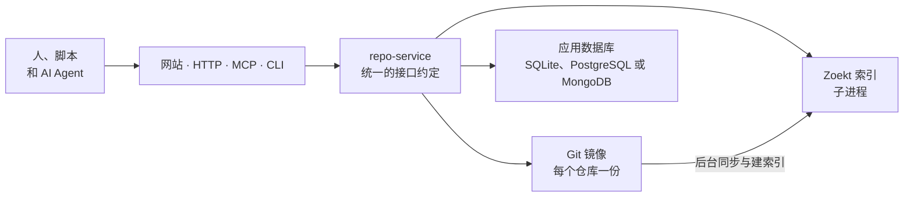

# Source Graph 定位与能力

<!-- context:section id="goal" -->
**Context Source Graph** 是一个自部署服务，用于在固定的 Git 版本上搜索和阅读代码。它基于 Go、Git 和 Zoekt 三元组（trigram）索引构建，面向 AI 编码 Agent 带来的典型负载：针对 Agent 并未检出的代码，进行大量小而精确的「先搜索、再阅读」往返。

每个请求在读取任何内容之前都会先解析到一个确定的提交，因此搜索命中、它指向的文件以及之后的差异，描述的都是同一个快照。同样的操作可以在浏览器中使用，也可以通过 HTTP、作为 MCP 服务器或通过命令行客户端调用。

Source Graph 是 Context 项目的一部分，名称并不代表它与 Sourcegraph 平台有任何关联。
<!-- /context:section -->

<!-- context:section id="get-it" -->
## 源码与在线示例

- **源码：** [github.com/context4ai/sourcegraph](https://github.com/context4ai/sourcegraph)。
- **在线示例：** [https://context4ai-portal.fly.dev/sourcegraph/](https://context4ai-portal.fly.dev/sourcegraph/)，也可以通过 [https://context4ai-sourcegraph.fly.dev/sourcegraph/](https://context4ai-sourcegraph.fly.dev/sourcegraph/) 访问。它是支撑本文档站知识服务的公开只读实例，提供 `context4ai/context` 与 `context4ai/sourcegraph` 两个仓库。MCP 端点为 `/sourcegraph/mcp`。部署方式见[部署建议](../../sop/source-graph/deployment-recommendations.md)。
- **对 Context 是可选的：** 没有 Source Graph，Context 也能工作。未安装或未配置实例时，Context 的查询技能改为通过浅层、稀疏的部分克隆加 grep 读取代码。
<!-- /context:section -->

<!-- context:section id="why" -->
## 为什么需要它

Agent 回答代码问题时，通常只需要少量确切的代码行，而不是整个仓库。把每个仓库都按正确版本克隆到每个 Agent 沙箱中很慢；在检出目录上运行 `rg` 或 `git grep`，每次调用又要重复同样的扫描。Source Graph 为每个仓库维护一份索引，直接作答：

- **快。** 带索引的搜索在服务端通常几毫秒内完成。当服务与调用方位于同一地域时，包含网络在内的完整请求也远低于 100 ms。[固定版本的搜索与阅读](pinned-search-and-reads.md)解释了速度从何而来，并给出实测对比。
- **可复现。** 分支会先解析为提交；完整提交 SHA 只有在仓库的保留窗口内才会被接受，因此在一次对话中途，答案不会漂移到另一个快照。
- **为 Agent 而生。** MCP 端点是无状态的 Streamable HTTP，可与任何 MCP 客户端配合使用。匿名访问为只读，且仅限公开仓库。
- **占用小。** 一个进程即可管理 Git 镜像、搜索引擎和后台建索引；默认数据库为 SQLite。
<!-- /context:section -->

<!-- context:section id="surfaces" -->
## 一套接口约定，四种入口

四种入口都提供相同的操作：

| 操作 | 作用 |
| --- | --- |
| `repositories` | 列出已登记的仓库及其观察到的分支 |
| `availability` | 显示仓库保留的版本和建索引状态 |
| `resolve` | 把分支或符合条件的完整 SHA 转换为后续要使用的固定提交 |
| `search` | 在某个提交上搜索文件内容，形式与 `rg` 类似 |
| `read` | 读取某个提交上一个文件的指定行范围 |
| `read_many` | 在一次 MCP 调用中读取同一提交上最多十个已知范围 |
| `list` | 列出某个提交上的一个目录 |
| `diff` | 比较两个符合条件的提交 |
| `prepare` | 请求同步某个提交并为其建索引（仅限已授权的调用方） |

网站位于 `/sourcegraph/` 下，MCP 端点为 `/sourcegraph/mcp`，HTTP API 位于 `/sourcegraph/v1/` 和 `/sourcegraph/api/` 下。命令行客户端 `sourcegraph-cli` 调用的也是这些 HTTP 路由。具体路由、工具输入和限制见 [HTTP 与 MCP 接口](../../product/reference/source-graph/http-and-mcp.md)和 [CLI](../../product/reference/source-graph/cli.md) 参考文档。
<!-- /context:section -->

<!-- context:section id="components" -->
## 实例的组成

一个 Source Graph 实例就是一个 `repo-service` 进程。它以子进程方式启动 Zoekt 搜索服务器（只监听回环接口），在数据卷上为每个已登记仓库保存一份裸 Git 镜像，并运行后台 worker 来同步监控分支、为新的分支最新提交建索引。

应用数据库存储仓库、任务、身份和设置。默认使用 SQLite；对于规模更大或需要分片的部署，也支持 PostgreSQL 和 MongoDB。Git 镜像和索引始终保存在实例的本地磁盘上——搜索速度正来自这种本地性——因此容量规划围绕磁盘而非 CPU 展开。需要扩容时，运行多个实例，各自负责互不重叠的一组仓库；切勿让两个实例处理同一批仓库或同一个数据目录。[自部署与数据库选择](../../sop/source-graph/self-hosting.md)介绍了这两种拓扑。

仓库还可以附带名为 `<name>.sourcegraph.wasm` 的 WebAssembly 插件，为 `read` 和 `read_many` 的结果追加文本。Context 借此为每个知识章节附上其来源，详见[与 Context 协同](evidence-for-context.md)。
<!-- /context:section -->

<!-- context:section id="access" -->
## 权限划分

未配置任何登录提供方时，实例是一个匿名只读站点：访客可以搜索和阅读标记为公开的仓库，并受每分钟限流约束。添加 Google 或 GitHub 登录后即可启用管理功能，第一个通过验证的用户会成为管理员。已登录用户可以为脚本和 Agent 创建个人 API Key，自动化场景则使用服务令牌。登记仓库、为较早的提交建索引以及其他变更操作，需要管理员或服务令牌。完整的权限矩阵见[登录与准入](../../sop/source-graph/authentication-and-access-control.md)。
<!-- /context:section -->

<!-- context:section id="next" -->
## 下一步

[context4ai.org/sourcegraph](https://context4ai.org/sourcegraph/) 上的公开演示实例为 Context 和 Source Graph 仓库建了索引，并允许匿名阅读。

| 如果你想… | 阅读 |
| --- | --- |
| 了解固定版本搜索和速度对比 | [固定版本的搜索与阅读](pinned-search-and-reads.md) |
| 了解 Context 知识与 Source Graph 如何结合 | [与 Context 协同](evidence-for-context.md) |
| 接入浏览器、MCP 客户端、脚本或 CLI | [接入](../../sop/source-graph/connecting.md) |
| 添加仓库和 Monorepo 路径组 | [登记仓库](../../sop/source-graph/registering-repositories.md) |
| 部署你自己的实例 | [自部署与数据库选择](../../sop/source-graph/self-hosting.md) |
| 配置登录和 API Key | [登录与准入](../../sop/source-graph/authentication-and-access-control.md) |
| 运行、监控和排查问题 | [运维](../../sop/source-graph/operations.md) |
| 查阅路由、工具、参数和设置 | [HTTP 与 MCP 接口](../../product/reference/source-graph/http-and-mcp.md)、[CLI](../../product/reference/source-graph/cli.md)、[搜索语法](../../product/reference/source-graph/query-syntax.md)、[配置](../../product/reference/source-graph/configuration.md) |
<!-- /context:section -->
