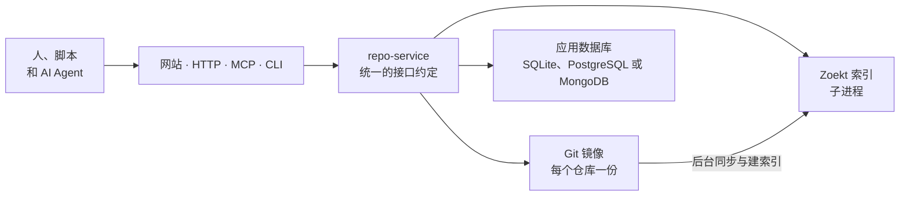

# 架构概览

<!-- context:section id="goal" -->
本页说明 **Context Source Graph** 如何工作：四个入口共享的操作、单个实例如何组成，以及谁能做什么。它是一个基于 Git 和 Zoekt 三元组（trigram）索引、可自部署的 Go 应用；每个请求在读取任何内容之前都会先解析到一个确定的提交。它为什么存在、适合做什么以及如何开始，请阅读 [Source Graph 是什么](../../sop/source-graph/introduction.md)。

源码位于 [github.com/context4ai/sourcegraph](https://github.com/context4ai/sourcegraph)。名称并不代表它与 Sourcegraph 平台有任何关联。
<!-- /context:section -->

<!-- context:section id="surfaces" -->
## 一套接口约定，四种入口

四种入口共享以下操作，其中 `read_many` 只能通过 MCP 使用：

| 操作 | 作用 |
| --- | --- |
| `repositories` | 列出已登记的仓库及其观察到的分支 |
| `availability` | 显示仓库保留的版本和建索引状态 |
| `resolve` | 把分支或符合条件的完整 SHA 转换为后续要使用的固定提交 |
| `search` | 在某个提交上搜索文件内容，形式与 `rg` 类似 |
| `read` | 读取某个提交上一个文件的指定行范围 |
| `read_many` | 在一次 MCP 调用中读取同一仓库、同一提交上最多十个已知范围 |
| `list` | 列出某个提交上的一个目录 |
| `diff` | 比较两个符合条件的提交 |
| `prepare` | 请求同步某个提交并为其建索引（仅限已授权的调用方） |

网站位于 `/sourcegraph/` 下，MCP 端点为 `/sourcegraph/mcp`，HTTP API 位于 `/sourcegraph/v1/` 和 `/sourcegraph/api/` 下。命令行客户端 `sourcegraph-cli` 调用的也是这些 HTTP 路由。具体路由、工具输入和限制见 [HTTP 与 MCP 接口](../../product/reference/source-graph/http-and-mcp.md) 和 [CLI](../../product/reference/source-graph/cli.md) 参考文档。
<!-- /context:section -->

<!-- context:section id="components" -->
## 实例的组成

一个 Source Graph 实例就是一个 `repo-service` 进程。它以子进程方式启动 Zoekt 搜索服务器（只监听回环接口），在数据卷上为每个已登记仓库保存一份裸 Git 镜像，并运行后台 worker 来同步监控分支、为新的分支最新提交建索引。

应用数据库存储仓库、任务、身份和设置，也加密存储实例的应用密钥：代码源令牌及其加密密钥、服务 API 凭据，以及 Google/GitHub 登录配置。因此数据卷只保存 Git 镜像和索引，替换主机时需要的是数据库，而不是旧的密钥文件。默认使用 SQLite；对于规模更大或需要分片的部署，也支持 PostgreSQL 和 MongoDB。Git 镜像和索引始终保存在实例的本地磁盘上——搜索速度正来自这种本地性——因此容量规划围绕磁盘而非 CPU 展开。需要扩容时，运行多个实例，各自负责互不重叠的一组仓库；切勿让两个实例处理同一批仓库或同一个数据目录。[自部署与数据库选择](../../sop/source-graph/self-hosting.md) 介绍了这两种拓扑。

仓库还可以附带名为 `<name>.sourcegraph.wasm` 的 WebAssembly 插件，为 `read` 和 `read_many` 的结果追加文本。Context 借此为每个知识章节附上其来源，详见 [与 Context 协同](evidence-for-context.md)。
<!-- /context:section -->

<!-- context:section id="access" -->
## 权限划分

未配置任何登录提供方时，实例是一个匿名只读站点：访客可以搜索和阅读标记为公开的仓库，并受每分钟限流约束。添加 Google 或 GitHub 登录后即可启用管理功能，第一个通过验证的用户会成为管理员。已登录用户可以为脚本和 Agent 创建个人 API Key，自动化场景则使用服务令牌。登记仓库、为较早的提交建索引以及其他变更操作，需要管理员或服务令牌；除非站点允许已登录用户登记仓库，此时每位这样的用户管理自己登记的仓库，并可以添加其他管理者。完整的权限矩阵见 [登录与准入](../../sop/source-graph/authentication-and-access-control.md)。
<!-- /context:section -->

<!-- context:section id="next" -->
## 下一步

| 如果你想… | 阅读 |
| --- | --- |
| 了解 Source Graph 为什么存在以及如何开始 | [Source Graph 是什么](../../sop/source-graph/introduction.md) |
| 了解固定版本搜索和速度对比 | [固定版本的搜索与阅读](pinned-search-and-reads.md) |
| 了解 Context 知识与 Source Graph 如何结合 | [与 Context 协同](evidence-for-context.md) |
| 接入浏览器、MCP 客户端、脚本或 CLI | [接入](../../sop/source-graph/connecting.md) |
| 添加仓库和 Monorepo 路径组 | [登记仓库](../../sop/source-graph/registering-repositories.md) |
| 部署你自己的实例 | [自部署与数据库选择](../../sop/source-graph/self-hosting.md) |
| 配置登录和 API Key | [登录与准入](../../sop/source-graph/authentication-and-access-control.md) |
| 运行、监控和排查问题 | [运维](../../sop/source-graph/operations.md) |
| 查阅路由、工具、参数和设置 | [HTTP 与 MCP 接口](../../product/reference/source-graph/http-and-mcp.md)、[CLI](../../product/reference/source-graph/cli.md)、[搜索语法](../../product/reference/source-graph/query-syntax.md)、[配置](../../product/reference/source-graph/configuration.md) |
<!-- /context:section -->
