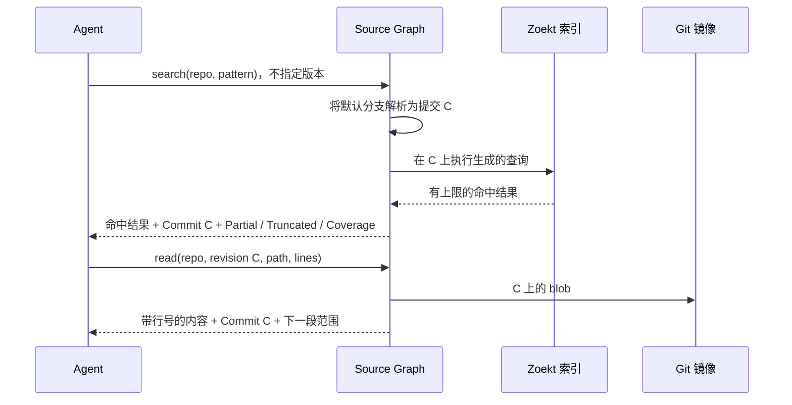

# 固定版本的搜索与阅读

<!-- context:section id="goal" -->
Source Graph 对每个请求都只在一个确定的 Git 提交上作答。它先把请求的版本转换为仓库保留窗口内的一个提交，然后在该提交上搜索索引或读取 Git，并把这个提交随结果一起返回，方便调用方继续使用。本页说明版本如何解析、版本如何保留和建索引、搜索和读取受哪些限制，以及为什么这种方式比在检出目录上运行 `rg` 更快。

<!-- /context:section -->

<!-- context:section id="resolve" -->
## 版本如何解析

每个操作都接受一个可选的版本参数，并按相同规则解析：

| 你传入 | Source Graph 使用 |
| --- | --- |
| 不传 | 若保留策略跟随默认分支，则使用发现到的仓库默认分支；否则使用唯一配置的 `main` 或 `master` 分支，取其最近一次同步的最新提交 |
| 一个监控分支名 | 该分支最近一次同步的最新提交 |
| 一个 40 位小写的完整提交 SHA | 该提交，前提是它在保留窗口内 |
| 短 SHA、标签、`HEAD` 或其他引用 | 拒绝（`SHORT_SHA_UNSUPPORTED`、`INVALID_REVISION`） |
| 未被监控的分支 | 拒绝（`BRANCH_NOT_MONITORED`） |

窗口之外的提交会返回 `REVISION_NOT_ELIGIBLE`，而不是用相近的提交代替。Source Graph 从不悄悄把请求的基线替换成另一个提交，因此调用方只要固定使用返回的提交，之后每次调用拿到的都是同一个快照。
<!-- /context:section -->

<!-- context:section id="versions" -->
## 有哪些版本

每个仓库都有一个保留策略：一到八个监控分支（可选包含远端的默认分支），以及一个按**天数**（1–365）或按**数量**（每个分支 1–4096 个第一父提交）定义的窗口。后台同步按仓库的同步间隔只拉取监控分支——从不拉取标签——记录每个分支的最新提交，并根据窗口构建符合条件的版本集合。因此，同一仓库的多个版本可以并存。

建索引与版本是否符合条件相互独立。同步成功后，服务会为每个尚未建索引的分支最新提交排入一个索引任务；同一个最新提交失败三次后不再重试。窗口内较早的提交仍可从 Git 读取，但只有在有权限的人通过 `prepare` 请求后才能被搜索；搜索未建索引的提交会返回 `INDEX_NOT_READY`。每份索引都作为独立的一代（generation）存储，不再被任何保留版本引用的代会在后台删除，每轮回收最多删除一代。
<!-- /context:section -->

<!-- context:section id="search" -->
## 搜索受哪些限制

调用方从不发送引擎语法。一次搜索是一组结构化、类似 `rg` 的字段——按行匹配的正则表达式或字面量、大小写折叠、glob 和目录路径——由服务在解析出的提交上编译为引擎查询。[搜索语法](../../product/reference/source-graph/query-syntax.md)参考文档列出了所有字段。

结果是有上限的第一页。第一次尝试最多返回 100 个文件和 1,000 个匹配，并附带两行上下文；如果响应会超出 2 MiB 的预算，服务会改用更小的页重试，最后退化为只列文件，整个过程都在五秒期限内完成。响应元数据会告诉调用方拿到了什么：

- `Commit` 和 `Repository` 标识快照。
- `Partial` 表示引擎提前停止，例如达到其 10,000 个匹配的上限。
- `Truncated` 表示实际存在的文件或匹配多于显示的数量。
- `Coverage` 描述索引了哪些内容——仅文本、没有符号索引、已登记的路径和路径组——因此零命中并不能证明仓库中不存在某样东西。
<!-- /context:section -->

<!-- context:section id="read" -->
## 读取受哪些限制

`read` 返回某个提交上一个文件的闭区间行范围，每次调用最多 500 行、256 KiB；通过 MCP 调用且未指定范围时，从第 1 行开始，最多覆盖 500 行。响应会说明返回了哪些行以及从哪里继续，并明确标出截断、二进制内容、不支持的编码和 Git LFS 指针，而不是靠猜测处理。

在全量仓库登记下，读取直接访问 Git，无需等待建索引。在 Monorepo 登记下，该路径组必须已在该提交上准备好（否则返回 `CONTENT_NOT_READY`）。`read_many` 在一次 MCP 调用中读取同一提交上一到十个已知范围，共享 1,000 行、256 KiB 和 30 秒的预算；每一项分别报告自己的内容和错误。
<!-- /context:section -->

<!-- context:section id="speed" -->
## 为什么比检出目录更快

`rg` 和 `git grep` 每次调用都要扫描文件；三元组索引则对每个提交只做一次这项工作。项目 README 给出了在公开演示仓库（`context4ai/context`，2,359 个已索引文件）与同一提交的本地检出目录上的对比：

| 查询 | Source Graph（服务端） | `rg`（本地） | `git grep`（本地） | `grep -r`（本地） |
| --- | ---: | ---: | ---: | ---: |
| 字面量，13 个匹配文件 | 0.7–0.9 ms | 61 ms | — | — |
| 字面量，约 100+ 个匹配文件 | 3.6–5.2 ms | 61 ms | 39 ms | 3.6 s |
| 正则，无匹配 | 0.4 ms | 62 ms | — | — |

服务端时间是引擎报告的搜索耗时。本地工具运行在 Apple M4 Pro 上，页缓存已预热。端到端延迟还需加上网络往返——同一地域内为几毫秒。仓库越大，差距越明显；而且该服务还省去了把每个仓库按正确版本检出的需要。

速度取决于本地性：每个实例都把自己的 Git 镜像和索引保存在自己的磁盘上，因此应把实例部署在与调用它的 Agent 相同的地域。Context 自己关于使用与不使用 Source Graph 作答的对比测量，见[知识检索](../benchmark/knowledge-retrieval.md)。
<!-- /context:section -->
