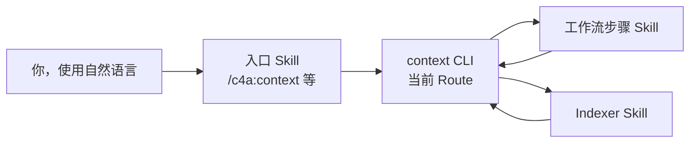

# 命令与技能

<!-- context:section id="goal" -->
你通过少数几个对话入口使用 Context。其余一切——生命周期 CLI 命令、Indexer 以及工作流自身的步骤 Skill——都在这些入口背后运行，由当前 Route 选择，而不需要你手动输入。

<!-- /context:section -->

<!-- context:section id="invoke" -->
## 你调用的入口

| 入口 | 用途 | 示例 |
| --- | --- | --- |
| `/c4a:context` | 创建或继续 Context 知识工作区，执行生产、审核、更新和构建 | *“为 ../billing-service 构建经过审核的知识，读者是值班工程师。”* |
| `/c4a:context-plan` | 在生产前分阶段规划大型项目或大范围更新 | *“为这三个仓库和设计文档目录规划知识。”* |
| `/c4a:context-inspect-search` | 基于知识包或已批准的知识提问，并附带来源 | *“退款是如何重试的？请引用代码。”* |
| `/c4a:context-repo-content` | 让 Context 引用你的项目在同一仓库中已维护的文档和自编 Skill，而不是重新生产 | *“把 docs/ 和 .agents/skills 登记为仓库内容。”* |

`/c4a:context` 是新建和已有知识工作区的生产入口。其他三个入口自身不推进生产：需要生产知识时，规划结果、指出知识缺口的回答或已登记的仓库内容都会交回 `/c4a:context`。仓库内容随项目持续演进，知识链接到它；参见[引用同仓库的文档与 Skill](../../sop/registering-sources/same-repository-docs.md)。Context 已经处于活动状态的对话无需再次调用即可继续；普通的编码或设计对话永远不会自行启动它。

要创建新的 Indexer，用自然语言提出即可——*“在 ./skills 中为我们的 RPC 框架创建一个 Indexer Skill”*。`context-indexer-create` Skill 会接手这个请求；它不是菜单命令。
<!-- /context:section -->

<!-- context:section id="hosts" -->
## 各宿主中的写法

| 宿主 | 入口形式 |
| --- | --- |
| Claude Code | 插件命令 `/c4a:context`、`/c4a:context-plan`、`/c4a:context-inspect-search`、`/c4a:context-repo-content` |
| Cursor | 命令 `/c4a-context`、`/c4a-context-plan`、`/c4a-context-inspect-search`、`/c4a-context-repo-content` |
| Codex | 按名称调用的 Skill：`context`、`context-plan`、`context-inspect-search`、`context-repo-content` |
| 只安装到单个仓库（`context plugin install --local`） | 同样的入口，但没有 `c4a` 插件命名空间 |

安装或更新插件后，请重启或刷新宿主，让它加载当前的入口。参见[安装](installation.md)。
<!-- /context:section -->

<!-- context:section id="requests" -->
## 常用请求

| 你想要 | 可以这样说 | 延伸阅读 |
| --- | --- | --- |
| 开始 | *“在 ./kb 中为……创建一个 Context 知识工作区；读者是……”* | [快速开始](quick-start.md) |
| 添加材料 | *“把 ../docs/refunds 加入来源，并重新规划受影响的部分。”* | [与 Agent 协作](../../sop/planning-and-production/working-with-agents.md) |
| 修正页面 | *“修订重试页面：上限是五次，不是三次。”* | [修订页面](../../sop/review-and-revision/revising-a-page.md) |
| 跟进变更 | *“billing 仓库发布了新版本；更新受影响的页面。”* | [更新知识](../../sop/updates-and-versions/updating-knowledge.md) |
| 让 Agent 替你审核某个任务 | 加入一个限定于该任务、委托审核决定的 `CONTEXT_RUN_POLICY` 块；没有它时，运行会询问你 | [托管模式与审核策略](../../sop/planning-and-production/managed-mode-and-review-policy.md) |
<!-- /context:section -->

<!-- context:section id="automatic" -->
## 自行运行的 Skill

有些 Skill 从不需要按名称调用。Indexer Skill（`context-code-indexer`、`context-markdown-indexer`、`context-note-indexer`、`context-sessions-indexer`）会在规划和写作期间根据当前来源和需求被选用；安装某个 Indexer 只是让它可用，并不会在每个知识工作区中启用。当宿主配置把知识问题路由给 `context-inspect-search` 时，它也会运行。工作流自身的步骤 Skill——写作某个生产阶段、翻译站点、记录版本、恢复卡住的任务——在当前 Route 选中对应步骤时运行。

Indexer Skill 安装时不带插件命名空间，因此在每个宿主中名称都相同。每个 Skill 的触发条件与交接关系见[技能清单](../reference/context/skills.md)；各 Indexer 的介绍见[社区 Indexer](../../sop/custom-indexers/community-indexers.md)。
<!-- /context:section -->

<!-- context:section id="never" -->
## 你永远不需要输入的内容

生命周期命令——`context source add`、`context review …`、`context build` 等——都由 Agent 按 Route 返回的确切修订执行。你会在进度消息中看到它们，但你只需描述目标。没有 `context continue` 命令：Agent 启动时，`context entry` 和 `context status` 会观察知识工作区并返回下一步。完整的命令列表见 [CLI 命令参考](../reference/context/cli-commands.md)。
<!-- /context:section -->
