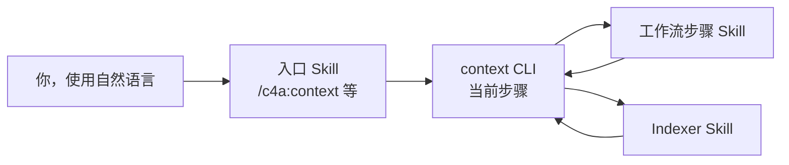

# 命令与技能

<!-- context:section id="goal" -->
你通过少数几个对话入口使用 Context。其余一切，从生命周期 CLI 命令到 Indexer 以及工作流自身的步骤 Skill，都在这些入口背后运行，由工作流根据当前步骤选择，而不需要你手动输入。

<!-- /context:section -->

<!-- context:section id="invoke" -->
## 你调用的入口

| 入口 | 用途 | 示例 |
| --- | --- | --- |
| `/c4a:context` | 创建或继续 Context 知识工作区，执行生产、审核、更新和构建 | *“为 ../billing-service 构建经过审核的知识，读者是值班工程师。”* |
| `/c4a:context-plan` | 在生产前分阶段规划大型项目或大范围更新 | *“为这三个仓库和设计文档目录规划知识。”* |
| `/c4a:context-inspect-search` | 基于知识包或已批准的知识提问，并附带来源 | *“退款是如何重试的？请引用代码。”* |
| `/c4a:context-repo-content` | 让 Context 引用你的项目在同一仓库中已维护的文档和自编 Skill，而不是重新生产 | *“把 docs/ 和 .agents/skills 登记为仓库内容。”* |

`/c4a:context` 是新建和已有知识工作区的生产入口。其他三个入口自身不推进生产：需要生产知识时，规划结果、指出知识缺口的回答或已登记的仓库内容都会交回 `/c4a:context`。仓库内容随项目持续演进，知识链接到它；参见[链接已有的文档与 Skill](../../sop/registering-sources/same-repository-docs.md)。Context 已经处于活动状态的对话无需再次调用即可继续；普通的编码或设计对话永远不会自行启动它。

要创建新的 Indexer，用自然语言提出即可：*“在 ./skills 中为我们的 RPC 框架创建一个 Indexer Skill”*。`context-indexer-create` Skill 会接手这个请求；它不是菜单命令。
<!-- /context:section -->

<!-- context:section id="hosts" -->
## 各宿主中的写法

| 宿主 | 入口形式 |
| --- | --- |
| Claude Code | 插件命令 `/c4a:context`、`/c4a:context-plan`、`/c4a:context-inspect-search`、`/c4a:context-repo-content` |
| Cursor | 命令 `/c4a-context`、`/c4a-context-plan`、`/c4a-context-inspect-search`、`/c4a-context-repo-content` |
| Codex | 按名称调用的 Skill：`context`、`context-plan`、`context-inspect-search`、`context-repo-content` |
| 只安装到单个仓库（`context plugin install --local`） | 同样的入口，但没有 `c4a` 插件命名空间 |

安装或更新插件后，请重启或刷新宿主，让它加载当前的入口。参见[安装](installation.md)。
<!-- /context:section -->

<!-- context:section id="requests" -->
## 常用请求

| 你想要 | 可以这样说 | 延伸阅读 |
| --- | --- | --- |
| 开始 | *“在 ./kb 中为……创建一个 Context 知识工作区；读者是……”* | [快速开始](quick-start.md) |
| 添加材料 | *“把 ../docs/refunds 加入来源，并重新规划受影响的部分。”* | [选择添加材料的方式](../../sop/registering-sources/source-batches.md) |
| 修正页面 | *“修订重试页面：上限是五次，不是三次。”* | [修订页面](../../sop/review-and-revision/revising-a-page.md) |
| 跟进变更 | *“billing 仓库发布了新版本；更新受影响的页面。”* | [更新知识](../../sop/updates-and-versions/updating-knowledge.md) |
| 让 Agent 替你审核某个任务 | 为该任务明确授权全托管模式；没有授权时，运行会询问你 | [全托管模式](../../sop/planning-and-production/managed-mode-and-review-policy.md) |
<!-- /context:section -->

<!-- context:section id="more-requests" -->
### 更多示例请求

把尖括号中的占位符替换成实际内容。每个请求都只是起点：Agent 会调研，在需要时反问，并在属于你的决定处停下。

| 你想要 | 可以这样说 | 会发生什么 |
| --- | --- | --- |
| 规划大型项目 | *“为 `<repositories and documents>` 规划一个知识项目。”* | Agent 调研并写出 PLAN 供你审阅；参见[分阶段规划大型项目](../../sop/planning-and-production/planning-large-projects.md) |
| 从大量质量参差的来源冷启 | *“先探索 `<repositories>`，再对照代码筛查 `<wiki range>` 下的每篇文档。除顶层设计外，跳过自 `<date>` 以来未更新的文档；以 `<document>` 为基准。在任何生产之前，给我一份 PLAN，包含每篇文档的处理决定和三级结构。”* | 只读探索、来源筛查和一份供审阅的 PLAN；参见[知识库冷启](../../sop/practices/cold-start.md) |
| 重组 | *“重新调研已批准的知识，提出更直观的目录和标题结构。我确认后再修订。”* | 先给出结构提案，再进行修订；参见[大规模重组](../../sop/review-and-revision/reorganizing-at-scale.md) |
| 来源发版后更新 | *“来源已升级到 `<version>`。找出受影响的知识并审核更新。”* | 一份影响评估、针对性修订和一份审核报告 |
| 评测 | *“用 `<question set>` 评测当前知识库，按四档评分为每个回答打分，并给出 P50/P90。”* | 一次带评分和计时的评测运行；参见[评测知识库效果](../../sop/practices/evaluating-your-knowledge-base.md) |
| 迁移 | *“先调研 Context 能做什么，再迁移当前知识库……”* | 完整请求见[迁移已有知识库](../../sop/practices/migrating-a-knowledge-base.md) |
| 构建与预览 | *“构建知识包和文档站，并给我一个本地预览。”* | 先构建，再提供本地预览，地址在分享前会经过检查；发布到托管环境需要你另行授权 |

上表用到的术语：

- **PLAN**：Agent 通过 `/c4a:context-plan` 为大型或冷启项目写出的调研报告，在生产前供你审阅。
- **基准文档**（冷启中）：你为某个领域指定的、当前且权威的文档。在其范围内它优先；当其他材料或代码与它不一致时，会记录处理决定及原因。
- **审核报告**：列出已写或已改页面的可读报告，由你批准或退回；参见[阅读审核报告](../../sop/review-and-revision/reading-review-reports.md)。
- **四档评分**与 **P50/P90**：回答的评分等级，以及回答耗时的中位数和第 90 百分位数；两者都在[测评评分与计时标准](../../sop/practices/evaluation-standard.md)中定义。
<!-- /context:section -->

<!-- context:section id="automatic" -->
## 自行运行的 Skill

有些 Skill 从不需要按名称调用。Indexer Skill（`context-code-indexer`、`context-markdown-indexer`、`context-note-indexer`、`context-sessions-indexer`）会在规划和写作期间根据当前来源和需求被选用；安装某个 Indexer 只是让它可用，并不会在每个知识工作区中启用。当宿主配置把知识问题路由给 `context-inspect-search` 时，它也会运行。工作流自身的步骤 Skill，例如写作某个生产阶段、翻译站点、记录版本或恢复卡住的任务，都会在工作流进行到对应步骤时运行。

Indexer Skill 安装时不带插件命名空间，因此在每个宿主中名称都相同。每个 Skill 的触发条件与交接关系见[技能清单](../reference/context/skills.md)；各 Indexer 的介绍见[内置 Indexer](../../sop/custom-indexers/community-indexers.md)。
<!-- /context:section -->

<!-- context:section id="never" -->
## 你永远不需要输入的内容

生命周期命令，例如 `context source add`、`context review …` 和 `context build`，都由 Agent 针对工作流返回的步骤执行。你会在进度消息中看到它们，但你只需描述目标。Agent 启动时会观察知识工作区，自行判断下一步。完整的命令列表见 [CLI 命令参考](../reference/context/cli-commands.md)。
<!-- /context:section -->
