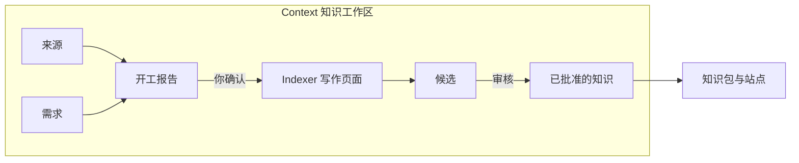

# 核心概念

<!-- context:section id="map" -->
## 概念之间的关系

所有内容都放在同一个 **Context 知识工作区**里。你登记**来源**、描述**需求**；Agent 在**开工报告**中提出要写什么；你确认后，**Indexer** 写出页面，以**候选**的形式提交；**审核**把它们收录为**已批准的知识**；构建再把这些知识产出为**知识包和站点**。下面的术语按同样的顺序介绍。工作流如何决定每一个下一步放在最后说明，入门时不需要了解。
<!-- /context:section -->

<!-- context:section id="workspace" -->
## Context 知识工作区

一个本地目录，通常提交到 Git，保存某一套知识的全部内容：

| 目录 | 存放内容 |
| --- | --- |
| `src/` | 来源、阶段和知识包的声明，以及 `indexers.yaml` 中的需求 |
| `sources/` | 已登记的来源和采集到的证据 |
| `knowledge/` | 已批准的知识和长期有效的决策 |
| `dist/` | 构建出的知识包（可复现，被 Git 忽略） |
| `.tmp/` | 可随时丢弃的运行时状态和报告（被忽略） |

`sources/`、`knowledge/`、`dist/` 和运行时状态都由 CLI 负责写入；只有当前步骤要求时，Agent 才会修改项目配置。每个目录和文件的说明见 [Context 知识工作区](knowledge-workspace.md)。
<!-- /context:section -->

<!-- context:section id="sources" -->
## 来源、采集、笔记与会话

**来源**是一条登记过的边界：一个仓库模块、一个本地文档目录或一篇在线文档。登记来源会记录它的身份和权限边界；它不决定要写哪些知识，也不授予读取边界之外内容的权限。**采集**把文档正文和资源保存为可审计的快照；仓库按固定提交读取，无需采集。

每个已批准的页面都会记录它所依据的来源版本，这个版本就是页面的**基线**。更新时，会把新的来源版本与基线比较，只修订受影响的页面，然后把基线前移；参见[更新知识](../../sop/updates-and-versions/updating-knowledge.md)。

**笔记**是整理过的摘录和观察；**会话**是保存下来的对话摘要。两者都直接导入，和其他来源一样成为证据；参见[笔记与会话摘要](../../sop/registering-sources/notes.md)。
<!-- /context:section -->

<!-- context:section id="indexers" -->
## 需求与 Indexer

`src/indexers.yaml` 中的**需求**记录了知识写给谁、必须回答哪些问题、授权使用哪些来源。**Indexer** 是 Agent Skill，每个读取一类来源并写出有来源依据的文章。Indexer 分为代码、文档、笔记和会话四类，每类可以有多个 Skill；Context 内置了一些，团队也可以自行创建。Agent 在规划时为每个任务挑选合适的 Indexer。详见[内置 Indexer](../../sop/custom-indexers/community-indexers.md)和 [Indexer 体系](../../architecture/knowledge/indexer-system.md)。
<!-- /context:section -->

<!-- context:section id="start-report" -->
## 开工报告与托管模式

开始实质性的新工作前，Agent 会调研有代表性的材料，并写一份**开工报告**：范围、将使用的 Skill，以及预计最先产出的页面。只有你确认后才开始写作。会改变范围的缺失信息会向你询问，而不是猜测。参见[确认开工报告](../../sop/planning-and-production/start-reports.md)。

在普通模式下，你还要审核拟定的结构和候选页面。如果你明确授权**全托管模式**，Agent 会执行可委托的审核决定并汇报结果；只能由人做的决定仍会停下来等你，开工报告也仍需你确认。参见[全托管模式](../../sop/planning-and-production/managed-mode-and-review-policy.md)。
<!-- /context:section -->

<!-- context:section id="candidates" -->
## 候选、审核与已批准的知识

Agent 写出的文章以**候选**的形式提交：它们是绑定了来源证据的草稿，并会检查覆盖度和过期输入。**审核**展示可读的标题、路径、摘要和内容；批准后，页面以长期保存的 Markdown 写入 `knowledge/`，拒绝则退回重写。被拒绝候选的状态只保存在临时的生命周期账本中；`knowledge/` 只存放已批准的页面。

一轮工作结束时，会**应用已批准的页面并重建产出**：已批准的页面写入 `knowledge/`，文章及其引用的记录随之刷新，你选定的知识包和站点重新构建，Agent 再把知识工作区提交到 Git。

已批准知识的每个小节都保留自己的**证据**，即指向来源确切位置的引用。它们共同构成[证据链](../../architecture/knowledge/evidence-chains.md)，让读者和 Agent 能够核实每一处陈述。有哪些文章和小节、每个小节引用了什么，都记录在 `knowledge/structure.yaml` 中，并在应用已批准页面时刷新。导航是另一回事：`src/knowledge-map.yaml` 中的**知识地图**决定站点如何分组和排序页面。在知识地图中移动页面不会改变它的 URL。
<!-- /context:section -->

<!-- context:section id="packages" -->
## 知识包与站点

**构建**把已批准的知识变成一种产出：Agent 知识包、文档站或 LLM 文档。每次构建都会生成一份清单，把分发出去的文件对应回知识工作区。详见[知识包与站点构建](../../architecture/context/packages-and-sites.md)。
<!-- /context:section -->

<!-- context:section id="route" -->
## 工作流如何选择下一步

在流程意外停下之前，你可以跳过这一节。CLI 观察知识工作区，并把结果记录为 **Facts**；对话中的说法不能作为完成的证据。工作流根据 Facts 选出一个 **Route**：当前要做的动作、为此要读的资源以及它的完成约定。**Gate** 会让 Route 暂停，等待需要人或更高权限做出的决定，例如确认开工报告或审核。正因如此，任务可以中断后再恢复：下一步是根据知识工作区重新计算的，而不是靠 Agent 记住。详见[工作流运行](../../architecture/context/workflow-execution.md)。
<!-- /context:section -->
