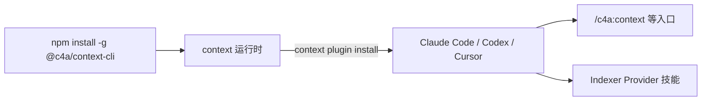

# 安装

<!-- context:section id="prerequisites" -->
## 准备工作

你需要：

- Node.js 20 或更高版本，以及 npm；
- 至少一个 Agent 宿主：Claude Code、Codex 或 Cursor；
- 对计划整理成知识的仓库和文档有读取权限。

Context 在你的本机运行。CLI 自身从不调用 LLM：阅读和写作由宿主中的 Agent 完成，CLI 负责确定性的工作，例如观察 Context 知识工作区、采集来源、索引代码、校验证据、应用审核结果和构建知识包。
<!-- /context:section -->

<!-- context:section id="install" -->
## 安装 CLI 和插件

```bash
npm install -g @c4a/context-cli@latest
context plugin install
```

第一条命令安装 `context` 运行时。第二条命令把 Agent 集成安装到它找到的所有受支持宿主中。完成后重启或刷新 Agent 宿主，让它加载新的入口。



全局安装会创建带命名空间的 Context 入口，同时以无命名空间的形式投影四个 Indexer Provider 技能——`context-code-indexer`、`context-markdown-indexer`、`context-note-indexer` 和 `context-sessions-indexer`——让每个宿主都能找到它们。安装 Provider 只是让它可被发现；具体用哪些 Provider，由工作流按任务选择。
<!-- /context:section -->

<!-- context:section id="entries" -->
## 安装后得到什么

| 入口 | 用途 |
| --- | --- |
| `/c4a:context` | 创建或继续知识工作区，执行生产、审核、更新和构建 |
| `/c4a:context-plan` | 在生产前分阶段规划大型项目 |
| `/c4a:context-inspect-search` | 基于知识包或知识工作区中已批准的知识提问，并附带来源 |
| `/c4a:context-repo-content` | 登记或编辑同仓库文档和自编 Skill，不启动生产 |

`/c4a:context` 是新建和已有知识工作区的生产入口；其他三个入口负责规划、回答或登记内容，并把生产交回给它。你不需要学习生命周期命令，用日常语言描述知识目标即可。普通的编码或设计对话不会自动启动 Context——需要显式调用它，或在进行中的 Context 对话里继续。[命令与技能](commands-and-skills.md)列出了全部入口、各宿主中的写法，以及无需调用即可运行的 Skill。
<!-- /context:section -->

<!-- context:section id="local" -->
## 只安装到单个仓库

如果不想改动全局配置，可以把入口只安装到某个仓库：

```bash
context plugin install --local /path/to/repo --agent auto-detect
```

`--local` 需要显式指定 `--agent`：

- `claude`、`cursor` 或 `codex` 分别安装到该仓库的 `.claude`、`.cursor` 或 `.agents` 目录；
- `all` 同时安装这三种布局；
- `auto-detect` 使用上述目录中已存在的那些，都不存在时回退到 `.agents/skills`；
- `standalone` 把所有技能直接写入 `<path>/skills`，不包含命令。

每种模式都支持 `--dry-run`。刷新时只替换未被修改过的托管文件；被自定义过的入口会保留，并作为冲突报告出来。本地安装的入口没有插件命名空间。
<!-- /context:section -->

<!-- context:section id="verify" -->
## 检查安装结果

```bash
context --version
context plugin status
```

`context plugin status` 检查全局宿主。然后打开 Agent，调用 `/c4a:context`。如果入口存在但缺少 `context` 可执行文件，入口会给出确切的安装步骤并停止，而不会只初始化一半知识工作区。

下一步：[快速开始](quick-start.md)。
<!-- /context:section -->
