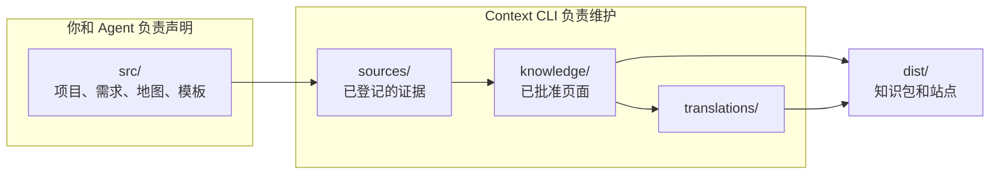

# Context 知识工作区

<!-- context:section id="goal" -->
**Context 知识工作区**是 Context 存放一套知识的目录：其中包括知识的声明、已登记的来源、已批准的页面，以及由这些页面构建出的产物。它由 `context init` 创建，其中的 `package.json` 把它标记为 Context 项目。它通常是一个独立的 Git 仓库，或者项目仓库中的一个目录。

与这套知识有关的一切都保存在这里，而不是对话里。请在这个目录下运行 Context 命令：Route 路径和 `.tmp/` 都属于这个知识工作区，而不属于外层仓库或父目录。


<!-- /context:section -->

<!-- context:section id="tree" -->
## 目录结构

在刚执行完 `context init`、并完成最初几次交付之后，知识工作区的结构如下：

```text
my-knowledge/
├── package.json            # version and context.project marker
├── AGENTS.md               # rules for Agents working here
├── README.md
├── .gitignore
├── src/
│   ├── index.ts            # sources, capture phases and packages
│   ├── indexers.yaml       # reader purpose and authorized sources
│   ├── knowledge-map.yaml  # navigation for sites and LLM Docs
│   ├── package-templates/  # templates for each package kind
│   └── site/               # optional website customization
├── sources/
│   ├── repo/index.yaml     # repository sources: remote, commit, modules
│   ├── file/               # local document sources and snapshots
│   ├── lark/               # Lark document sources and snapshots
│   ├── note/YYYYMMDD/      # saved notes
│   └── sessions/YYYYMMDD/  # saved conversation summaries
├── knowledge/
│   ├── <collection>/…      # approved Markdown pages
│   └── structure.yaml      # page identities, sections and source references
├── translations/<locale>/  # translated pages and navigation titles
├── changelog.yaml          # knowledge version history
├── CHANGELOG.md            # generated from changelog.yaml
├── dist/                   # built packages and sites
└── .tmp/                   # runtime state, reports, Agent scratch
```

有些文件只有在你用到对应功能时才会出现：`imports.yaml`、`repo-content.yaml` 及其 `repo-content/` 视图、`context-evidence.sourcegraph.wasm`，以及规划项目期间的 `PLAN-*.md`。下文会逐一介绍。
<!-- /context:section -->

<!-- context:section id="ownership" -->
## 谁写入什么，Git 保留什么

| 路径 | 写入方 | 是否进入 Git |
| --- | --- | --- |
| `package.json`、`AGENTS.md`、`README.md` | 由 `context init` 创建；版本号由 CLI 更新 | 是 |
| `src/index.ts`、`src/indexers.yaml`、`src/package-templates/`、`src/site/` | 你或 Agent，仅在当前 Route 要求修改配置时 | 是 |
| `src/knowledge-map.yaml` | CLI，依据 Agent 提交的导航调整 | 是 |
| `sources/` 中的登记信息、快照、笔记和摘要 | CLI | 是——但 `sources/repo/` 下的仓库检出除外，它们会根据 `index.yaml` 恢复 |
| `knowledge/` | CLI，在你批准一次 Review 时 | 是 |
| `translations/`、`changelog.yaml`、`CHANGELOG.md` | CLI，依据 Agent 写好的翻译和变更说明 | 是 |
| `dist/` | `context build` | 否——可重新生成 |
| `.tmp/` | CLI 和 Agent | 否——仅用于运行时 |

`sources/` 和 `knowledge/` 是这套知识的持久状态；`dist/` 随时可以由它们重新构建。只有在你的任务获准执行 Git 操作时，才提交知识工作区。
<!-- /context:section -->

<!-- context:section id="growing" -->
## 随知识增长而出现的文件

- **`src/knowledge-map.yaml`** 是持久的知识地图。它组织网站导航和 LLM Docs，但不改变页面身份，并在每次交付后保留。参见[大规模重组](../../sop/review-and-revision/reorganizing-at-scale.md)。
- **`translations/<locale>/`** 为每个已批准页面保存一个翻译文件，另有一个存放导航标题译文的 `knowledge-map.yaml`。翻译属于正式内容：它们计入版本，并随站点一起打包。
- **`changelog.yaml` 和 `CHANGELOG.md`** 会在每次交付记录版本时，与 `package.json.version` 一起更新。参见[版本与 Changelog](../../sop/updates-and-versions/versions-and-changelog.md)。
<!-- /context:section -->

<!-- context:section id="linked" -->
## 用于关联内容的文件

- 根目录下的 **`imports.yaml`** 声明外部入口——页面可以链接到的其他位置的内容——但不会下载或采集它们。参见[外部入口](../../sop/registering-sources/external-entrances.md)。
- **`repo-content.yaml`** 登记位于同一仓库中的文档和自编 Skill；**`repo-content/`** 是它们的符号链接视图，原文件保持原位不动。参见[同仓库文档](../../sop/registering-sources/same-repository-docs.md)。
- **`context-evidence.sourcegraph.wasm`** 是一个用于远程读取代码证据的可选插件。它由 `context evidence install` 维护；查询过程从不会自行安装它。参见[远程读取代码证据](../../sop/querying-knowledge/reading-code-evidence-remotely.md)。
<!-- /context:section -->

<!-- context:section id="runtime" -->
## 运行时与临时空间

| 路径 | 存放内容 |
| --- | --- |
| `.tmp/context-runtime/` | 未完成的工作流状态：生产阶段、候选、审核报告、Route |
| `.tmp/agent-payloads/` | Agent 准备的命令输入，例如翻译 |
| `.tmp/install/` | 安装依赖时使用的临时文件 |
| `.tmp/context-plans/<date-slug>/` | 规划项目的调研材料：`repos/`、`documents/`、`research/`、`stage-inputs/` |

`.tmp/context-runtime/` 并不是进度的唯一记录。交付成功后，CLI 会移除已完成任务的状态，而已批准的知识连同 `structure.yaml` 会保留后续更新所需的信息。它不存在，绝不意味着已接受的工作可以重放。规划项目还会在 Git 根目录保留 `PLAN-YYYYMMDD-slug.md`，并提交到 Git，以便工作可以恢复；参见[规划大型项目](../../sop/planning-and-production/planning-large-projects.md)。
<!-- /context:section -->

<!-- context:section id="rules" -->
## 保持健康的规则

- **不要手动编辑 CLI 管理的状态。** `sources/`、`knowledge/`、`dist/` 和 `.tmp/context-runtime/` 只能通过 Context 命令修改。要修改页面，请申请[修订](../../sop/review-and-revision/revising-a-page.md)。
- **每个目录只有一个知识工作区。** 不要创建隐藏的第二个知识工作区，也不要把修订、任务或 `.tmp/` 文件与同样是知识工作区的父目录混在一起。
- **通过 Route 修复。** 发现异常时，按当前 Route 返回的恢复动作处理，而不是删除运行时文件。

下一步：[命令与技能](commands-and-skills.md)列出了你可以在这个知识工作区中调用的内容，[核心概念](core-concepts.md)则说明各部分之间的关系。
<!-- /context:section -->
