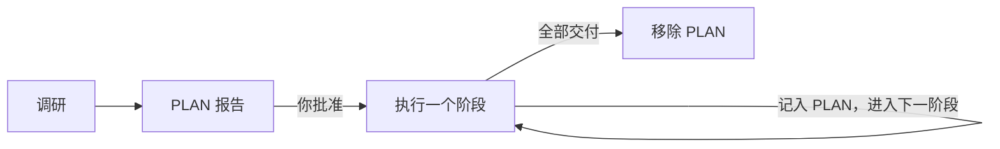

# 复杂任务

<!-- context:section id="threshold" -->
## 什么算大型任务

当任务范围包含**超过 30 份来源文档，或至少两个需要深入调研的仓库**时，应分阶段规划。可以显式使用 `/c4a:context-plan`，也可以在已授权的任务超过这一阈值时，由 `/c4a:context` 入口自动转交给它。新启动的知识项目如果范围仍需调研，同样适合先做计划。

对于跨多个领域的超大型 monorepo，按方向各建一个 Context 知识工作区，往往比只用一个知识工作区效果更好。
<!-- /context:section -->

<!-- context:section id="plan" -->
## PLAN 报告

规划会在项目的 Git 根目录生成一份 `PLAN-YYYYMMDD-slug.md` 报告。它盘点来源，梳理与已有知识的重叠部分，并把工作划分为若干阶段。在任何生产开始之前，你需要先审核第一份报告。

批准 PLAN 并不等于批准任何文章。每个阶段仍会走常规工作流，有各自的开工报告和内容审核。[规划大型项目](../../sop/planning-and-production/planning-large-projects.md)逐一介绍了报告的各个部分、如何审核以及如何恢复。
<!-- /context:section -->

<!-- context:section id="limits" -->
## 阶段规模

| 边界 | 建议 |
| --- | --- |
| 每阶段来源文档数 | 30 份，最多 50 份（超过 30 份的分组需在 PLAN 中说明理由） |
| 每阶段新调研的仓库数 | 1 个 |
| 修订阶段的目标文章数 | 30 篇 |
| 范围超过 100 份文档 | Agent 会与你确认，有限范围的调研能否得到有用的范围 |
| 范围超过 500 份文档 | 整个任务暂停，直到有人确认范围 |

这些是规划上的边界，而不是 CLI 的门禁。每个阶段结束后，Agent 会把实际的调研、生产、审核和交付结果记录到 PLAN 中并提交，然后才开始下一阶段。
<!-- /context:section -->

<!-- context:section id="steer" -->
## 尽早纠偏

在大型任务中，开工报告和第一批变更页面一出来就要预览。如果措辞、示例或风格不对，请结合反例指出。第一阶段做出的纠正会延续到之后的所有阶段；纠正得越早，最终质量越高。

如果会话中断，PLAN 中记录了确切的位置和下一步动作，新对话可以接着同一阶段继续。
<!-- /context:section -->
