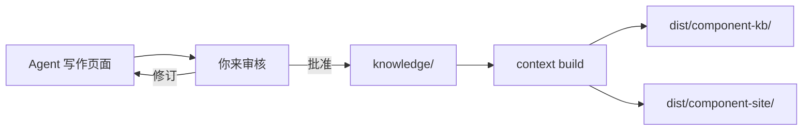

# 快速开始

<!-- context:section id="goal" -->
本教程把一个代码模块和一个本地文档目录整理成经过审核的知识包，并附带可浏览的站点。你用自然语言下达指令，Agent 执行工作流返回的命令。下文列出的命令都是 Agent 代你执行的，方便你在它的进度消息中认出它们。

请先完成[安装](installation.md)，并重启 Agent 会话以加载插件。
<!-- /context:section -->

<!-- context:section id="init" -->
## 1. 创建知识工作区

告诉 Agent Context 知识工作区放在哪里、用来做什么：

```text
/c4a:context 请在 ./context 创建一个 Context 知识工作区，整理我们的组件库和产品文档。
读者是刚开始使用这个组件库的前端开发者。
```

Agent 会初始化目录并安装依赖：

```bash
context init ./context
cd ./context
bun install
context status --format json
```

得到的目录结构如下：

```text
context/
├── AGENTS.md       # 给 Agent 的使用说明
├── src/            # 来源、阶段和知识包声明
├── sources/        # 已登记的来源和采集到的证据
├── knowledge/      # 已审核的知识（目前为空）
├── dist/           # 构建后的知识包（Git 忽略）
└── .tmp/           # 运行状态和报告（Git 忽略）
```
<!-- /context:section -->

<!-- context:section id="register" -->
## 2. 指定来源

说明要用哪些材料，以及 Agent 应该跳过什么：

```text
代码请使用 ../component-lib，产品文档使用 ../docs。
已经废弃的 v1 文件夹就不纳入了。
```

Agent 会逐一登记每个边界。登记只记录范围内有哪些内容，并不决定要写什么。

```bash
context source add repo 20260901 --module component-lib --local ../component-lib --configure
context source add file 20260901 --module product-docs --local ../docs --configure
```

对于 monorepo，挑出读者真正需要的包或服务即可。无关材料会浪费阅读时间和 token，但也不要仅因为文件名看起来旧就把它排除。
<!-- /context:section -->

<!-- context:section id="plan" -->
## 3. 确认开工报告

Agent 会阅读有代表性的材料，就可能改变范围的问题向你确认，把读者目标记录到 `src/indexers.yaml`，然后给出一份**开工报告**，包括：

- 已确认的来源和范围；
- 将使用的 Indexer 技能；
- 预计产出的第一批页面，以及它们在站点中的位置。

在你批准报告之前，不会写入任何内容。如果计划不对，直接说要改什么——例如“合并两个 API 页面”或“增加一个故障排查页面”——Agent 会据此修订。
<!-- /context:section -->

<!-- context:section id="produce" -->
## 4. 让它写作，然后审核

批准后，Agent 逐页写作，引用精确到来源行，并提交检查覆盖度和过期输入。

写作完成后，你会收到一份审核报告，列出每个页面的标题、路径、摘要和内容。你可以批准、拒绝部分页面，或要求修订。批准的页面以 Markdown 形式落入 `knowledge/`；被拒绝或要求修订的页面回到写作环节。


<!-- /context:section -->

<!-- context:section id="build" -->
## 5. 构建知识包和站点

对于新的知识工作区，Agent 默认会建议构建一个知识包加一个网站。`src/index.ts` 中的知识包声明如下：

```ts
kbPackage({
  name: "component-kb",
  template: "src/package-templates/kb",
  site: { title: "Component knowledge", lang: "en-US", base: "/" },
});
```

随后 `context build` 会产出供 Agent 使用的 `dist/component-kb/`，以及供人阅读的 `dist/component-site/`——一个包含文章页面和本地搜索的静态站点。把知识工作区提交到 Git，以便之后检查、做版本管理和刷新。
<!-- /context:section -->

<!-- context:section id="next" -->
## 下一步

- 用 `/c4a:context-inspect-search` 基于新知识包提问。
- 代码或文档变化时，告诉 `/c4a:context` 改了什么；它只会重新打开受影响的页面。
- 范围更大时，请阅读[复杂任务](large-projects.md)。
- 所有可调用的入口，以及会自行运行的 Skill，见[命令与技能](commands-and-skills.md)。
<!-- /context:section -->
