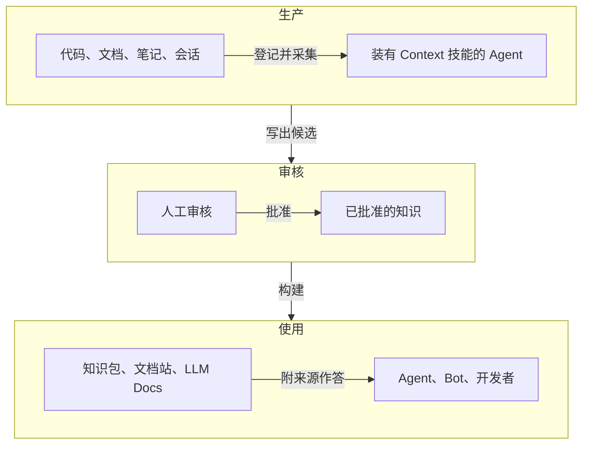

# Context 是什么

<!-- context:section id="definition" -->
Context 是面向研发团队及其 AI Agent 的知识工作流。它把代码仓库、文档、笔记和会话转化为经过审核、带版本的知识，其中每一条论述都能追溯到来源；再把这些知识构建成 Agent 知识包、文档站和 LLM 文档。

你只需说明需要什么知识、材料在哪里；然后 Agent 负责阅读证据、提出结构并解释决策；Context 则约束 Agent 一步步按照技能里描述的流程与标准 —— 记录来源边界、检查证据覆盖、暂存可审核的候选、保留出处、验证已批准的结果，最终构建出你选择的产物。在回答问题时，Agent 先读这些知识，只有需要精确细节时才沿证据链回到原文。
<!-- /context:section -->

<!-- context:section id="overview" -->
## 整体如何运作

下图展示了从原始材料到提问的人和 Agent 的完整路径。

Context 不是一次性的摘要工具。来源快照、审核状态、已批准的知识和知识包清单都保存在本地的 Context 知识工作区中，因此结果可以检查、做版本管理，并在来源变化时刷新。
<!-- /context:section -->

<!-- context:section id="pillars" -->
## 有何不同

- **带证据链的索引，而不是照搬原文。** Indexer 只保留能回答读者问题的内容，并记录每条论述的出处。在一个大型生产 monorepo 中，约 202 MB 的代码和文档最终变成约 1.75 MB 已批准的知识，约为源材料体量的 1/115。参见 [写给 Agent 的知识](../../architecture/knowledge/knowledge-for-agents.md) 和 [证据链与索引优先](../../architecture/knowledge/evidence-chains.md)。
- **技能和 CLI 就在你正在使用的 Agent 里。** Context 本身不调用 LLM，也不是托管平台。它的技能运行在 Claude Code、Codex、Cursor 或托管 Agent 中，确定性的工作由本地 CLI 完成。参见 [为什么是工作流](../../architecture/context/why-a-workflow.md)。
- **发布前必须审核。** 目标、来源授权、结构和审核决策都由人来定；草稿只有通过审核才会成为已批准的 Markdown。参见 [知识生命周期](../../architecture/context/knowledge-lifecycle.md)。
- **知识随来源保持更新。** 来源会固定版本，之后的变更只会重新打开受影响的页面。参见 [知识的持续更新](../../architecture/knowledge/keeping-knowledge-current.md)。
- **一份知识，多种产物。** 同一批已批准的页面可以构建出 Agent 知识包、文档站和 LLM Docs，每种产物都通过构建清单映射回知识工作区。参见 [知识包与站点构建](../../architecture/context/packages-and-sites.md)。
<!-- /context:section -->

<!-- context:section id="who" -->
## 适合谁

当知识已经存在、但还不能直接给 Agent 使用时，Context 就能派上用场。它的主要优势是帮助团队从已有的文档和仓库代码出发，逐步建立系统化的知识，从无到有形成一套完整的知识库；它适合需要随代码长期演进的知识。典型需求包括：

- 把产品、架构、运维或 FAQ 文档整理成便于浏览的知识库；
- 把代码结构和解释性文档关联起来，同时保留精确的来源证据；
- 把多个仓库和多套文档合并成一个经过审核的知识包；
- 在来源变化时更新已有的知识工作区，而不必全部重建。

在来自一个大型生产 monorepo 的 24 个真实开发者问题上，结合 Context 知识与 Source Graph 的 Agent，比阅读 LLM Wiki（由 LLM 一次性生成、Agent 在本地检索阅读的 Wiki）的 Agent 完全解决了更多问题，用时不到一半，估算成本约为九分之一。仅使用 Context 并在本地检索时，同样解决了更多问题，而且工具调用次数少得多。参见 [知识检索测评](../../architecture/benchmark/knowledge-retrieval.md)。
<!-- /context:section -->

<!-- context:section id="companions" -->
## Source Graph 与 Agent Graph

工作流中的部分环节由两个配套项目承担。入门时两者都不是必需的。

- **Source Graph** 通过网页、MCP、HTTP 和 CLI，在固定提交上搜索和阅读仓库。Context 提供一个可选的证据插件：Agent 通过 Source Graph 阅读代码时，也能同时拿到所读知识章节的来源，无需克隆仓库。参见 [Source Graph 概览](../../architecture/source-graph/overview.md) 和 [远程读取代码证据](../../sop/querying-knowledge/reading-code-evidence-remotely.md)。
- **Agent Graph** 是 Context 工作流底层的一层，它根据 Context 在知识工作区中观察到的事实选出每一个下一步，从而让漫长的工作流可以中断恢复、可以测试。参见 [为什么是 Graph Engineering](../../architecture/agent-graph/why-graph-engineering.md) 和 [工作流运行](../../architecture/context/workflow-execution.md)。
<!-- /context:section -->

<!-- context:section id="delivery" -->
## 如何获取

Context 以 npm CLI（`@c4a/context-cli` 提供的 `context`）加 Agent 插件的形式交付。两者只需安装一次，重启 Agent 会话后，用自然语言向 `/c4a:context` 入口描述你的知识目标即可。一轮结束时，你会在知识工作区中得到已批准的 Markdown 页面（由 Agent 提交到 Git），以及由它们构建的知识包和文档站。

接下来先读 [工作流概览](workflow-at-a-glance.md)，再读 [安装](installation.md) 和 [快速开始](quick-start.md)。
<!-- /context:section -->
