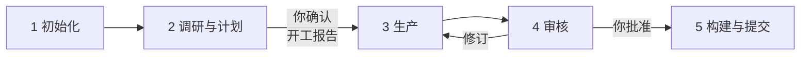

# 工作流概览

<!-- context:section id="steps" -->
## 五个步骤

安装之前先读这一页，了解一个 Context 任务是什么样子。安装事先在每台机器上完成一次即可（见[安装](installation.md)）；之后的每个任务——无论只涉及一套文档还是多个仓库——都遵循相同的五个步骤。你和 Agent 对话；Agent 按 CLI 返回的工作流执行。

| 步骤 | 你要做的 | 发生了什么 |
| --- | --- | --- |
| 1 初始化 | 让 `/c4a:context` 在某个目录创建 Context 知识工作区 | CLI 创建知识工作区，以及 `AGENTS.md` 中的指引 |
| 2 调研与计划 | 描述所需知识、来源和预期形态，并回答 Agent 的问题 | Agent 登记来源、展开调研，并给出**开工报告**：已确认的配置与范围、计划内容，以及预期的知识包或站点结构——**你的第一个决定** |
| 3 生产 | 等待，或随时要求本地预览 | Agent 撰写绑定来源证据的文章，并按任务数汇报进度 |
| 4 审核 | 阅读审核报告，选择批准、拒绝或要求修订——**你的第二个决定** | 已批准的页面成为 `knowledge/` 下持久保存的 Markdown |
| 5 构建与提交 | 确认知识包及其他产物 | Context 验证并构建；Agent 把知识工作区提交到 Git |

[快速开始](quick-start.md)用示例请求逐步演示了每个步骤。
<!-- /context:section -->

<!-- context:section id="loop" -->
## 随时可以中断和恢复

每一步都根据知识工作区的实际状态选出，而不是根据对话内容。每次动作之后，CLI 都会重新观察知识工作区，返回当前步骤、必读内容和确切命令。即使关闭对话，之后再调用 `/c4a:context`，也会从工作实际所处的位置继续。参见[工作流运行](../../architecture/context/workflow-execution.md)。
<!-- /context:section -->

<!-- context:section id="durations" -->
## 预期耗时与 Token 消耗

生产是耗时最长的一步：平均每个写作任务约一分钟。想在浏览器里查看页面时，随时可以要求预览。开工报告和审核报告是你的判断对结果影响最大的两个时刻；指南中关于审核的章节说明了需要关注什么。

Token 消耗的经验值：约 200 篇文档的知识库，输入约 600M tokens（约 97% 命中缓存），输出约 6M tokens。按 Opus 5.5 API 计费，平均每篇文档 1–2 美元。这是首次建立知识库的预估成本；如果使用订阅额度（例如 Claude 或 GPT 的 Max 20 档），成本可降至约 20%。按实践经验，可以先在本地完成首次建立并推送知识仓库，后续的新增和迭代再在远程进行。知识库建立后，每次更新一个页面约 0.1–0.2 美元，回答一个问题平均约 0.2–0.3 美元；回答成本的对比见[知识检索测评](../../architecture/benchmark/knowledge-retrieval.md)。
<!-- /context:section -->

<!-- context:section id="lanes" -->
## 生产、更新与提问

上述五个步骤描述的是首轮生产。另有两条路径复用同一个知识工作区：

- **更新。** 构建只是完成当前已批准的状态，并不会冻结知识工作区。来源变化时，新一轮只重新打开受影响的知识。参见[知识的持续更新](../../architecture/knowledge/keeping-knowledge-current.md)。
- **提问。** `/c4a:context-inspect-search` 基于知识包或知识工作区中已批准的知识回答问题，并把每个答案追溯到来源。

下一步：[安装](installation.md)。
<!-- /context:section -->
