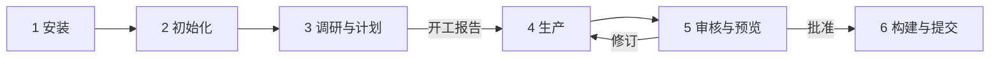

# 工作流概览

<!-- context:section id="steps" -->
## 六个步骤

无论只涉及一套文档还是多个仓库，Context 任务都遵循相同的六个步骤。你和 Agent 对话；Agent 按 CLI 返回的工作流执行。

| 步骤 | 你要做的 | 发生了什么 |
| --- | --- | --- |
| 1 安装 | 一次性安装 CLI 和插件 | 入口出现在 Agent 宿主中；参见[安装](installation.md) |
| 2 初始化 | 让 `/c4a:context` 在某个目录创建 Context 知识工作区 | CLI 创建 `src/`、`sources/`、`knowledge/`，以及 `AGENTS.md` 中的指引 |
| 3 调研与计划 | 描述所需知识、来源和预期形态，并回答 Agent 的问题 | Agent 登记来源、展开调研，并给出**开工报告**：已确认的配置与范围、计划内容，以及预期的知识包或站点结构 |
| 4 生产 | 等待，或随时要求本地预览 | Agent 撰写绑定来源证据的文章，并按任务数汇报进度 |
| 5 审核与预览 | 阅读审核报告，选择批准、拒绝或要求修订 | 已批准的候选成为 `knowledge/` 下持久保存的 Markdown |
| 6 构建与提交 | 确认知识包及其他产物 | Context 验证并构建；Agent 把知识工作区提交到 Git |
<!-- /context:section -->

<!-- context:section id="durations" -->
## 预期耗时

生产是耗时最长的一步：平均每个写作任务约一分钟。想在浏览器里查看页面时，随时可以要求预览。开工报告和审核报告是你的判断对结果影响最大的两个时刻；指南中关于审核的章节说明了需要关注什么。
<!-- /context:section -->

<!-- context:section id="lanes" -->
## 生产、更新与提问

上述六个步骤描述的是首轮生产。另有两条路径复用同一个知识工作区：

- **更新。** 构建只是完成当前已批准的状态，并不会冻结知识工作区。来源变化时，新一轮只重新打开受影响的知识。参见[知识的持续更新](../../architecture/knowledge/keeping-knowledge-current.md)。
- **提问。** `/c4a:context-inspect-search` 基于知识包或知识工作区中已批准的知识回答问题，并把每个答案追溯到来源。
<!-- /context:section -->

<!-- context:section id="loop" -->
## 为什么可以随时中断和恢复

每一步都根据知识工作区的实际状态选出，而不是根据对话内容。每次动作之后，CLI 都会重新观察知识工作区，返回当前步骤、必读内容和确切命令。即使关闭对话，之后再调用 `/c4a:context`，也会从工作实际所处的位置继续。参见[工作流运行](../../architecture/context/workflow-execution.md)。
<!-- /context:section -->
