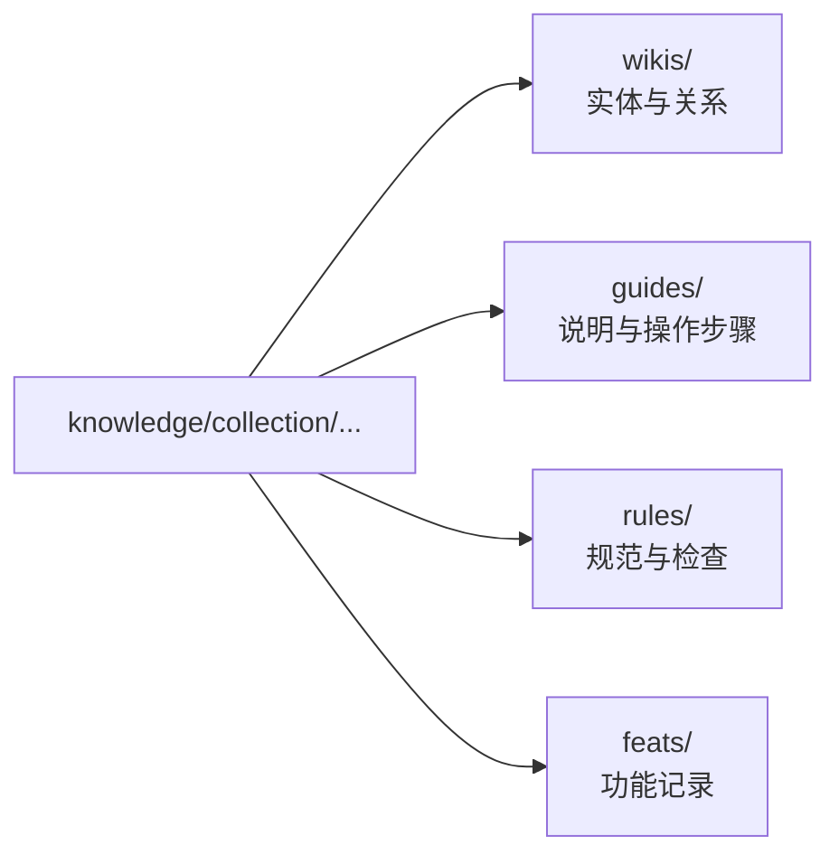

# 知识分类

<!-- context:section id="goal" -->
`knowledge/` 中每篇已批准的文章都位于某个**知识分类**之下——即其路径的第一级目录，例如 `knowledge/sop/…`。知识分类说明这篇文章服务于哪类阅读需求。构建时，它决定文章进入哪个包根目录，包的 `select.collections` 也按它来过滤。

<!-- /context:section -->

<!-- context:section id="table" -->
## 分类一览

| 知识分类 | 内容 | 包内路径 | OKF 类型 |
| --- | --- | --- | --- |
| `codeindex` | 有源码依据的代码索引，可附带结构化关系 | `wikis/codeindex/` | Wiki |
| `business` | 结构化的业务实体与关系 | `wikis/business/` | Wiki |
| `product` | 结构化的产品实体、行为与关系 | `wikis/product/` | Wiki |
| `architecture` | 架构说明与设计叙述 | `guides/architecture/` | Guide |
| `sop` | 操作流程与运维手册 | `guides/sop/` | Guide |
| `faq` | 以问题为导向的解释与故障排查 | `guides/faq/` | Guide |
| `decision` | 决策记录与权衡分析 | `guides/decision/` | Guide |
| `incident` | 事故时间线、响应与后续跟进 | `guides/incident/` | Guide |
| `standards` | 规范性标准与约束 | `rules/standards/` | Rule |
| `test` | 验证规则、场景与验收检查 | `rules/test/` | Rule |
| `feats` | 功能能力记录 | `feats/` | Feature |

`codegraph` 作为代码索引分类的旧名称仍被接受，并与 `codeindex` 一样映射到 `wikis/`。
<!-- /context:section -->

<!-- context:section id="roots" -->
## 包根目录的含义

- **`wikis/`** 是结构化的实体与关系层，也是知识包必需的默认入口，从 `wikis/index.md` 开始。
- **`guides/`** 和 **`rules/`** 用于解释、落地或约束这些知识。把文章放在这里并不会与任何内容建立关系；只有 Context 记录的类型化边才会。
- **`feats/`** 存放功能记录。

除了知识分类，知识包还可以用 `select.okfRoots` 选择根目录；见[包模板](./package-templates.md)。
<!-- /context:section -->

<!-- context:section id="choose" -->
## 如何选择知识分类

Indexer 根据读者的需求而不是来源类型来建议知识分类：同一份文档可以成为 `sop` 中的运维手册、`decision` 中的决策记录，或 `standards` 中的规范。常见的对应关系：

| 读者需求 | 合适的形式 |
| --- | --- |
| 理解某个术语、边界或业务规则 | 带范围和示例的领域说明 |
| 理解架构或集成方式 | 技术说明、契约与限制 |
| 完成一项可重复的任务 | 包含前置条件、操作和检查的指南 |
| 诊断或恢复 | 包含症状、安全操作和验证的运维手册 |
| 理解某个选择 | 决策、备选方案、理由与后果 |
| 从事故中学习 | 影响、观察、原因与响应 |
| 解读一项测试 | 方法、范围以及结果能证明什么 |

之后你可以用 `context revise <target> --move-to <path>` 把已批准的文章移到其他知识分类，文章标识保持不变。
<!-- /context:section -->

<!-- context:section id="reserved" -->
## 保留名称

`index.md` 保留给包入口索引和目录索引使用。来源文档可以叫 `index.md`，但文章必须换个名字，例如 `index-page.md`；如果复制进来的知识会占用 `wikis/**/index.md`，`context build` 会拒绝构建。
<!-- /context:section -->
