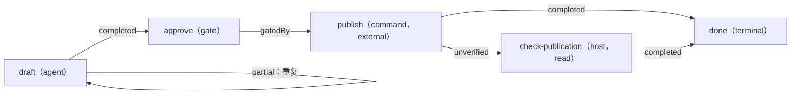

# 编写 Graph

<!-- context:section id="design" -->
从稳定的工作模型出发，而不是从一串命令出发：

1. 找出宿主实际能观察到的 Facts。
2. 定义合法的 Action 及其 effect。
3. 说明什么能证明每个 Action 已完成。
4. 在涉及授权的地方加入用户 Gate。
5. 把失败、部分完成、校验和恢复都显式表达出来。
6. 只把长篇说明挂到需要它们的 Route 上。
7. 为重要的状态和选择编写 Graph 测试。
8. 把一个或多个轻量 Skill 绑定到 Graph 和 Entry。

不要把旧 Skill 的每一段都变成节点。节点是可独立执行、受 Gate 控制、可恢复或可测试的状态转换；辅助说明仍作为 Resource。模块名、文档 ID、日期和队列条目仍是 Facts——由一个稳定的 Host Action 解析当前目标，而不是让 Provider 为每个条目生成一个节点。
<!-- /context:section -->

<!-- context:section id="layout" -->
## 项目结构

目录名只是约定，不属于协议。所有引用都相对于 Provider 清单，加载器会拒绝任何逃出 Provider 根目录的路径。

```text
provider.yaml   Provider ID, version, Graph list, optional Code Catalog
graphs/         Graph definitions
actions/        Action contracts
skills/         Agent Skills used by agent Actions
resources/      Procedures, templates, schemas, dynamic view descriptors
schemas/        Action input and output schemas
tests/          Graph tests (not shipped in the bundle)
```
<!-- /context:section -->

<!-- context:section id="example" -->
## 完整示例：周报

这个示例会起草一份周报、请求批准、发布周报，并在发布步骤声称成功却没有证据时检查发布结果。它在 `@c4a/agent-graph@0.3.0` 下通过校验，七个测试全部通过。



```yaml
schema: agent-graph.graph.v1
id: report
entrypoints:
  default: draft
nodes:
  - id: draft
    kind: action
    reasonCode: route.report.draft
    action: actions/draft.yaml
    resources:
      required: [resources/procedure.md]
    satisfiedBy:
      - path: report.digest
        exists: true
  - id: approve
    kind: gate
    reasonCode: route.report.approval-required
    gate:
      id: report-approval
      prompt: Publish this report?
      authority: report.publish
      delegatable: true
    satisfiedBy:
      - path: report.approved
        equals: true
  - id: publish
    kind: action
    reasonCode: route.report.publish
    action: actions/publish.yaml
    satisfiedBy:
      - path: publication.url
        exists: true
  - id: check-publication
    kind: action
    reasonCode: route.report.check-publication
    action: actions/check-publication.yaml
  - id: done
    kind: terminal
    join: any
    terminalOutcome: completed
edges:
  - { from: draft, to: draft, kind: repeat, outcomes: [partial] }
  - { from: draft, to: approve }
  - { from: approve, to: publish, kind: gatedBy }
  - { from: publish, to: done }
  - { from: publish, to: check-publication, outcomes: [unverified] }
  - { from: check-publication, to: done }
```

每个 Action 和 Gate 都有一个以 `route.` 开头的 `reasonCode`；由于这个 Provider 声明了 Code Catalog，这些原因码也必须全部出现在 `codes.yaml` 中，否则校验会以 `route-reason-code-missing` 失败。`done` 使用 `join: any`，因为有两条备选路径都会到达它。
<!-- /context:section -->

<!-- context:section id="actions" -->
## Action

```yaml
# actions/publish.yaml
schema: agent-graph.action.v1
id: publish
runner: command
effect: external
command: ./scripts/publish-report.sh
```

| Runner | 必填字段 | Route 返回什么 |
| --- | --- | --- |
| `command` | `command` | 确切的 shell 命令 |
| `script` | `entry`、`runtime`，可选 `args` | 运行时以及安装后入口的绝对路径 |
| `agent` | `skill` | 作为必需文件资源的 Skill |
| `host` | `handler` | 由宿主定义的 handler 标识 |

runner 字段相互排斥，因此宿主不会以两种方式解读同一个 Action。`effect` 为必填：`read`（不应改变生命周期 Facts）、`write`（本地修改）或 `external`（外部状态可能改变——通常放在 Gate 之后）。`cwd` 默认为 `workspace`，也可设为 `provider`；`inputSchema`、`outputSchema` 和 `files` 会随 Action 一起打包。Agent Graph 只解析 Action，不会自动执行；由宿主执行，然后刷新 Facts 并重新评估。
<!-- /context:section -->

<!-- context:section id="facts" -->
## 依据 Facts，而非历史

`satisfiedBy` 用来证明节点已完成。检查条件是一个受限的数据模型：一个点分 `path`（数字段用于索引数组，如 `artifacts.0.digest`），加上 `exists` 或 `equals` 二者之一，取值为标量。没有表达式语言。

- 即使没有 Run 记录，只要 Facts 匹配，节点就算完成——在示例中，当 `report.digest` 已存在时，`draft` 会被跳过。
- 记录了 `completed` 但 Facts 不匹配时，会变成 `unverified`；示例把这种情况路由到 `check-publication`。
- `requiresFacts` 让节点只在当前外部状态下才合法；要决定适用哪个选项，应使用它，而不是 `priority`。

当证据有生命周期时，把它放在普通的嵌套 Facts 中，例如 `{digest, sourceRevision, available, fresh}`，并只检查让它可信的那些字段。每个 Fact 都会参与 Evaluation 修订号（revision）的计算，因此宿主应在应用自己的时钟或租约后发布 `fresh: false` 这样的稳定状态，而不是不断变化的轮询时间戳。当 `missing`、`unavailable`、`stale` 和显式的 `false` 需要不同的恢复 Route 时，要把它们区分开。

为了避免生产者自己校验自己的工作，可以另加一个 `effect: read` 的 Host Action，其 `satisfiedBy` 要求一份校验回执；宿主把它绑定到一个独立授权的校验方。
<!-- /context:section -->

<!-- context:section id="edges" -->
## 边与循环

边匹配显式的 Outcome；省略 `outcomes` 即表示 `[completed]`。边类型只记录意图，不改变可达性：

| 类型 | 适用场景 |
| --- | --- |
| `flow` | 普通转换（默认） |
| `consumes` | 目标消费源节点产出的内容 |
| `requires` | 源节点是目标的前置条件 |
| `gatedBy` | 由 Gate 解决目标的策略边界；必须从 Gate 出发 |
| `repeat` | 匹配的 Outcome 会重新激活某个 Action 或 Gate |

边不携带数据。通过宿主持久化输出，并把引用、摘要或回执作为 Facts 发布。普通边必须无环：在示例中加入一条 `failed` 时的 `publish → draft`，会以 `graph-flow-cycle` 被拒绝，并提示“use a repeat edge”。`repeat` 边就是显式循环——Agent 完成一轮，记录 `partial`，重新评估后得到同一个 Action，直到记录下其他结果。扇出和扇入只描述可达性；不会有任何东西并行执行。
<!-- /context:section -->

<!-- context:section id="gates" -->
## Gate 与委托

没有指定的授权时，Gate Route 处于 `waiting-user`，`commandPlan` 为空。如果当前输入或 Run 中带有 `delegatable` 授权，它就会变为可执行，且 `resolution: session-authority`。授权永远不能满足 Facts；在示例中，仍必须观察到 `report.approved`，`publish` 才会变为合法。

Gate 可以额外添加三个可选契约：

```yaml
inspectionAction: actions/inspect-review.yaml   # effect: read; prepares evidence, safe before confirmation
resolutionAction: actions/apply-review.yaml     # effect: write or external; persists the decision after confirmation
delegated:
  inspection: skip                              # only with a delegatable authority and an inspection Action
  resolutionAction: actions/accept-review.yaml  # replaces resolution on the delegated Route only
  resources: { required: [], recommended: [] }  # replaces the Gate's resources on the delegated Route
```

保持 Gate 提示简短，把结构化的决策输入放到 resolution Action 的 `inputSchema` 上。只要 Route 仍需要用户，宿主就不得执行 resolution。仓库中的 `examples/review-gate` 同时演示了等待和委托两种情况。
<!-- /context:section -->

<!-- context:section id="resources" -->
## Resource

把长篇说明写成带 frontmatter 的 Markdown，并在需要它的节点上声明：

```yaml
---
id: procedure.prepare
kind: procedure
media-type: text/markdown
---
```

JSON Schema 等非 Markdown 文件使用 `agent-graph.resource.file.v1` 描述符，包含 `id`、`kind`、`mediaType` 和 `path`。动态上下文视图使用 `agent-graph.resource.graph-action.v1`，配合只读的命令或脚本物化器；宿主生成的内容使用 `agent-graph.resource.host-action.v1`。agent Action 的 Skill 只在使用它的 Action 处加载；Gate 的 inspection 或 resolution Skill 会留在对应的嵌套 Action 上，直到选中该阶段。详见 [技能与 Provider](../../architecture/agent-graph/skills-and-providers.md)。
<!-- /context:section -->

<!-- context:section id="subgraphs" -->
## Subgraph 与排序

`subgraph` 节点调用同一 Provider 中另一个 Graph 的具名入口。子 Route 保留自己的 Graph 和节点标识以及父级调用路径，子 Graph 的终止 Outcome 会回流到父级的边。递归调用祖先会在静态检查和运行时都被拒绝，版本 1 不支持跨 Provider 的 Subgraph。

当多个 Route 同时合法时，`priority` 在同一可用性类别内对它们排序；它从不决定哪个选项在语义上正确。每个 Graph 至少需要一个 Terminal（终止节点），以相互冲突的 Outcome 到达多个 Terminal 属于错误（`terminal-outcome-ambiguous`），永远不会按声明顺序来裁决。

接下来，用测试固定上述每一种行为：[测试与发布](testing-and-publishing.md)。
<!-- /context:section -->
