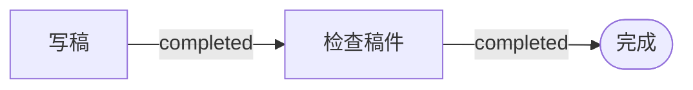

# Agent Graph 是什么

<!-- context:section id="purpose" -->
**让 Agent 按稳定的工作流运行：具备充足知识技能，保证多次任务结果一致。** 每一步都带着它需要的知识和技能，同一个任务再跑一次，也能得到一致的结果，而不取决于某一次对话碰巧怎么走。

**过程可观测、可测试，驱动工作流优化迭代。** 每一步、每个选择和结果都可以查看、回放并用测试检查，工作流的维护者能看清哪里出了问题，一轮轮把工作流本身改得更好。
<!-- /context:section -->

<!-- context:section id="what" -->
## 它是什么

Agent Graph 是 Agent Skill 的工作契约层。你把工作流描述成一张由合法步骤组成的小图；运行时它读取当前的 **Facts**，告诉 Agent 下一步做什么、这一步要读哪些文件、什么能证明这一步已完成。

它协调的是工作，不是 Agent：它从不调用模型、不分配 Agent 身份、不传递共享状态，也不调度 worker。每一步由你现有的 Agent 或宿主执行，执行边界仍在它们手里。Agent Graph 以 `@c4a/agent-graph` 包发布，包含文件规范、Node.js SDK 和 `agent-graph` CLI，源码在 [github.com/context4ai/agent-graph](https://github.com/context4ai/agent-graph)。
<!-- /context:section -->

<!-- context:section id="problem" -->
## 长 Skill 的问题

Agent 通常知道得够多。长任务里更难的是：**此刻**该用哪一部分、下一步哪个动作合法、什么能证明这个动作已完成、中断后从哪里继续。把提示词写得更长并不能可靠地解决：复杂 Skill 写成一篇文档时，每条规则都挨在一起、往往一起加载，Agent 只能从对话中推断当前阶段，而这样的工作流不跑完整个模型行为就很难测试。

> Context should be discovered, not accumulated. The plan is explicit; the path is selected from current reality.
<!-- /context:section -->

<!-- context:section id="example" -->
## 一个小例子

一个 Agent 只有一件事：写稿、检查、完成。

宿主能观察到两个事实：`draft.saved = true` 和 `review.passed = false`。稿件已经存在，但还没通过检查，所以 Agent Graph 返回 **检查稿件** 作为当前 Route。没有任何东西是从对话里猜的：`review.passed` 变成 `true` 时，下一次评估到达 **完成**；只要它仍是 `false`，Route 就停在 **检查稿件**。

这个例子靠四个概念支撑：**Graph** 描述合法的顺序，**Facts** 描述现在什么为真，**Route** 是根据这些 Facts 选出的下一个合法步骤，**Action** 告诉 Agent 或宿主怎么执行。真实工作流会加入必读文件、人工 Gate、显式 Outcome、选择和恢复路径，但这个循环不变。
<!-- /context:section -->

<!-- context:section id="benefits" -->
## 带来什么

| 目标 | Agent Graph 如何支撑 |
| --- | --- |
| 结果一致 | Graph 固定合法的选择和停止条件，当前证据决定实际路径。相同的 Facts 选出相同的 Route，重试或新会话都会沿同样的方式继续。 |
| 每一步拿到对的知识 | 流程、Schema 和手册都留在文件里，只在选中的 Route 需要时加载，而不是一个巨大的提示词。 |
| 中断后能继续 | Facts 和显式 Outcome 能重建工作进行到哪里；可选的 Run 还提供事件、检查点和可恢复状态。 |
| 过程可观测 | Route、事件和诊断显示执行了哪一步、为什么选它、返回了什么。 |
| 先测试再交给模型 | 作者不必让模型跑完整个工作流，就能校验引用、循环、资源边界和预期 Route。 |

反馈分两个层面。运行时，结果决定下一个 Route：成功推进目标，缺少证据转入验证，失败转入恢复。长期来看，事件、诊断和 Route 测试会暴露指令、事实定义或图本身的问题。Agent Graph 从不改写自己的计划——由人根据观察到的结果改进 Graph。
<!-- /context:section -->

<!-- context:section id="context" -->
## 真实案例：Context

Context 的整个知识工作流都运行在 Agent Graph 上，对外只有一个很薄的 Agent 入口。这个入口新建或恢复工作区；每次评估只把选中 Route 需要的流程和资源交给 Agent，Agent 还要证明已经读过。Facts 不变时重新进入会选出同一个 Route，绑定 revision 的命令会拒绝过期写入，所以重试和新会话都是安全的。[在 Context 中的应用](../../architecture/agent-graph/agent-graph-in-context.md) 详细介绍了这套集成。
<!-- /context:section -->

<!-- context:section id="when" -->
## 什么时候用

不是每个 Skill 都需要 Graph。单次会话就能完成的短任务，写在 `SKILL.md` 里即可。当宿主能提供可信的外部事实，而工作确实需要可验证的完成、跨会话恢复，或可测试的路由和人工 Gate 时，再采用 Agent Graph。

只安装 CLI 不会改变任何 Agent 的行为。一次集成由三部分组成：Provider 定义工作契约，Skill 让它可被发现，宿主（你的 Agent 或产品）提供 Facts、展示 Route、执行 Gate 并记录 Outcome。
<!-- /context:section -->

<!-- context:section id="start" -->
## 从哪里开始

| 你的情况 | 从这里开始 |
| --- | --- |
| Skill 能用，但越写越长、每轮重复上下文、跨会话就丢失进度，或用大段文字描述 Gate 和恢复 | [版本迁移](../../product/reference/agent-graph/migration.md) |
| 能力还不存在，可以和 Skill 一起设计它的运行契约 | [快速上手](getting-started.md)，然后读 [编写 Graph](authoring-graphs.md) |
| 产品已经负责 Agent 发现、命令执行、界面或工作区状态 | [技能与 Provider](../../architecture/agent-graph/skills-and-providers.md) 和 [CLI 与 SDK](../../product/reference/agent-graph/cli-and-sdk.md) |
| 只是使用别人已经集成好的能力，比如 Context | 正常调用那个 Skill 即可，通常不需要安装或配置任何东西 |

想了解背后的设计，先读 [Graph Engineering 设计原则](../../architecture/agent-graph/why-graph-engineering.md)，再读 [核心模型](../../architecture/agent-graph/core-model.md) 和 [运行与恢复](../../architecture/agent-graph/runs-and-recovery.md)。
<!-- /context:section -->
