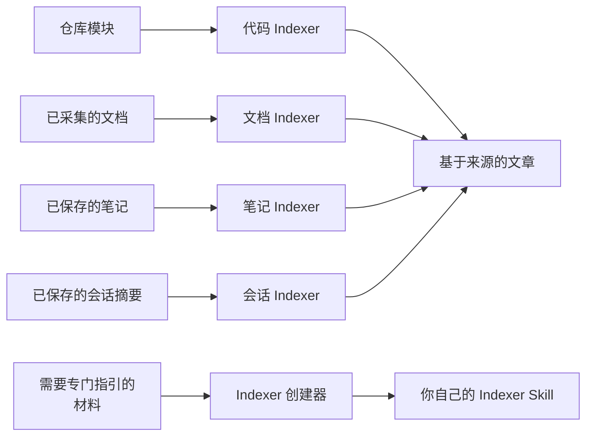

# 内置 Indexer

<!-- context:section id="goal" -->
**Indexer** 是一种 Skill，告诉 Agent 如何调研某一类来源，以及如何据此撰写基于来源的文章。Indexer 分为四类：**代码、文档、笔记和会话**，每一类都可以有多个 Skill。Context 为每一类自带一个 Skill，另有一个创建器 Skill，在你需要时编写新的 Indexer。

本小节从读者角度介绍 Indexer：先从这里了解内置 Indexer 已经覆盖了什么。只有当它们不适合你的材料时，再继续阅读[选择、替换与停用 Indexer](providers-and-customization.md)、[创建 Indexer](creating-an-indexer.md) 或[编写 Indexer 指引](code-indexers.md)。

<!-- /context:section -->

<!-- context:section id="at-a-glance" -->
## 概览

| 类别 | Skill | 读取 |
| --- | --- | --- |
| 代码 | `context-code-indexer` | 仓库模块 |
| 文档 | `context-markdown-indexer` | 已采集的文档和同仓库文档 |
| 笔记 | `context-note-indexer` | 已保存的笔记、摘录和观察记录 |
| 会话 | `context-sessions-indexer` | 已保存的会话摘要 |
| 创建器 | `context-indexer-create` | 你创建新 Indexer 的请求 |

Indexer 在规划和撰写期间工作。创建器是一个编写助手：当你提出要求时，它会为代码、文档、笔记或会话摘要编写新的 Indexer Skill。
<!-- /context:section -->

<!-- context:section id="code" -->
## 代码：`context-code-indexer`

- **你会得到**：关于已登记仓库中某个已授权模块的文章，涵盖其技术、对外提供的能力类别、契约和集成点，并按你在开工报告中确认的读者主题分组。文章大纲适配 16 种模块，从 monorepo 容器、Web 应用、组件与 SDK 库、CLI 工具，到 API 服务、事件消费者、存储仓库、适配器、契约来源和生成的源码。
- **如何读取**：规划期间查看模块结构和有代表性的源码；撰写时读取每篇文章所需的实际实现和契约。不完整的计数会被明确标为不完整。
- **不会做**：在规划期间解析整个仓库、列出每个符号或构建关系图；直接写入知识或修改你的仓库。
- **以下情况改为添加笔记或文档**：知识是代码无法体现的业务意图或理由。代码确立已实现的行为；笔记和文档解释原因。
<!-- /context:section -->

<!-- context:section id="documents" -->
## 文档：`context-markdown-indexer`

- **你会得到**：围绕读者问题而非来源文件组织的文章，保留原文中有用的指引、示例和限制，并引用所使用的段落。文章大纲适配 13 种文档，从领域参考、产品需求、技术指南，到运维手册、FAQ、决策记录、事故复盘、测试验证、发布与迁移指南以及文档站。
- **如何读取**：规划从文档标题、开头摘录和标题大纲开始，在分组不清晰时全文阅读；撰写时读取相关的完整来源。一个标题不等于一篇文章。
- **不会做**：除非你要求，否则不会从你仅做了链接的同仓库文档和 Skill 生产知识；它们保持为原件，作为辅助证据。参见[链接已有的文档与 Skill](../registering-sources/same-repository-docs.md)。
- **以下情况改为添加笔记**：知识存在于人们的头脑或聊天中，而不在文档里；参见[笔记与会话摘要](../registering-sources/notes.md)。
<!-- /context:section -->

<!-- context:section id="notes" -->
## 笔记：`context-note-indexer`

- **你会得到**：一条笔记要么充实已有页面，要么在回答独立的读者问题时成为单独的文章。它有九种自有读者画像（领域参考、产品需求、技术指南、用户与开发者指南、运维手册、FAQ、决策记录、事故复盘、测试验证），也可以按每种代码和文档画像的风格撰写，例如关于某个 API 服务或某份运维手册的笔记。
- **如何读取**：直接阅读已保存的笔记、摘录和观察记录。
- **不会做**：扫描宿主历史、抓取未经你批准的 URL，或为迎合论断篡改证据。
- **以下情况改为添加文档或会话摘要**：材料是持续维护的文档（作为文档来源添加），或是你希望保留其决定的对话（保存一份摘要）。
<!-- /context:section -->

<!-- context:section id="sessions" -->
## 会话摘要：`context-sessions-indexer`

- **你会得到**：从已保存的会话摘要中提取问题、实际达成的决定、理解这些决定所需的理由、遗留问题和适用范围，并区分“提议”“已同意”“已实现”和“已验证”。摘要不必与代码相关。关联的提交或合并请求记录讨论涉及的内容；它并不能证明某个变更已合并、已部署或已通过测试。
- **如何读取**：直接阅读由宿主或其他工具准备的、篇幅有限的摘要。
- **不会做**：扫描聊天历史、加载完整对话记录，或根据 diff 拼凑出一段对话。
- **以下情况改为添加笔记**：你只想保留一段摘录或一条观察，而不是一段对话的决定。
<!-- /context:section -->

<!-- context:section id="creator" -->
## 创建器：`context-indexer-create`

`context-indexer-create` 会在你选定的目录中编写一个可复用的 Indexer Skill。请用自然语言提出（它不是斜杠命令），并明确说明你要为代码、文档、笔记或会话摘要创建新的 Context Indexer Skill。

它只编写 Skill：不会初始化知识工作区，也不会启动生产。最后，它会汇报所创建的文件、支持的输入以及尚存的限制。完整步骤参见[创建 Indexer](creating-an-indexer.md)。
<!-- /context:section -->

<!-- context:section id="installation" -->
## 如何安装

安装 Context 插件（参见[安装](../../product/getting-started/installation.md)）后，所有内置 Indexer 都可在 Claude Code、Codex 和 Cursor 中使用。四个 Indexer 安装时不带插件前缀，因此在每个宿主中名称都相同。安装后请重启或刷新 Agent 宿主。
<!-- /context:section -->

<!-- context:section id="selection" -->
## Agent 如何选用它们

你不会直接调用 Indexer；Context 工作开始时，Agent 会选出适合你材料的那些。普通的编码和设计对话不会启动它，所以请显式调用 Context，或继续一个进行中的 Context 对话。选择的工作方式，以及如何替换或停用 Indexer，参见[选择、替换与停用 Indexer](providers-and-customization.md)。
<!-- /context:section -->

<!-- context:section id="combining" -->
## 同一模块上的多个 Indexer

多个 Skill 可以考察同一模块的不同方面，它们的发现会写进同一篇文章，而不是产生多份副本。代码确立已实现的行为，已授权的笔记或文档则可以解释业务意图和理由。

只是为已有页面提供支撑的笔记，会写进该页面。回答独立读者问题的笔记，可以成为单独的文章。

接下来：

- [选择、替换与停用 Indexer](providers-and-customization.md)介绍如何在知识工作区中引导选择。
- [创建 Indexer](creating-an-indexer.md) 和[编写 Indexer 指引](code-indexers.md)介绍如何编写你自己的 Indexer。
- [Indexer 体系](../../architecture/knowledge/indexer-system.md)说明 Indexer 如何融入生产生命周期。
<!-- /context:section -->
