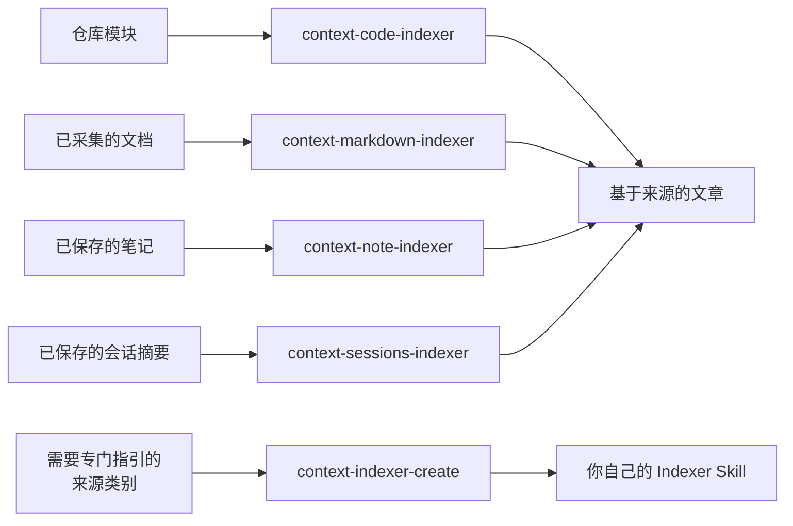

# 社区 Indexer 一览

<!-- context:section id="goal" -->
**Indexer** 是一种 Skill，告诉 Agent 如何调研某一类来源，以及如何据此撰写基于来源的文章。它帮助 Agent 理解已授权的材料；它不负责工作流路由、来源授权、审核，也不拥有文章的永久身份。多个 Indexer 可以为同一个模块或同一篇文章做贡献。

社区版自带四个 Indexer Skill——分别面向代码、文档、笔记和会话摘要——以及一个用于编写新 Indexer 的创建器 Skill。它们都维护在 Context 仓库的 `plugins/context/skills/` 中，`context plugin install` 会让你的 Agent 宿主可以使用它们。

<!-- /context:section -->

<!-- context:section id="at-a-glance" -->
## 概览

| 类别 | Skill | 源码目录 |
| --- | --- | --- |
| 代码 | `context-code-indexer` | [plugins/context/skills/context-code-indexer](https://github.com/context4ai/context/tree/main/plugins/context/skills/context-code-indexer) |
| 文档 | `context-markdown-indexer` | [plugins/context/skills/context-markdown-indexer](https://github.com/context4ai/context/tree/main/plugins/context/skills/context-markdown-indexer) |
| 笔记 | `context-note-indexer` | [plugins/context/skills/context-note-indexer](https://github.com/context4ai/context/tree/main/plugins/context/skills/context-note-indexer) |
| 会话摘要 | `context-sessions-indexer` | [plugins/context/skills/context-sessions-indexer](https://github.com/context4ai/context/tree/main/plugins/context/skills/context-sessions-indexer) |
| 创建器 | `context-indexer-create` | [plugins/context/skills/context-indexer-create](https://github.com/context4ai/context/tree/main/plugins/context/skills/context-indexer-create) |

前四个是 Indexer Provider 技能，Context 工作流在规划和撰写时使用它们。创建器是一个编写助手：当你提出要求时，它会为代码、文档、笔记或会话摘要编写新的 Indexer Skill。
<!-- /context:section -->

<!-- context:section id="code" -->
## 代码：`context-code-indexer`

- **读取：**已登记仓库中已授权的模块，从 CLI 提供的目录和文件导航开始。
- **调研产出：**相关技术、可见的能力类别，以及拟定的读者主题和撰写批次。它可以查看有代表性的源码，但在规划期间不会解析整个仓库、枚举每个符号或构建关系图。不完整的计数会被明确标为不完整。
- **撰写时读取：**回答每个读者问题所需的实际实现和契约。草稿写入 Agent 的临时目录，并通过当前的 CLI 操作提交；该 Skill 从不写入正式知识，也不修改来源仓库。
- **附带资源：**包含调研与撰写指引的 `references/indexer.md`、每种模块画像对应的文章目录、图表与源码可视化指引，以及每种画像的模板。这些画像涵盖 16 种模块，从 monorepo 容器、Web 应用、组件与 SDK 库、CLI 工具，到 API 服务、事件消费者、存储仓库、适配器、契约来源和生成的源码。
- **测试：**`tests/fixtures/` 下的匿名化测试夹具集。

源码：[GitHub 上的 context-code-indexer](https://github.com/context4ai/context/tree/main/plugins/context/skills/context-code-indexer)。
<!-- /context:section -->

<!-- context:section id="documents" -->
## 文档：`context-markdown-indexer`

- **读取：**已采集的文档。以 repo-content 形式登记的同仓库文档和自编 Skill 保持为原件；除非你明确要求从中生产知识，否则该 Skill 只把它们用作有限的辅助证据。
- **调研产出：**根据 CLI 提供的文档标题、有限的开头摘录和完整的 H2/H3 大纲确定的主题和撰写批次，必要时有选择地全文阅读。大纲只是导航，既不能证明某个论断，也不意味着每个标题写一篇文章。
- **撰写时读取：**相关的完整来源，保留其中有用的指引、示例和限制，并引用实际使用的区域。
- **附带资源：**规划指引（`references/semantic-planning.md`）、撰写指引（`references/indexer.md`）、读者结果（`references/classification.md`）和文章边界（`references/structure-and-artifacts.md`），以及默认不读取的文章目录和模板。它的 13 种文档画像覆盖领域参考、产品需求、技术指南，直到运维手册、FAQ、决策记录、事故复盘、测试验证、发布与迁移指南以及文档站点。
- **测试：**`tests/fixtures/` 下的匿名化测试夹具集，例如文档路由用例。

源码：[GitHub 上的 context-markdown-indexer](https://github.com/context4ai/context/tree/main/plugins/context/skills/context-markdown-indexer)。
<!-- /context:section -->

<!-- context:section id="notes" -->
## 笔记：`context-note-indexer`

- **读取：**已保存的笔记、摘录和观察记录，直接阅读。这类来源通常不需要解析器，也不需要单独的盘点环节。
- **调研产出：**一份有用的骨架，而不是详尽的事实台账，并借助 `references/classification.md` 对照已有主题提出文章目标。
- **撰写时读取：**选定的材料，遵循 `references/writing.md`；当笔记修订或合并已有主题时，适用 `references/updates-and-composition.md` 和 `references/extension-placement.md`。
- **附带资源：**九种自有读者画像（领域参考、产品需求、技术指南、用户与开发者指南、运维手册、FAQ、决策记录、事故复盘、测试验证），以及针对每种代码和文档画像的、带 `note/` 前缀的扩展画像，例如 `note/api-service` 或 `note/runbook`。模板和文章目录只在需要时加载。
- **边界：**它不会扫描宿主历史、抓取未经批准的 URL、为迎合论断篡改证据，也不会写入正式知识。
- **测试：**`tests/fixtures/` 下的匿名化画像测试夹具。

源码：[GitHub 上的 context-note-indexer](https://github.com/context4ai/context/tree/main/plugins/context/skills/context-note-indexer)。
<!-- /context:section -->

<!-- context:section id="sessions" -->
## 会话摘要：`context-sessions-indexer`

- **读取：**由宿主或外部提供方准备的、篇幅有限的对话摘要。该 Indexer 不会扫描聊天历史、加载完整对话记录，也不会根据 diff 拼凑出一段对话。摘要不必与代码相关，也不必有对应的提交。
- **调研产出：**通过直接阅读得出骨架和文章目标，方式与笔记 Indexer 相同。
- **撰写时提取：**问题、实际达成的决定、理解这些决定所需的理由、遗留问题和适用范围——并区分“提议”“已同意”“已实现”和“已验证”。可选的 `changes` 关联（完整的 `commit` SHA 或 `mr` URL）记录讨论涉及的内容；它并不能证明某个变更已合并、已部署或已通过测试。
- **附带资源：**与笔记 Indexer 同类的参考、模板和文章目录，只在需要时加载。

源码：[GitHub 上的 context-sessions-indexer](https://github.com/context4ai/context/tree/main/plugins/context/skills/context-sessions-indexer)。
<!-- /context:section -->

<!-- context:section id="creator" -->
## 创建器：`context-indexer-create`

`context-indexer-create` 会在你选定的目录中编写一个可复用的 Indexer Skill。只有当你明确要求为代码、文档、笔记或会话摘要创建新的 Context Indexer Skill 时，它才会启用——为已有来源建索引、普通编码、知识查询或选择已安装的 Skill 都不会触发它。它不是斜杠命令，所以请用自然语言提出。

它只编写 Skill：不会初始化知识工作区，也不会启动生产。它交付一个 `SKILL.md`，只附带真正有用的参考、模板或脚本，不包含 Provider 注册清单，也没有版本或哈希校验流程。最后，它会汇报所创建的文件、支持的输入以及尚存的限制。安装新 Skill 只是让它可用，并不等于被选用。

完整步骤参见[创建 Indexer](creating-an-indexer.md)。

源码：[GitHub 上的 context-indexer-create](https://github.com/context4ai/context/tree/main/plugins/context/skills/context-indexer-create)。
<!-- /context:section -->

<!-- context:section id="installation" -->
## 如何安装

`context plugin install` 会安装 Context 的 Agent 集成。全局安装会创建带宿主命名空间的 Context 入口，同时为 Claude、Codex 和 Cursor 把四个 Indexer Skill 投影为**无命名空间**的 Skill：Codex 和 Cursor 投影到共享的 `~/.agents/skills` 目录，Claude 投影到 `~/.claude/skills`。因此它们的名称保持为 `context-code-indexer`、`context-markdown-indexer`、`context-note-indexer` 和 `context-sessions-indexer`，不带插件前缀。

创建器则不同：它随宿主专属的插件根目录分发，与生产、项目规划和查询入口放在一起。安装后请重启或刷新 Agent 宿主。

安装 Indexer 只是让它可被发现，并不会为每个 Context 知识工作区启用它。
<!-- /context:section -->

<!-- context:section id="selection" -->
## Agent 如何选用它们

你不会直接调用 Indexer。Indexer Skill 只会通过 Context 工作流启用，所以请显式调用 Context，或继续一个进行中的 Context 对话；普通的编码和设计讨论不会触发它。

工作开始时，Agent 会声明宿主中可用的相关 Skill，然后选出适合实际材料和读者任务的那些，并把这一选择记录在当前的规划 schema 中。不存在单独的 Provider 选择、主负责方或解析阶段需要通过。Agent 会：

- 尊重你在宿主中禁用的 Skill；
- 尊重明确的业务替换，例如用你自己的 Indexer 代替某个内置 Indexer；
- 只读取选定的指引，不扫描插件缓存，也不另建一套 Skill 注册表。

Skill 名称只是指引，既不是版本锁定，也不能证明已完成阅读。替换或禁用 Indexer 参见 [Provider 与定制](providers-and-customization.md)。
<!-- /context:section -->

<!-- context:section id="combining" -->
## 同一模块上的多个 Indexer

多个 Skill 可以考察同一模块的不同方面。Agent 会合并它们的发现，而不会让其中任何一个成为永久负责方。代码确立已实现的行为，已授权的笔记或文档则可以解释业务意图和理由。多个选定 Skill 的贡献会写进同一篇文章，而不是产生多份副本。

只是为已有页面提供支撑的笔记，会写进该页面，并使用该页面的证据和阅读范围。回答独立读者问题的笔记，可以通过选定的笔记 Indexer（无论是默认的还是业务替换的）成为单独的文章。需要专门解读时，会显式选用兼容的扩展层；不会仅仅因为存在一条笔记就启用另一个 Skill。

接下来：

- [Indexer 体系](../../architecture/knowledge/indexer-system.md)说明 Indexer 如何融入生产生命周期。
- [创建 Indexer](creating-an-indexer.md)、[代码类 Indexer](code-indexers.md) 和[文档类 Indexer](document-indexers.md) 介绍如何编写你自己的 Indexer。
- [Provider 与定制](providers-and-customization.md)介绍如何组合、替换和禁用 Indexer。
<!-- /context:section -->
