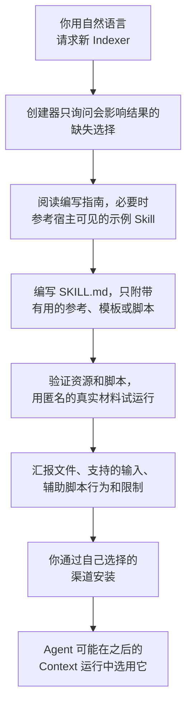

# 创建 Indexer

<!-- context:section id="goal" -->
Indexer 是针对特定来源的调研与撰写指引：它帮助 Agent 理解已授权的材料并产出有用的文章。当内置 Indexer 对某项技术或某类文档了解不够时，你可以请 Agent 使用 **`context-indexer-create`** Skill 创建一个。

创建器会在你选定的目录中编写一个可复用的 Skill。它只编写 Skill：不会初始化 Context 知识工作区，也不会启动知识生产。你的新 Indexer 贡献调研和撰写指引；目的、范围、调度和提交 schema 仍由当前的 Context 阶段提供。


<!-- /context:section -->

<!-- context:section id="when" -->
## 什么时候适合自定义 Indexer

当某项技术或某类文档反复需要内置 Indexer 不具备的指引时，就编写自定义 Indexer——例如某个框架的服务声明在它自己的文件中，或者某类文档有自己的结构。一个可复用的专用 Skill 会描述如何解读这类来源、如何调研出轻量的骨架、有哪些可选的有限辅助工具，以及如何据此撰写。组织和项目知识应放在它们自己的 Skill 中，而不是放进社区示例。

不要只因为某个主题不熟悉就创建 Indexer。如果调整撰写方式——换一种大纲、分组或标题——就能解决问题，那就调整大纲。不熟悉的主题不等于需要新的 Provider；真正的工具缺口及其恢复方法，应在知识页面之外说明。
<!-- /context:section -->

<!-- context:section id="asking" -->
## 如何提出请求

创建器没有斜杠命令。当你用自然语言明确要求为代码、文档、笔记或会话摘要创建新的 Context Indexer Skill 时，它才会启用。为已有来源建索引、普通编码、知识查询或选择已安装的 Skill 都不会触发它。

创建器使用你的对话语言，只询问会实质影响结果的缺失来源、读者或能力选择。开始之前，请准备好：

- **在哪里创建**——创建器会写入你选定的目录。
- **哪类材料**——代码、文档、笔记或会话摘要，以及其中具体的技术或文档类型。
- **真实的匿名样例**——创建器会用真实的匿名材料来试运行它声称的能力。

例如：

```text
Create a Context Indexer Skill for code built with the Acme RPC framework.
Put it in ./skills/acme-rpc-indexer. Acme RPC services are declared in
*.acme files and registered in each module's server entry. Use the anonymized
sample module in ./fixtures/acme-sample to check it.
```
<!-- /context:section -->

<!-- context:section id="output" -->
## 它产出什么

| 你会得到 | 你不会得到 |
| --- | --- |
| 一个 `SKILL.md`，带有可被发现的名称，并精确描述该 Skill 何时有用、理解哪些来源以及真实的限制 | `context-indexer.yaml` 或其他 Provider 注册清单 |
| 在需要时，用于承载大量来源专属指引的参考文件 | 主/扩展绑定 |
| 对读者有帮助时的模板 | 版本或哈希校验流程，或完整性回执 |
| 仅当某个具体的重复操作需要确定性辅助时才提供的脚本 | 逐符号的事实台账、文章生产者记录或持久的生产者日志 |

附带资源使用可移植的相对路径引用。一个简单的笔记解读器不需要脚本、清单、画像注册表或模板目录。

完成后，创建器会汇报所创建的文件、该 Skill 支持的输入、各个有限辅助工具的行为以及尚存的限制。
<!-- /context:section -->

<!-- context:section id="anatomy" -->
## 好的 Indexer 包含什么

**可识别的信号和低成本的调研。**Skill 要说明哪些来源信号可以识别它所针对的材料，以及如何低成本地检查这些信号。调研的结果是一份**骨架**：来源结构、可识别的特征、名称、已实际确认的计数，以及入口位置。

- 对于代码，它从声明或注册中识别有用的功能类别，并给出名称和位置。依赖或文件名只是线索，不能证明运行时行为。
- 对于文档，它使用标题、开头摘录和标题层级，必要时全文阅读以确定分组。
- 对于已保存的笔记和会话，它直接解读所提供的记录，而不是扫描历史。

**有限的辅助工具（如果有）。**针对特定技术的辅助工具要有明确的输入边界、有限的时间和输出，以及有用的停止行为。它返回名称、计数和入口位置——而不是源码正文或完整的符号或关系图。它区分已检查的计数和总数，指出未完成的范围，绝不把文件数当作功能数，也绝不把超时当作空结果，并把大量结果存放在临时文件中。默认情况下，它不安装依赖，也不解析整个仓库；代价高昂的语义分析属于选定的撰写任务。如果辅助工具没有增益，由 Agent 直接调研就是合理的默认方式。

**不主导计划的主题指引。**Skill 描述可见信号可以引出哪些读者问题，以及撰写者还需要哪些进一步证据。一组路由、一个组件或一个存储边界可以支持一套重复使用的大纲，但绝不能自动决定固定的页数。代码可以确立结构，文档则能提供更好的业务主题。选用 Skill 和划分文章批次仍由 Agent 负责。

**撰写指引。**Skill 说明来源的权威性、有意义的读者产出、真实的引用和修订行为，并把示例、假设和已确认的事实区分开。它使用当前的任务目录，而不是从过去版本复制来的 schema，并把草稿写到指定的临时目录。它从不写入正式知识，也不在正式内容中加入 Skill 身份。

各类别的细节参见[代码类 Indexer](code-indexers.md) 和[文档类 Indexer](document-indexers.md)。
<!-- /context:section -->

<!-- context:section id="validation" -->
## 如何验证

创建器会验证 Skill 的参考文件和所有脚本，然后用真实的匿名材料试运行该 Skill 声称的能力。它把三个层次的证据分开：静态验证、模型输出评审，以及真实的生产运行。它不会悄悄安装依赖，也不会声称运行过无法运行的测试。

需要检查什么，以及每项检查能证明什么：

| 检查 | 覆盖内容 |
| --- | --- |
| Frontmatter 以及每个被引用的本地资源 | 包是完整的 |
| 用小型匿名测试夹具运行新脚本 | 空输入、有限的部分扫描、声称的失败与恢复行为、不越出选定范围、不泄露机密或源码正文 |
| 有用的输出、证据不足的情况，以及对已有文章的修订 | 指引在理想路径之外同样有效 |
| 每个声称支持的类别中有代表性的差异 | 例如未被采纳的提议、需要深入阅读的文档，或同一模块中的两种技术 |
| 如果可行且有要求，在隔离的知识工作区中进行一次真实的 Context 运行 | 通过现有工作流确认报告并提交文件 |

静态资源检查不能证明语义质量，评审过的示例也不能证明 CLI 提交可行。不要声称支持你尚未测试过的类别。
<!-- /context:section -->

<!-- context:section id="install" -->
## 安装并使其可被选用

保持包的可移植性，并通过你偏好的渠道安装。安装只是让 Skill 可用，并不等于被选用：宿主列出可用的 Skill，Agent 根据实际材料和读者任务选择相关的 Skill，同时尊重被禁用的 Skill 和明确的业务替换。规划只会临时记录它所选用的 Skill。

这个 Skill 的任何信息都不需要事后恢复。正式文章、来源和长期范围决定在新机器上依然保留，而草稿、候选、Skill 选择和执行回执都是临时的。新用户无需你之前的 Skill 包，也能开始一次全新的生产运行。

创建器自身不会启动任何生产。当你想使用新的 Indexer 时，请通过 Context 生产的现有入口启动。

接下来：

- [代码类 Indexer](code-indexers.md)——面向框架和技术的调研信号、辅助工具和撰写指引。
- [文档类 Indexer](document-indexers.md)——面向文档类别的大纲、分组和图像处理。
- [Provider 与定制](providers-and-customization.md)——多个 Indexer 如何组合，以及如何替换或禁用某个 Indexer。
<!-- /context:section -->
