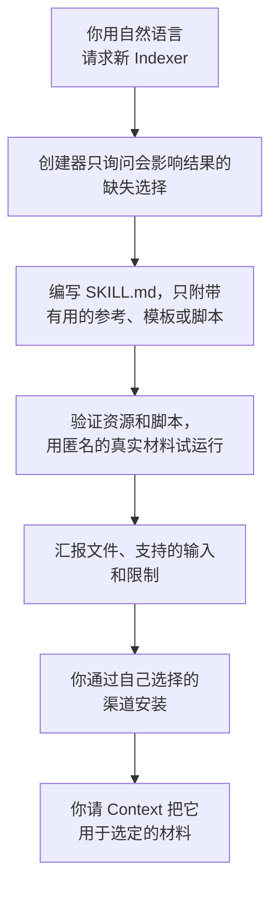

# 创建 Indexer

<!-- context:section id="goal" -->
Indexer 是针对特定来源的调研与撰写指引：它帮助 Agent 理解已授权的材料并产出有用的文章。当内置 Indexer 对某项技术或某类文档了解不够时，你可以请 Agent 使用 **`context-indexer-create`** Skill 创建一个。

创建器会在你选定的目录中编写一个可复用的 Skill。它只编写 Skill：不会初始化知识工作区，也不会启动知识生产。你的新 Indexer 贡献调研和撰写指引；每个任务的目的、范围和调度仍由 Context 工作流决定。


<!-- /context:section -->

<!-- context:section id="when" -->
## 什么时候适合自定义 Indexer

当某项技术或某类文档反复需要内置 Indexer 不具备的指引时，就编写自定义 Indexer——例如某个框架的服务声明在它自己的文件中，或者某类文档有自己的结构。开始之前，先确定你真正需要哪种改动：

| 你的需求 | 做法 |
| --- | --- |
| 某个知识工作区的措辞、读者或页面格式不合适 | 调整大纲或页面模板；参见 [页面与主题定制](../outputs-and-sites/page-and-theme-customization.md)。不需要新 Indexer。 |
| 内置 Indexer 仍然适用，但某个框架或业务层需要额外指引 | 创建一个专项 Indexer，与内置 Indexer 一起处理同一个模块。 |
| 内置 Indexer 读取和撰写这类材料的方式不适合你，而且这些规则会在多个项目中复用 | 创建一个独立的 Indexer，并请 Context 在这类材料上用它代替内置 Indexer。 |

多个 Indexer 如何协同工作，以及如何在知识工作区中切换，参见 [选择、替换与停用 Indexer](providers-and-customization.md)。

不要只因为某个主题不熟悉就创建 Indexer。如果调整撰写方式——换一种大纲、分组或标题——就能解决问题，那就调整大纲。
<!-- /context:section -->

<!-- context:section id="asking" -->
## 如何提出请求

创建器没有斜杠命令。请用自然语言提出，并明确说明你要为代码、文档、笔记或会话摘要创建新的 Context Indexer Skill；要求为已有来源建索引或选择已安装的 Skill 都不会触发它。它使用你的对话语言，只询问会实质影响结果的缺失来源、读者或能力选择。

请准备好：

- **在哪里创建**——创建器会写入你选定的目录。
- **哪类材料**——代码、文档、笔记或会话摘要，以及其中具体的技术或文档类型。
- **真实的匿名样例**——创建器会用真实的匿名材料来试运行它声称的能力。

例如：

```text
请帮我为使用 Acme RPC 框架的代码创建一个 Context Indexer Skill，
放在 ./skills/acme-rpc-indexer。Acme RPC 服务在 *.acme 文件中声明，
并在各模块的服务端入口注册。请用 ./fixtures/acme-sample 中的匿名化示例模块检查效果。
```
<!-- /context:section -->

<!-- context:section id="output" -->
## 它产出什么

- 一个 `SKILL.md`，带有可被发现的名称，并精确描述该 Skill 何时有用、理解哪些来源以及真实的限制。
- 在需要时，用于承载大量来源专属指引的参考文件。
- 对读者有帮助时的模板。
- 仅当某个具体的重复操作需要确定性辅助时才提供的脚本。

附带资源使用可移植的相对路径引用。一个简单的笔记解读器不需要脚本或模板目录。

完成后，创建器会汇报所创建的文件、该 Skill 支持的输入、各个辅助工具的行为以及尚存的限制。
<!-- /context:section -->

<!-- context:section id="anatomy" -->
## 好的 Indexer 包含什么

好的 Indexer 会说明哪些来源信号可以识别它所针对的材料、如何低成本地检查这些信号；只在确有增益时提供有限的辅助工具；建议读者主题但不固定页数；并指导有来源依据的撰写。这些要求对每类材料意味着什么，以及相应示例，见 [编写 Indexer 指引](code-indexers.md)中的代码类 Indexer 和文档类 Indexer 两节。
<!-- /context:section -->

<!-- context:section id="validation" -->
## 创建器如何验证

创建器会验证 Skill 的参考文件和所有脚本，然后用真实的匿名材料试运行该 Skill 声称的能力。它把三个层次的证据分开：静态验证、模型输出评审，以及真实的生产运行。它不会悄悄安装依赖，也不会声称运行过无法运行的测试。

| 检查 | 覆盖内容 |
| --- | --- |
| Frontmatter 以及每个被引用的本地资源 | 包是完整的 |
| 用小型匿名测试夹具运行新脚本 | 空输入、有限的部分扫描、声称的失败与恢复行为、不越出选定范围、不泄露机密或源码正文 |
| 有用的输出、证据不足的情况，以及对已有文章的修订 | 指引在理想路径之外同样有效 |
| 每个声称支持的类别中有代表性的差异 | 例如未被采纳的提议、需要深入阅读的文档，或同一模块中的两种技术 |

静态资源检查不能证明语义质量，评审过的示例也不能证明该 Skill 在真实的生产运行中可用。不要声称支持你尚未测试过的类别。
<!-- /context:section -->

<!-- context:section id="try" -->
## 在测试知识工作区中试用

创建器的检查通过后，在分享 Skill 之前，先在一个单独的测试知识工作区中跑一次真实的 Context 流程。只有这一层证据能表明该 Skill 在现有工作流中可用，包括确认开工报告和提交页面。需要你明确提出——创建器自身不会启动任何生产。

把 Skill 安装到宿主能看到的位置（位置参见 [选择、替换与停用 Indexer](providers-and-customization.md)），在测试知识工作区中启动 `/c4a:context`，再对照你提供给创建器的样例检查生成的页面。
<!-- /context:section -->

<!-- context:section id="install" -->
## 安装并投入使用

保持 Skill 的可移植性，并通过你偏好的渠道安装，然后刷新或重启 Agent 宿主，确认新 Skill 可见。

安装只是让 Skill 可用，并不等于被选用。通过 `/c4a:context` 继续知识工作区的工作，并说明哪些材料现在应使用新 Skill、它替换哪个内置 Indexer（如果有），以及其他来源保持当前选择。请 Agent 说明它为哪些材料选用了哪些 Indexer，再检查它写出的页面。

这个 Skill 的任何信息都不需要事后恢复。已批准的页面、来源和长期范围决定在新机器上依然保留，而草稿和任务中的 Skill 选择都是临时的。新用户无需你之前的 Skill，也能开始一次全新的生产运行。

接下来：

- [编写 Indexer 指引](code-indexers.md)——代码类和文档类 Indexer 的调研信号、辅助工具、规划与撰写指引。
- [选择、替换与停用 Indexer](providers-and-customization.md)——多个 Indexer 如何协同工作，以及如何替换或停用某个 Indexer。
<!-- /context:section -->
