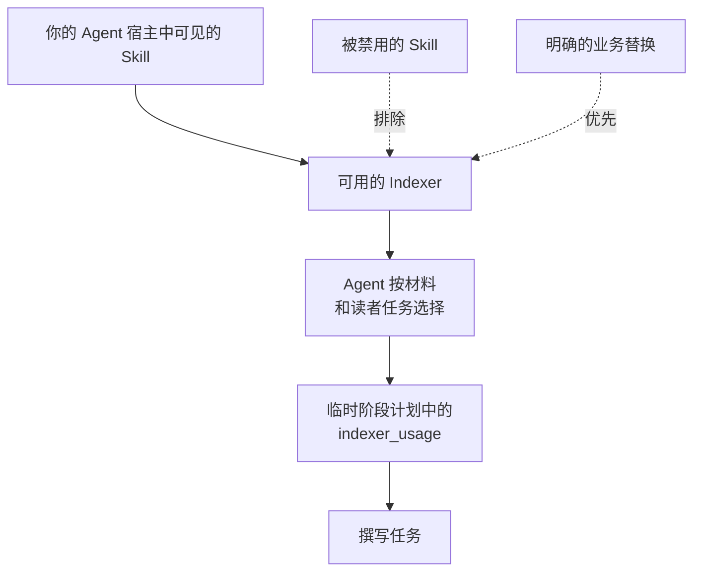

# Provider 与定制

<!-- context:section id="goal" -->
在 Context 中，Indexer Skill 也称为 **Indexer Provider**：为某一类来源提供调研和撰写指引的一组内容。本页说明如何为你的 Context 知识工作区选择和组合 Provider，如何引导这一选择——添加专用 Indexer、替换内置 Indexer、禁用某个 Indexer——以及哪些相关信息会被记录、哪些不会。

<!-- /context:section -->

<!-- context:section id="selection" -->
## 选择如何进行

规划某个阶段时，Agent 会声明当前宿主中可用的相关 Skill，以及它能否调度子 Agent。随后它挑选适合实际材料和读者任务的 Indexer，并把它们连同相关配置作为 `indexer_usage` 记录在临时阶段计划中；CLI 在规划和撰写期间会把这些指引交回给 Agent。

不存在 Provider 解析阶段，也没有需要选定的主负责方。Agent 不会检查缓存、比较 Skill 哈希、解析确切版本或另建一套安装注册表——安装和启用 Skill 是宿主的职责。Skill 名称只是发现线索，并不能证明该 Skill 适用。
<!-- /context:section -->

<!-- context:section id="combine" -->
## 在同一模块上组合 Indexer

多个 Indexer 可以讲解同一模块的不同方面，它们的发现可以支撑同一篇文章。典型的组合是通用的 `context-code-indexer` 加上针对该模块框架的专用 Indexer，或者用代码 Indexer 讲结构、用笔记解释业务意图。组合不需要主/扩展绑定：每个 Skill 各自贡献指引，仅仅来源类型不同并不需要另起一页。
<!-- /context:section -->

<!-- context:section id="steer" -->
## 添加、替换和禁用

| 你想要 | 这样做 |
| --- | --- |
| 添加专用 Indexer | 按照[创建 Indexer](creating-an-indexer.md)创建，并安装到宿主可见的位置。安装只是让它可用，并不等于被选用。 |
| 对某些材料优先使用团队的 Indexer 而非内置 Indexer | 在请求或常驻指令中明确说明替换；Agent 会尊重明确的业务替换。 |
| 阻止某个 Indexer 被使用 | 在 Agent 宿主中禁用该 Skill；Agent 会尊重被禁用的 Skill。 |
| 为单个任务调整指引 | 在任务中说明。记录在 `indexer_usage` 中的选择是临时的，不会改变该 Skill。 |

如果代码中缺少某个所需的结构性事实，撰写指引无法凭空创造它；这需要解析器。参见[代码抽取](../../architecture/knowledge/code-extraction.md)。
<!-- /context:section -->

<!-- context:section id="where" -->
## 自定义 Indexer 放在哪里

| 位置 | 可见范围 |
| --- | --- |
| 仓库的 `.claude`、`.cursor` 或 `.agents` 目录 | 在对应宿主中打开该仓库的任何人；无插件命名空间 |
| 用户级目录：`~/.agents/skills`（Codex、Cursor）或 `~/.claude/skills`（Claude Code） | 你在该机器上的所有项目；自带的 Indexer 也安装在这里 |
| 你分发的插件 | 安装该插件的所有人 |

保持包的可移植性，并使用你常用的安装渠道。Indexer 的发行版本可以携带普通的版本元数据，但生产在工作前从不校验 Indexer 的版本或哈希。
<!-- /context:section -->

<!-- context:section id="records" -->
## 工作流记录什么

| 会记录 | 不会记录 |
| --- | --- |
| 正式文章、其来源和真实引用 | 文章、小节或生产结果上的 Skill 身份 |
| `src/indexers.yaml` 中的长期需求：目的、读者目标、覆盖领域和已授权来源 | 生产分配或 Indexer 选择 |
| `.tmp` 下的临时 `indexer_usage`、草稿和回执 | Skill 哈希、版本锁定或生产者日志 |

临时状态完好时，当前工作可以恢复或重试。清空 `.tmp` 或在别处克隆后，新的生产会从正式知识和来源开始，而不会恢复之前的 Skill 包。
<!-- /context:section -->

<!-- context:section id="manifest" -->
## Provider 清单

自带的 Indexer 还附带一个 `context-indexer.yaml` Provider 清单（协议为 `context.indexer.provider/v1`），声明它们的领域、激活信号、画像、资源和支持的定制步骤。SDK 提供了这一协议及其校验器。新的 Indexer 不需要清单——`context-indexer-create` 有意不生成清单——生产也不依赖它。关于该协议以及工作流如何使用 Indexer，参见 [Indexer 体系](../../architecture/knowledge/indexer-system.md)。
<!-- /context:section -->
