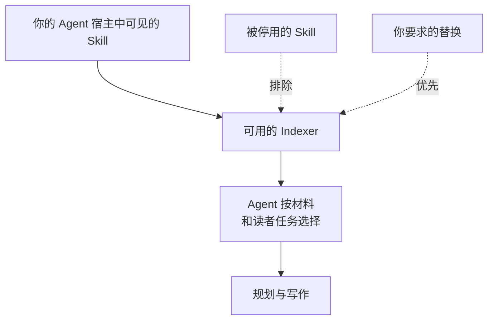

# 选择、替换与停用 Indexer

<!-- context:section id="goal" -->
当内置 Indexer 不太合适时阅读本页：你希望某些材料使用团队的专用 Indexer、替换某个内置 Indexer，或者彻底停用某个 Indexer。先从 [内置 Indexer](community-indexers.md) 了解自带的 Indexer 已经覆盖了什么；工作流内部如何使用 Indexer，见 [Indexer 体系](../../architecture/knowledge/indexer-system.md)。


<!-- /context:section -->

<!-- context:section id="selection" -->
## Agent 如何选择

你不需要手动挑选 Indexer。规划某个阶段时，Agent 会查看你的 Agent 宿主中已安装并启用的 Skill，挑选适合实际材料和读者任务的那些，并在规划和写作中使用它们的指引。Skill 名称只是线索；是否适合眼前的材料由 Agent 判断。

Agent 始终会：

- 排除你在宿主中停用的 Skill；
- 遵循你明确要求的替换，例如用你自己的 Indexer 代替某个内置 Indexer。

开工报告会列出 Agent 打算使用的 Skill，你可以在写作开始前纠正这一选择；参见 [确认开工报告](../planning-and-production/start-reports.md)。
<!-- /context:section -->

<!-- context:section id="install-vs-select" -->
## 安装不等于选用

在宿主中安装 Indexer 只是让它可以被发现，并不会让它在每个知识工作区中都启用。知识工作区长期保存的是目的、读者目标、覆盖范围和已授权来源，而不是一份 Indexer 列表。每次规划工作时，Agent 都会针对眼前的材料，从宿主提供的 Skill 中重新选择。

因此，安装新的 Indexer 后，如果你在意哪些材料使用它，请在请求中说明，并检查开工报告中的 Indexing 指引一行。在宿主中停用某个 Skill，会让它退出下一次选择。
<!-- /context:section -->

<!-- context:section id="combine" -->
## 同一模块上的多个 Indexer

多个 Indexer 可以讲解同一模块的不同方面，它们的发现支撑同一篇文章。仅仅来源类型不同，并不需要另起一页。常见的模式有两种：

- **不同来源或模块使用不同 Indexer。** 每个来源或模块使用适合它的 Indexer，例如服务使用 Code Indexer，值班工程师维护的笔记使用 Note Indexer。
- **同一模块使用两个 Indexer。** 通用的 `context-code-indexer` 讲解模块结构，再由针对该模块框架的专用 Indexer，或解释业务意图的笔记，补充结构本身体现不出的内容。
<!-- /context:section -->

<!-- context:section id="replace" -->
## 替换内置 Indexer

你可以在知识工作区的一部分范围内替换内置 Indexer，例如对某一批笔记使用团队的值班问答 Indexer，而不是 Note Indexer。

1. 在宿主中安装并启用新的 Skill；参见 [创建 Indexer](creating-an-indexer.md)。
2. 通过 `/c4a:context` 继续该知识工作区，并明确说明替换：

   ```text
   oncall/ 下的笔记请使用 oncall-qa-indexer，而不是 Note Indexer。其他来源保持当前的选择。
   ```

3. 询问 Agent 实际选用了哪些 Indexer、分别用于哪些材料，然后检查它写出的页面。
4. 不再有人需要旧的 Skill 时，在宿主中停用它。

在此过程中请保留 Context 插件。它还承载生产、规划、提问和创建等入口，其他内置 Indexer 也仍在为其余来源服务。
<!-- /context:section -->

<!-- context:section id="steer" -->
## 速查

| 你想要 | 这样做 |
| --- | --- |
| 添加专用 Indexer | 按照 [创建 Indexer](creating-an-indexer.md) 创建，安装到宿主可见的位置，然后在请求中说明哪些材料应使用它。 |
| 对某些材料优先使用团队的 Indexer 而非内置 Indexer | 在知识工作区中明确说明替换，做法见上文“替换内置 Indexer”。 |
| 阻止某个 Indexer 被使用 | 在 Agent 宿主中停用该 Skill。 |
| 为单个任务调整指引 | 在任务中说明。该选择只适用于这一任务，不会改变 Skill 本身。 |

如果 Agent 在代码中看不到某个结构性事实，写作指引无法凭空创造它；这需要解析器。参见 [代码抽取](../../architecture/knowledge/code-extraction.md)。
<!-- /context:section -->

<!-- context:section id="where" -->
## 自定义 Indexer 放在哪里

| 位置 | 可见范围 |
| --- | --- |
| 仓库的 `.claude`、`.cursor` 或 `.agents` 目录 | 在对应宿主中打开该仓库的任何人；无插件命名空间 |
| 用户级目录：`~/.agents/skills`（Codex、Cursor）或 `~/.claude/skills`（Claude Code） | 你在该机器上的所有项目；自带的 Indexer 也安装在这里 |
| 你分发的插件 | 安装该插件的所有人 |

保持 Skill 的可移植性，并使用你常用的安装渠道。
<!-- /context:section -->
