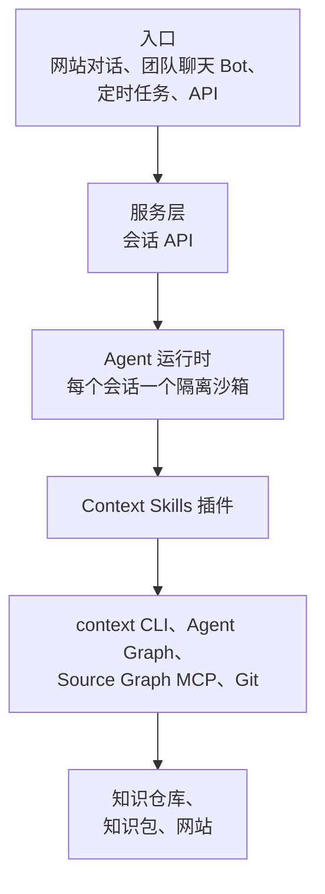

# 搭建知识服务

<!-- context:section id="goal" -->
**知识服务 Agent** 是一个常驻 Agent，它借助 Context Skills 生产、更新团队知识并据此回答问题，人在关键决策点上审核。它不是一个新的 Agent 平台：你只需拿一个现有的 Agent 运行时，为它配上 Context Skills 插件、Bot 提示词和远程检索。

同一套 Skill 在任何地方都能用——无论是托管的 Agent 运行时，还是 Claude Code、Codex、Cursor 这样的本地编码 Agent。常驻服务的价值在于团队共享的知识：生产过程需要大量检索和确认，问题也需要随时有人回答。小模块的知识直接放在其仓库的 `docs/` 下即可。

> **状态。** 社区版不提供 Bot 实现。下文的运行时与服务接口描述的是本站自有 Bot 的规划设计。Skill、流程和交互经验已在实践中得到验证。
<!-- /context:section -->

<!-- context:section id="layers" -->
## 分层

| 层 | 组成 | 职责 |
| --- | --- | --- |
| 入口 | 网站对话、团队聊天 Bot、定时任务、API 调用 | 提问、生产或更新请求、例行巡检 |
| 服务层 | 会话 API | 鉴权、限流、每个会话一个运行时、转发事件流、把结果渲染为网页消息或聊天卡片、收集评价 |
| Agent | 托管 Agent 运行时 | 每个会话一个隔离沙箱；系统提示词加 Bot 提示词；按意图选择 Skill |
| Skill | Context Skills 插件 | 生产：`context`、`context-plan` 和四个 Indexer。检索：`context-inspect-search`。同仓库文档：`context-repo-content` |
| 基础 | `context` CLI 与 Agent Graph、Source Graph MCP、Git | 推进和恢复工作流、按提交远程读取代码、提交 Context 知识工作区 |
| 产出 | 知识仓库（Git）、知识包、文档站点 | 构建后一并发布 |
<!-- /context:section -->

<!-- context:section id="flows" -->
## 三条流程

| 流程 | 步骤 |
| --- | --- |
| 生产 | 准备环境（恢复知识工作区和来源版本，`context`）→ 规划（Bot 提示词识别意图，`context-plan`）→ 采集（代码固定到提交，文档生成快照）→ 编写（Indexer Skill，每一节都带来源引用）→ 审核（自动检查引用，人审核 Diff 报告）→ 构建并发布 → 归档（版本与 Changelog） |
| 检索 | 准备（挂载插件和知识包）→ 识别问题 → 查找知识（`context-inspect-search`：先查索引，再看页面正文和证据）→ 知识不够时，通过 Source Graph 按提交读取原文 → 结论先行并附来源作答 |
| 更新 | 由聊天中的请求、回答时发现并经用户确认的缺口，或定时巡检触发 → 评估影响（对比新旧来源版本，找出受影响的文章）→ 只修订受影响的部分及其引用 → 人审核 Diff 报告 → 发布 → 报告变更的文章和新版本 |
<!-- /context:section -->

<!-- context:section id="runtime" -->
## 选择运行时

任何为每个会话提供隔离沙箱的托管 Agent 运行时都可以；选择时看这几点：

- **沙箱启动时间**——冷启动是首次回答耗时的主要来源。
- **会话时长上限**——生产会话往往运行很久。
- **文件系统持久化**——Context 知识工作区和已安装的工具能否在会话之间保留。
- **出网控制**——沙箱可以访问哪些来源和服务。

让服务层基于通用的会话接口——创建会话、发送消息、读取事件流、结束会话——这样更换运行时不会影响 Skill。
<!-- /context:section -->

<!-- context:section id="configure" -->
## 配置 Bot

Bot 提示词是 Bot 受信任的实例配置。用它来：

- **设置审核策略。** Bot 设置可以为它运行的每个任务覆盖任意 `context.gate.*` 开关；优先级依次是 Bot、全托管模式、普通模式默认值，而经授权、仅作用于单个任务的两个审核开关覆盖，在该任务中仍然优先。参见[托管模式与审核策略](../planning-and-production/managed-mode-and-review-policy.md)。
- **设置检索顺序。** `CONTEXT_QUERY_SOURCE_MODE`（`repo-first`、`package-first`、`dual`）和 `CONTEXT_QUERY_ACCESS_MODE`（`auto`、`remote`、`local`）来自宿主或 Bot 配置。参见[提问](../querying-knowledge/asking-questions.md)。
- **描述巡检。** 定时任务需要各自的提示词；参见[定时更新](../updates-and-versions/scheduled-updates.md)。

团队日常如何与 Bot 交互，见[在团队聊天中使用 Bot](./using-the-bot-in-team-chat.md)。
<!-- /context:section -->
