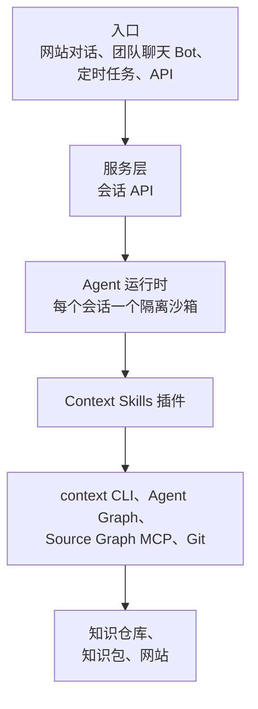

# 构建知识服务

<!-- context:section id="goal" -->
**知识服务 Agent** 是一个常驻 Agent，它借助 Context Skills 生产、更新团队知识并据此回答问题，人在关键决策点上审核。它不是一个新的 Agent 平台：你只需拿一个现有的 Agent 运行时，为它配上 Context Skills 插件、Bot 提示词和远程检索。

同一套 Skill 在任何地方都能用——无论是托管的 Agent 运行时，还是 Claude Code、Codex、Cursor 这样的本地编码 Agent。常驻服务的价值在于团队共享的知识：生产过程需要大量检索和确认，问题也需要随时得到回答。小模块的知识直接放在其仓库的 `docs/` 下即可。

运行时、入口和服务层由你提供；Context 提供 Skill 及其背后的工作流。本页介绍各部分如何组合、服务做什么、如何选择运行时，以及 Bot 提示词里该写什么。团队的日常使用见[在团队聊天中使用 Bot](./using-the-bot-in-team-chat.md)。
<!-- /context:section -->

<!-- context:section id="layers" -->
## 各部分如何组合

- **入口**是请求的来源：网站对话、团队聊天 Bot、定时任务和 API 调用。它们承载提问、生产或更新请求，以及例行巡检。
- **服务层**是由你运行的会话 API。它负责鉴权和限流，为每个会话启动一个运行时，转发事件流，把结果渲染为网页消息或聊天卡片，并收集评价。
- **Agent 运行时**为每个会话提供独立的隔离沙箱，运行系统提示词加你的 Bot 提示词，并根据用户的请求选择 Skill。
- **Context Skills 插件**完成知识工作：生产、附来源的问答，以及同仓库文档。各个 Skill 及其对应的入口列在[技能清单](../../product/reference/context/skills.md)中。
- **底层基础**是 `context` CLI 与 Agent Graph、Source Graph MCP 和 Git。它们推进和恢复工作流、按提交远程读取代码，并提交知识工作区。
- **产出**——Git 中的知识仓库、知识包和文档站——在构建后一并发布。
<!-- /context:section -->

<!-- context:section id="setup" -->
## 搭建服务

1. **选择运行时**，它要为每个会话提供隔离沙箱；见下文[选择运行时](#choosing-a-runtime)。
2. **在运行时镜像中安装 Context**：`context` CLI 和 Context 插件，参见[安装](../../product/getting-started/installation.md)。同时预装知识包和知识工作区，避免每个会话都重新安装和克隆——冷启动是首次回答慢的主要原因。
3. **接入远程检索**，让 Agent 按提交读取代码，而不是在沙箱里克隆仓库；参见[远程读取代码证据](../querying-knowledge/reading-code-evidence-remotely.md)。
4. **编写 Bot 提示词**，写明审核策略和检索顺序；见下文[配置 Bot](#configuring-the-bot)。
5. **通过服务层接入各个入口**，并决定谁可以做什么：公开访客提问，维护者负责生产、更新和发布。边界说明见[在团队聊天中使用 Bot](./using-the-bot-in-team-chat.md)。

然后按团队实际的用法试一试：问一个你已知答案的问题，再请求一次小更新，并一路跟进到审核报告。
<!-- /context:section -->

<!-- context:section id="flows" -->
## 服务做什么

服务运行三条流程，都通过同一套 Skill 完成。

- **生产。** Agent 先恢复知识工作区和来源版本来准备环境，识别出生产请求并做规划，采集来源（代码固定到提交，文档生成快照），编写每一节并附上来源引用，自动检查引用，再把 Diff 报告交给人审核。之后构建、发布，并归档一个附带 Changelog 条目的版本。
- **提问。** 挂载插件和知识包后，Agent 识别出问题并检索知识——先查索引，再看页面正文和证据。知识不够时，通过 Source Graph 按提交读取原文。回答结论先行，并附来源。参见[提问](../querying-knowledge/asking-questions.md)。
- **更新。** 更新可以由聊天中的请求、回答时发现并经用户确认的缺口，或定时巡检触发。Agent 对比新旧来源版本找出受影响的文章，只修订这些部分及其引用，并把 Diff 报告交给人审核。发布后，它会报告变更的文章和新版本。参见[更新知识](../updates-and-versions/updating-knowledge.md)。

你要做的决策与在本地工作时相同：确认计划、审核 Diff 报告、同意发布——除非 Bot 的审核策略把其中一部分委托了出去。
<!-- /context:section -->

<!-- context:section id="runtime" -->
## 选择运行时

任何为每个会话提供隔离沙箱的托管 Agent 运行时都可以。比较运行时时看这几点：

- **沙箱启动时间。** 冷启动是首次回答耗时的主要来源。
- **会话时长上限。** 生产会话往往运行很久。
- **文件系统持久化。** 知识工作区和已安装的工具能否在会话之间保留。
- **出网控制。** 沙箱可以访问哪些来源和服务。

让服务层基于通用的会话接口——创建会话、发送消息、读取事件流、结束会话——这样更换运行时不会影响 Skill。
<!-- /context:section -->

<!-- context:section id="configure" -->
## 配置 Bot

Bot 提示词是 Bot 受信任的实例配置。用它来：

- **设置审核策略。** Bot 设置作用于它运行的每个任务，优先于全托管模式和普通模式的默认值；例如，Bot 可以始终把审核报告发给人，同时在其配置的目标范围内直接发布而无需询问。参见[全托管模式](../planning-and-production/managed-mode-and-review-policy.md)。
- **设置检索顺序与访问方式。** 选择提问时先读知识工作区中已批准的知识、先读知识包，还是两者都读，以及代码是远程读取还是本地读取。参见[提问](../querying-knowledge/asking-questions.md)。
- **描述巡检。** 定时任务需要各自的提示词，写明巡检范围、没有变化时该做什么，以及哪些情况需要人来处理。参见[定时更新](../updates-and-versions/scheduled-updates.md)。

可能出的问题：策略与审核者的实际工作方式不匹配。如果工作流需要一个人工决策，而策略说要跳过，Agent 会停下来报告这一不一致，而不会自行批准。
<!-- /context:section -->
