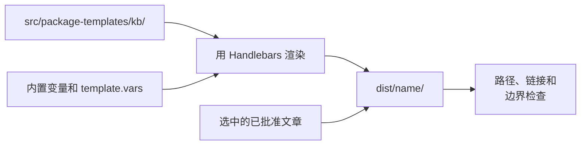

# 定制输出模板

<!-- context:section id="goal" -->
每个知识包都由你的 Context 知识工作区中的一个**知识包模板**渲染而成，默认位于 `src/package-templates/kb/`。模板提供知识包的入口页、查询 Skill 以及给 Agent 的各种说明；`context build` 会渲染模板并加入选中的已批准文章。生成的默认模板是一个可用的通用起点。当你的知识包需要项目术语、精选导航、路由规则或面向特定任务的 Skill 时，再对它进行定制。


<!-- /context:section -->

<!-- context:section id="layout" -->
## 模板包含什么

```text
src/package-templates/
├── kb/
│   ├── AGENTS.md
│   ├── wikis/
│   │   └── index.md
│   └── skills/
│       └── knowledge-query/
│           ├── SKILL.md
│           └── scripts/
│               └── search.mjs
└── llms/
    └── llms.txt
```

知识包模板至少必须包含一个 `SKILL.md` 和 `wikis/index.md`；只有 `AGENTS.md` 的模板会被拒绝。每个渲染出的 Skill 都位于 `skills/<skill-name>/SKILL.md`，且 frontmatter 中的 `name` 与之匹配。如果想给查询 Skill 加上项目前缀，请重命名它的模板文件夹——例如 `skills/android-query/`——因为 Context 绝不会根据知识包名称推导 Skill 名称。只有当你需要知识查找之外的行为时，才添加其他 Skill。
<!-- /context:section -->

<!-- context:section id="review" -->
## 首次构建前接受或修改

新初始化的通用模板必须先修改或明确接受，才能进行首次构建。`context status` 会把它显示为知识包模板审核步骤：Agent 要么通过工作流返回的命令接受未修改的默认模板，要么由你修改 `src/package-templates/` 下的文件。Context 会比较文件摘要并记录这一决定；它不会评判模板的文字内容。
<!-- /context:section -->

<!-- context:section id="entry" -->
## 入口页与导航

`wikis/index.md` 是知识包的入口页。请告诉读者这个知识包覆盖什么、面向谁，以及如何查询它。每个选中的根目录——`wikis/`、`guides/`、`rules/`、`feats/`——始终都会有一个索引。默认情况下，小目录会折叠到最近的已生成上级索引中，只有当某个目录会向其父级暴露超过 50 个条目时，才会获得自己的 `index.md`；设置 `navigation.foldDirectoryIndexes: false` 可为每个目录生成一个索引，也可以修改 `maxInlineEntries`。

如需精选导航，可在 `wikis/index.md` 中遍历内置变量：

```handlebars
{{#each knowledgeGroups}}
## {{title}} ({{count}})
{{#each items}}
- [{{title}}]({{href}})
{{/each}}
{{/each}}
```

| 变量 | 提供的内容 |
| --- | --- |
| `{{displayName}}`、`{{packageName}}` | 知识包显示名称和名称 |
| `{{knowledgeCount}}`、`{{knowledgeTimestamp}}` | 选中页面的数量和最新时间戳 |
| `{{knowledgeItems}}` | 供循环使用的选中页面元数据 |
| `{{knowledgeGroups}}` | 按根目录和一级目录分组的页面 |
| `{{knowledgeTreeNodes}}`、`{{knowledgeTree}}` | 嵌套树，或其 Markdown 预览 |
| `{{wikisRoot}}` … `{{featsRoot}}` | 相对于知识包的根路径，用于 Skill 内的链接 |

包括循环、条件和辅助函数在内的完整列表见[模板变量](../../product/reference/context/template-variables.md)。自定义值来自 `template.vars`。
<!-- /context:section -->

<!-- context:section id="skill" -->
## 查询 Skill

默认的 `knowledge-query` Skill 已经内置了结构优先的查询规范和 BM25 搜索兜底。当你需要项目术语、入口或任务工作流时，修改它的模板。编写说明请放在模板注释或单独的指南中——不要放在交付的 Skill 里一个写给作者的末尾章节中。
<!-- /context:section -->

<!-- context:section id="rules" -->
## 构建强制执行的规则

- **不能有第二个知识来源。** 描述覆盖范围、范围边界、已知缺口或限制的模板文字，必须引用已批准的知识、`context-build-inventory.json` 或渲染后的结构数据；否则构建会报告模板边界诊断。事实应放在已批准的文章中。
- **不能冲突。** 模板路径会先渲染；渲染后的路径不能与选中的知识路径或生成的索引路径冲突。请重命名模板文件，或用 `select.exclude` 排除该知识路径。
- **链接必须有效。** 每个根索引和生成的子索引中的链接都必须能在知识包内解析；失效的链接会被报告为 `package/index-link-invalid`。
- **在源头修复。** 修复模板、已批准的知识路径或声明，然后重新构建；永远不要修补 `dist/`。

`context build` 和 `context verify` 检查的是结构，而不是选中的知识对你的读者是否有意义——请自己检查产出。模板 API 见[包模板](../../product/reference/context/package-templates.md)。
<!-- /context:section -->
