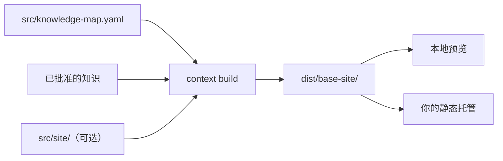

# 文档站

<!-- context:section id="goal" -->
Context 文档站点是一个静态网站，与你的知识包基于同一批已批准的知识构建。在知识包上加一个 `site` 选项即可开启；此后每次 `context build` 都会写出知识包和一个同级的 `dist/<base>-site/` 文件夹，你可以在本地预览它，也可以上传到任意静态托管服务。


<!-- /context:section -->

<!-- context:section id="enable" -->
## 开启站点

```ts
kbPackage({
  name: "project-kb",
  template: "src/package-templates/kb",
  site: {
    title: "Project knowledge",
    lang: "en-US",
    base: "/",
    home: {
      slogan: "Find the context behind the work",
      resources: [{
        title: "Project workspace",
        description: "Open the repository that maintains this knowledge.",
        href: "https://example.com/project",
        featured: true,
      }],
    },
  },
});
```

| 选项 | 含义 |
| --- | --- |
| `title`、`description` | 站点标题（默认为知识包名称）和描述 |
| `lang` | 主语言，默认 `en-US` |
| `base` | URL 前缀，默认 `/`；托管在 `/docs/` 路径下时使用 `/docs/`。它不会改变输出文件夹 |
| `home` | 首页标题、标语、描述和资源卡片；每张卡片需要一个安全的 `href`、一个可复制的 `command`，或两者都有；`featured` 还会把它放进首屏的操作按钮中 |

输出文件夹会去掉知识包名称末尾的一个 `-kb`：`project-kb` 会构建出 `dist/project-kb/` 和 `dist/project-site/`。资源卡片来自已确认的设置、仓库远端地址或真实的部署结果；未知的目标地址会被省略，绝不会用占位内容填充。
<!-- /context:section -->

<!-- context:section id="features" -->
## 站点提供什么

- **首页**——每个一级知识地图分区显示为一张卡片，附有其页面的有限预览，另有 LLM Docs 和 Changelog。
- **导航**——顶栏显示各分区；左侧边栏只显示当前分区的下级内容。每个分区的落地页把其一级分组显示为卡片，每行两张，窄屏时每行一张。不属于任何分区的页面——“更多”菜单目标、LLM Docs 和更新日志——不显示侧边栏，也不高亮任何分区。
- **搜索**——本地搜索，可通过搜索按钮或 Cmd/Ctrl+K 打开；不依赖搜索服务。
- **主题**——浅色和深色。无论系统配色如何，站点都以浅色模式打开；读者的选择保存在整个源（origin）共用的 `context-theme` 键下，因此同一源下的站点共享该选择，并从首次绘制起生效，页面加载时不会闪现另一种配色。
- **缺失页面**——访问不存在的地址时显示居中的 404 页面，使用读者的语言，并提供返回站点首页的链接。
- **图表**——Mermaid 在浏览器中渲染，提供适应、100%、缩放、全屏和查看源码等控件。无效的图表会保留源码并显示提示，而不会阻止发布。
- **来源**——每篇文章末尾列出其来源：仓库条目链接到记录的修订版本，文档条目链接到其登记的 URL。文章正文中的行内代码如果是被引用仓库的文件、其中某个目录或此类目录的唯一名称（例如 Skill 名称），会链接到记录版本中的对应路径；未被引用或有歧义的名称保持为普通代码。

代码示例和原始 HTML 只作为内容展示，绝不会被执行。
<!-- /context:section -->

<!-- context:section id="navigation" -->
## 导航来自知识地图

`src/knowledge-map.yaml` 决定侧边栏：每个条目通过文章的身份标识绑定到文章，因此标签和父级分组永远不会改变文章的 URL，同一篇文章也可以出现在多个位置而只保留一个 URL。打包前，每篇选中的文章都必须有一个有效的位置；缺少绑定会阻止构建，CLI 会返回待放置文章的列表。在文章仍处于计划阶段时，分类条目可以暂时为空。

| 设置 | 添加的内容 |
| --- | --- |
| `site.nav` | 顶栏中阅读分区之后的链接，或设置 `position: "start"` 后显示在分区之前——例如文档首页链接；指向当前页的导航链接会被高亮 |
| `site.more` | “更多”菜单中的条目，位于 LLM Docs 和 Changelog 之前；条目可以指向保留在知识地图之外的已批准文章，例如发布说明 |
| `socialLinks` | 顶栏中的图标链接（仅限 `https`） |
| `titleLink` | 点击站点标题时前往的地址；像 `/` 这样的根相对链接指向源站根路径，而不是 `base` |

以 `/` 开头的链接是源站路径，这样位于 `/docs/` 下的站点就可以链接到同一域名下的同级应用。导航或“更多”条目上的 `locales` 用于翻译其标签。
<!-- /context:section -->

<!-- context:section id="build" -->
## 构建与预览

站点会先在暂存文件夹中生成，然后才替换任何内容，因此网站构建失败时会保留之前的知识包和站点。移除 `site` 后，下一次成功构建会删除旧站点。`dist/<base>-site/context-site-map.json` 记录每篇文章的已批准路径、知识包路径和站点路径，以及菜单和所有未解析的目标。

构建不比对被引用的来源区域，因此发布构建不需要已登记来源的检出副本；`context verify` 仍会报告变化、移动或缺失的区域，所以发布前请先运行它。

通过本地 HTTP 服务器预览：

```sh
python3 -m http.server 8000 --bind 127.0.0.1 --directory dist/project-site
```

Agent 的完成报告会分别列出知识包文件夹、网站文件夹和 LLM 文本，并把每一项标为已生成、失败或未选择，同时给出导航覆盖情况和经过验证的预览 URL。
<!-- /context:section -->

<!-- context:section id="deploy" -->
## 部署

用你选择的静态托管工具部署 **`dist/<base>-site/` 中的内容**。Context 的构建不包含任何托管 SDK、登录或部署步骤；每次网站构建成功后，Agent 会告诉你应部署哪个文件夹，如果你已授权某个目标，它还会使用兼容的部署 Skill。只发布网站文件夹——绝不发布来源、私有的工作区状态或整个知识包——并且只有在检查过托管后的 URL 之后才会报告成功。

部署完成后，记录公开的根地址，以便查询 Skill 能链接到页面：

```bash
context package site-url project-kb https://example.com/docs/
```

这个地址只是访问提示，并不能证明已经发布；重新构建时会保留它。

| 你的要求 | Agent 的做法 |
| --- | --- |
| 知识包和网站 | 一个带 `site` 的 `kbPackage` |
| 只要知识包 | 移除 `site` 并重新构建；旧站点会被删除 |
| 之后再添加网站 | 添加 `site`，放置所有未放置的文章，然后重新构建 |
| 只为分享而要网站 | 同样构建知识包，但只分享网站文件夹 |

如需修改页面、插槽和颜色，请参阅[页面与主题定制](page-and-theme-customization.md)；如需支持其他语言，请参阅[多语言站点](multilingual-sites.md)。
<!-- /context:section -->
