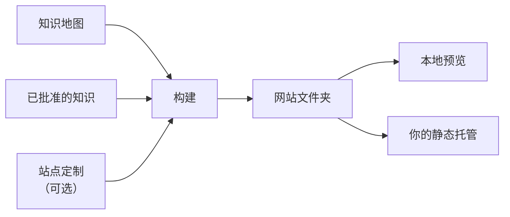

# 文档站

<!-- context:section id="goal" -->
Context 文档站是一个静态网站，与你的知识包基于同一批已批准的知识构建。开启后，每次构建都会写出知识包和一个同级的网站文件夹。你可以在本地预览网站，也可以把它上传到任意静态托管服务。

<!-- /context:section -->

<!-- context:section id="enable" -->
## 提出什么要求

| 你的要求 | Agent 的做法 |
| --- | --- |
| 知识包和网站 | 由同一个知识包声明同时构建两者 |
| 只要知识包 | 关闭网站并重新构建；旧的网站文件夹会被删除 |
| 之后再添加网站 | 开启网站，把尚未进入导航的页面放置好，然后重新构建 |
| 只为分享而要网站 | 同样构建知识包，但只分享网站文件夹 |

一个典型的请求：

> 添加一个标题为“Project knowledge”的英文文档站，托管在 `/docs/` 下，并在首页放一个指向我们仓库的链接。

Agent 会为你设置站点标题、语言、地址前缀和首页。地址前缀只改变站点的 URL，不改变输出文件夹。网站文件夹以知识包名称命名，并去掉末尾的一个 `-kb`：`project-kb` 会构建出 `dist/project-kb/` 和 `dist/project-site/`。Agent 可以设置的所有选项都列在 [Project API](../../product/reference/context/project-api.md) 的站点选项中。
<!-- /context:section -->

<!-- context:section id="features" -->
## 站点提供什么

- **首页**——知识地图的每个一级分区显示为一张卡片，附有其页面的简短预览，另有资源卡片。
- **导航**——顶栏显示各分区；左侧边栏只显示当前分区的页面。每个分区的落地页把其分组显示为卡片。
- **搜索**——本地搜索，可通过搜索按钮或 Cmd/Ctrl+K 打开；不依赖搜索服务。
- **主题**——浅色和深色。站点默认以浅色模式打开，直到读者切换，并会记住这一选择；参见 [页面与主题定制](page-and-theme-customization.md)。
- **缺失页面**——访问不存在的地址时显示 404 页面，使用读者的语言，并提供返回首页的链接。
- **图表**——Mermaid 在浏览器中渲染，提供适应、100%、缩放、全屏和查看源码等控件。无效的图表会显示源码和提示，而不会阻止发布。
- **来源**——每个页面末尾列出其来源：仓库条目链接到记录的修订版本，文档条目链接到其登记的 URL。行内代码如果指向被引用仓库中的文件或目录，会链接到记录版本中的对应路径。
- **LLM Docs 与 Changelog**——站点可以链接同一次构建产出的纯文本 [LLM Docs](llm-docs.md)，以及知识库的 Changelog。

代码示例和原始 HTML 只作为内容展示，绝不会被执行。
<!-- /context:section -->

<!-- context:section id="navigation" -->
## 导航来自知识地图

知识地图决定侧边栏。每个条目通过身份标识指向页面，因此重命名标签或把页面移到其他分组都不会改变它的 URL，同一个页面也可以出现在多个位置而只保留一个 URL。构建前，每个选中的页面都需要在知识地图中有位置；如果有缺失，Agent 会把它们放好，或询问你应放在哪里。在页面仍处于计划阶段时，分组可以暂时为空。

你也可以请 Agent 在顶栏添加额外链接（例如返回文档首页的链接）、在“更多”菜单中添加条目（例如保留在知识地图之外的发布说明）、添加图标链接，或更改站点标题的跳转目标。以 `/` 开头的链接指向同一域名，因此位于 `/docs/` 下的站点可以链接到同级应用。具体设置见 [Project API](../../product/reference/context/project-api.md)。
<!-- /context:section -->

<!-- context:section id="home-cards" -->
## 首页资源卡片

资源卡片把读者引向站点之外的地方，例如维护这些知识的仓库。卡片可以打开一个链接、提供一条可复制的命令，或两者兼有；精选卡片还会出现在首页顶部的操作按钮中。

这些值来自真实的来源，绝不靠猜测：你已确认的设置、知识工作区的仓库远端地址，或真实的部署结果。未知的目标会被省略，不会编造链接，也不会出现空的占位卡片。修改卡片需要重新构建；托管的站点会在你下一次部署时更新。
<!-- /context:section -->

<!-- context:section id="build" -->
## 预览

请 Agent 预览站点：

> 构建站点并打开本地预览。

Agent 会通过本地 HTTP 服务器提供网站文件夹。网站会先在暂存文件夹中生成，因此构建失败时会保留之前的知识包和站点。Agent 的完成报告会分别列出知识包、网站和 LLM 文本——每一项标为已生成、失败或未选择——同时给出导航覆盖情况和它检查过的预览 URL。

构建不会重新读取你的来源仓库，因此无需检出它们也能构建和部署。部署前，Agent 仍会检查被引用的来源是否有变化、移动或缺失，并告诉你是否有页面需要更新。
<!-- /context:section -->

<!-- context:section id="deploy" -->
## 部署

用你选择的静态托管工具部署**网站文件夹中的内容**。Context 的构建不包含任何托管服务、登录或部署步骤。每次网站构建成功后，Agent 会告诉你应部署哪个文件夹，如果你已授权某个目标，它还会使用兼容的部署 Skill。只发布网站文件夹——绝不发布来源、私有的工作区状态或整个知识包——并且只有在检查过托管后的 URL 之后才会报告成功。

站点上线后，请 Agent 把它的公开地址记录到知识包中，以便查询 Skill 能把回答链接到站点页面。这个地址只是访问提示，并不能证明已经发布；重新构建时会保留它。

如需修改页面、插槽和颜色，请参阅 [页面与主题定制](page-and-theme-customization.md)；如需支持其他语言，请参阅 [多语言站点](multilingual-sites.md)。
<!-- /context:section -->
