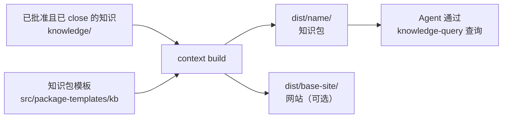

# 知识包

<!-- context:section id="goal" -->
**知识包**是 Context 知识工作区面向 Agent 的产出：`dist/` 下的一个文件夹，把已批准的知识变成其他 Agent 可以安装和查询的内容。它包含面向读者的已批准文章、一个懂得如何搜索这些文章的查询 Skill，以及一份把每个文件映射回其已批准来源的清单。同一次构建还可以生成文档网站和 LLM 文本；本页只介绍知识包本身。


<!-- /context:section -->

<!-- context:section id="contents" -->
## 包里有什么

```text
dist/<package-name>/
├── AGENTS.md
├── skills/
│   └── knowledge-query/
│       ├── SKILL.md
│       └── scripts/search.mjs
├── wikis/
│   ├── index.md          # package entry page
│   ├── codeindex/ ...
│   ├── business/ ...
│   └── product/ ...
├── guides/ ...           # architecture, sop, faq, decision, incident
├── rules/ ...            # standards, test
├── feats/ ...
├── others/assets/ ...    # bundled images and resources
└── context-build-inventory.json
```

知识包名称已经是文件夹名，所以内部的根目录是扁平的：`wikis/`、`guides/`、`rules/`、`feats/`。每篇文章都放在其所属集合对应的根目录下——`sop` 页面放在 `guides/sop/`，`codeindex` 页面放在 `wikis/codeindex/`——具体对应关系见[知识分类](../../product/reference/context/knowledge-collections.md)。`wikis/` 是结构化的实体与关系层；`guides/` 和 `rules/` 则对其进行解释、落地为操作或加以约束。

知识包中的页面是写给使用者的：它们保留面向读者的 frontmatter，去掉生命周期注释、章节标记和指纹，并在末尾附上一个根据文章引用生成的可读来源章节——仓库链接带有文件和行范围，文档链接带有采集时记录的来源归属。精确的章节证据仍保留在知识工作区中对应的页面里。
<!-- /context:section -->

<!-- context:section id="query" -->
## Agent 如何读取知识包

默认的 `knowledge-query` Skill 是一个完整、通用的查询入口。它以结构优先的方式工作：

1. 从每个根目录中生成的目录索引开始。
2. 借助 `context-build-inventory.json` 中的关系记录了解知识包中可见的关联。
3. 阅读候选页面，并引用其中可见的标题和段落。
4. 当知识包没有覆盖所问的事实时，报告这一缺口。

当索引无法缩小范围，或某个页面太大而无法直接阅读时，它会用内置的 `scripts/search.mjs` 以 BM25 对有限大小的 Markdown 片段排序。搜索结果只是线索；知识包说了什么，要以页面正文和带类型的关系记录为准。只读取知识包的 Agent 不得声称自己读过原始来源。关于如何把知识包安装到 Agent 中，请参阅[在 Agent 中使用知识包](../querying-knowledge/using-packages-in-agents.md)。
<!-- /context:section -->

<!-- context:section id="declare" -->
## 声明知识包

知识包在知识工作区的 `src/index.ts` 中声明。当你在开工报告中选择产出时，Agent 会替你修改这个文件；你无需手写。

```ts
kbPackage({
  name: "project-kb",
  template: "src/package-templates/kb",
  select: { exclude: ["**/internal/**"] },
  site: { title: "Project knowledge", lang: "en-US", base: "/" },
});
```

| 字段 | 含义 |
| --- | --- |
| `name` | 小写且可安全用于路径的知识包名称；产出写入 `dist/<name>/` |
| `template` | 模板目录，或 `{ path, vars }` |
| `select` | 可选，按 `collections`、OKF `okfRoots`，或 `knowledge/` 下的 `include` / `exclude` 路径进行选择；省略表示选择全部已批准的知识 |
| `navigation` | 目录索引策略；默认折叠索引，每个索引最多内联 50 个条目 |
| `assets` | 资源交付方式：默认打包；显式配置时可改为 Git raw 链接或不交付 |
| `site` | 同时构建[文档网站](documentation-sites.md) |

完整说明见[包模板](../../product/reference/context/package-templates.md)。
<!-- /context:section -->

<!-- context:section id="choose" -->
## 选择产出

多种产出可以组合。开工报告会把它们显示为一个多选列表，后续步骤沿用你的选择：

- [x] Agent 知识包——新知识工作区的默认选项。
- [x] 文档网站——默认与知识包一起生成，用于本地预览或之后托管。
- [ ] LLM 文本——可选，作为模型上下文或 RAG 的输入；参见 [LLM Docs](llm-docs.md)。

你也可以只停留在已批准的 Markdown：保持 `packages: []`，就不会运行任何构建。没有单独的网站 Skill，每个选中的产出也不需要再单独授权。
<!-- /context:section -->

<!-- context:section id="build" -->
## 构建与资源

`context build` 只使用已批准且已 close 的知识；如果 close 尚未完成，工作流会先执行它。新初始化的通用模板必须先修改或明确接受，才能进行首次构建——`context status` 会把它显示为知识包模板审核步骤。

已批准页面引用的图片和资源默认打包到 `others/assets/`。每张打包的图片不超过 1 MiB，所有图片合计不超过 40 MiB；过大的图片只会在 `dist/` 中被压缩为新的 WebP 文件，绝不会改动 `sources/` 或 `knowledge/assets/`。来源审计文件和采集报告永远不会作为读者资源交付。
<!-- /context:section -->

<!-- context:section id="checks" -->
## 构建会检查什么

- **模板边界。** 描述覆盖范围、范围边界或已知缺口的模板文字，必须引用已批准的知识、清单或渲染后的结构数据；否则构建会报告诊断。
- **索引链接。** 每个生成的目录索引都会被检查，确保相对链接能在知识包内解析。
- **路径冲突。** 渲染后的模板路径不能与选中的知识路径冲突；请重命名模板文件，或用 `select.exclude` 排除该知识路径。
- **关系覆盖。** 清单中的 `structure.relationship_coverage` 记录代码索引页面是否带有当前的关系数据，因此空的边列表是覆盖情况的证据，而不是可以凭空捏造依赖的许可。

请在模板、已批准的知识或知识包声明中修复问题，然后重新构建。永远不要把修补 `dist/` 当作长期修复。如需修改模板本身，请参阅[定制输出模板](custom-output-templates.md)。
<!-- /context:section -->
