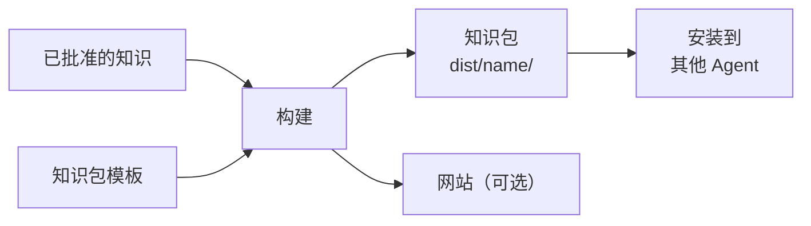

# 知识包

<!-- context:section id="goal" -->
**知识包**是 Context 知识工作区面向 Agent 的产出：`dist/` 下的一个文件夹，把已批准的知识变成其他 Agent 可以安装和查询的内容。它包含面向读者的已批准页面、一个懂得如何搜索这些页面的查询 Skill，以及一份把每个文件映射回其已批准来源的清单。同一次构建还可以生成文档站和 LLM Docs。

“产出与站点”这一小节涵盖页面批准之后的所有环节：知识包（本页）、[文档站](documentation-sites.md)、[LLM Docs](llm-docs.md)、[页面与主题定制](page-and-theme-customization.md)、[多语言站点](multilingual-sites.md)和[定制输出模板](custom-output-templates.md)。


<!-- /context:section -->

<!-- context:section id="choose" -->
## 选择产出

你在[开工报告](../planning-and-production/start-reports.md)中通过一个多选列表选择产出，后续步骤沿用你的选择：

- [x] Agent 知识包：新知识工作区的默认选项。
- [x] 文档网站：默认与知识包一起生成，用于本地预览或之后托管。
- [ ] LLM 文本：可选，作为模型上下文或检索的输入；参见 [LLM Docs](llm-docs.md)。

你也可以只停留在已批准的 Markdown，此时不会运行任何构建。选中某个产出即是对它的全部授权。

之后想改变选择，直接告诉 Agent 即可，例如：

> 为这个知识包加上文档网站，并排除 `internal/` 下的所有内容。

Agent 会替你更新知识工作区的知识包声明，你无需手写。如果想了解它设置的选项，例如知识包选择哪些页面、目录索引如何折叠、图片如何交付，可参阅 [Project API](../../product/reference/context/project-api.md) 和[包模板](../../product/reference/context/package-templates.md)。
<!-- /context:section -->

<!-- context:section id="contents" -->
## 包里有什么

```text
dist/<package-name>/
├── AGENTS.md
├── skills/
│   └── knowledge-query/
│       ├── SKILL.md
│       └── scripts/search.mjs
├── wikis/
│   ├── index.md          # 知识包入口页
│   ├── codeindex/ ...
│   ├── business/ ...
│   └── product/ ...
├── guides/ ...           # 架构、操作流程、常见问题、决策、故障记录
├── rules/ ...            # 规范、测试
├── feats/ ...
├── others/assets/ ...    # 随包提供的图片和资源
└── context-build-inventory.json
```

知识包名称已经是文件夹名，所以内部的根目录是扁平的：`wikis/`、`guides/`、`rules/`、`feats/`。每个页面都放在其所属集合对应的根目录下，例如 `sop` 页面放在 `guides/sop/`，`codeindex` 页面放在 `wikis/codeindex/`，具体对应关系见[知识分类](../../product/reference/context/knowledge-collections.md)。`wikis/` 是结构化的实体与关系层；`guides/` 和 `rules/` 则对其进行解释、落地为操作或加以约束。

知识包中的页面是写给使用者的：它们保留面向读者的 frontmatter，去掉内部标记，并在末尾附上一个根据页面引用生成的可读来源章节：仓库链接带有文件和行范围，文档链接带有采集时记录的来源归属。精确到章节的证据仍保留在知识工作区中。
<!-- /context:section -->

<!-- context:section id="query" -->
## Agent 如何读取知识包

随包提供的 `knowledge-query` Skill 是一个完整、通用的查询入口。它以结构优先的方式工作：

1. 从每个根目录中生成的目录索引开始。
2. 借助清单中记录的关系了解页面之间的关联。
3. 阅读最可能相关的页面，并引用其中可见的标题和段落。
4. 当知识包没有覆盖所问的事实时，报告这一缺口。

当索引无法缩小范围，或某个页面太大而无法直接阅读时，随包提供的搜索脚本会按相关度对 Markdown 片段排序。搜索结果只是线索；知识包说了什么，要以页面正文和记录的关系为准。只读取知识包的 Agent 不得声称自己读过原始来源。
<!-- /context:section -->

<!-- context:section id="build" -->
## 构建与资源

构建只使用已批准的知识。新生成的知识包模板必须先被接受或修改，才能进行首次构建；参见[定制输出模板](custom-output-templates.md)。

已批准页面引用的图片和资源默认打包到 `others/assets/`。每张打包的图片不超过 1 MiB，所有图片合计不超过 40 MiB；过大的图片只会在 `dist/` 中被压缩为新的 WebP 文件，绝不会改动你的来源或已批准的知识。来源审计文件和采集报告永远不会作为读者资源交付。
<!-- /context:section -->

<!-- context:section id="checks" -->
## 构建会检查什么

- **模板如实。** 描述覆盖范围、范围边界或已知缺口的模板文字，必须有已批准的知识或知识包自身的结构数据作为依据。
- **索引链接。** 每个生成的目录索引都会被检查，确保相对链接能在知识包内解析。
- **路径冲突。** 模板文件不能与选中的页面落在同一路径上。
- **关系覆盖。** 清单会记录代码索引页面是否带有当前的关系数据，因此空的依赖列表表示“未发现”，而不是“未检查”。

检查失败时，Agent 会修复模板、已批准的知识或知识包声明，然后重新构建；它不会把修补 `dist/` 当作修复。具体规则见[定制输出模板](custom-output-templates.md)。
<!-- /context:section -->

<!-- context:section id="install" -->
## 使用知识包

知识包可以在构建所在的位置使用，也可以复制到 Agent 宿主能读取的任意目录。要让 Claude Code、Codex 或 Cursor 指向某个知识包并查询它，参见[在 Agent 中使用知识包](../querying-knowledge/using-packages-in-agents.md)。
<!-- /context:section -->
