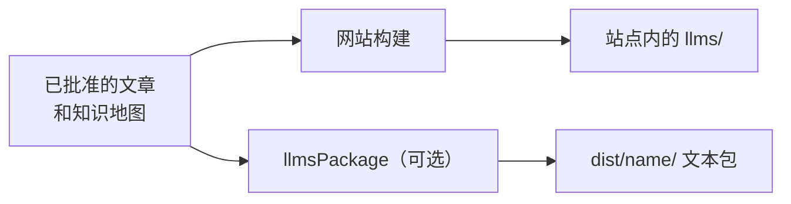

# LLM Docs

<!-- context:section id="goal" -->
**LLM Docs** 是把已批准的知识导出为供模型使用的纯文本：一个索引、一个包含全部文本的文件，以及每篇文章的原始 Markdown。每个 Context 文档站点都会自动在顶栏的 **LLM Docs** 下提供它们。如果你需要文本而不需要网站——例如粘贴到模型上下文中，或导入检索系统——请声明一个独立的 LLM 文本包。


<!-- /context:section -->

<!-- context:section id="files" -->
## 你会得到什么

| 文件 | 内容 |
| --- | --- |
| `llms.txt` | 索引，保留知识地图的分组、顺序和重复出现的位置 |
| `llms-full.txt` | 所有选中的已批准文本，每篇文章只出现一次，按首次出现的位置排序 |
| `llms/pages/<identity>.txt` | 每篇已批准文章对应一个原始 Markdown 文件 |
| `llms/index.html` | 网站上的入口页：先是索引和全文链接，后面是知识地图 |

在网站中，这些文件位于站点文件夹内，并使用配置的 `base`；无需额外的声明或命令。即使站点有翻译，它们也保持主语言。文本文件带有 UTF-8 字节顺序标记（BOM），这样即使托管服务省略了字符集，浏览器也能识别编码；请以 `text/plain; charset=utf-8` 提供它们。
<!-- /context:section -->

<!-- context:section id="standalone" -->
## 独立的文本包

如果你想要一个便于复制、索引或上传的合并文件，而不需要 Agent Skill 打包，请选择 LLM 文本包：

```ts
llmsPackage({ name: "project-llms", template: "src/package-templates/llms" });
```

它会根据模板生成 `llms.txt`，另外生成 `llms-full.txt` 和逐篇文章的文件，并按同一份知识地图组织。它可以与知识包放在同一份声明中；你可以在开工报告中或之后让 Agent 添加它。
<!-- /context:section -->

<!-- context:section id="freshness" -->
## 时效性

只有已批准且被选中的内容才会被导出。知识地图或任何文章发生变化，都会使网站及其 LLM Docs 失效，而构建失败时会保留之前的产出。关于为 Agent 构建、带查询 Skill 的知识包，请参阅[知识包](knowledge-packages.md)。
<!-- /context:section -->
