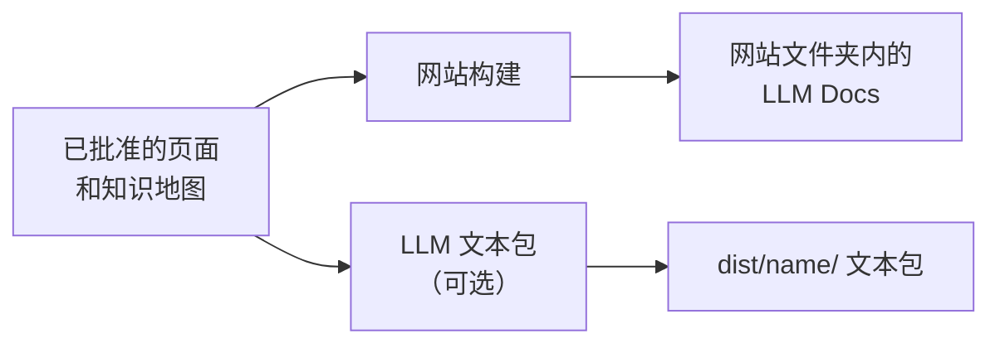

# LLM Docs

<!-- context:section id="goal" -->
**LLM Docs** 是把已批准的知识导出为供模型使用的纯文本：一个索引、一个包含全部文本的文件，以及每个页面的原始 Markdown。它们是 `dist/` 下的构建产物：每次构建文档站都会把它们写入网站文件夹，站点也可以为读者链接它们。如果你需要文本而不需要网站——例如粘贴到模型上下文中，或导入检索系统——请要求构建一个独立的 LLM 文本包。

<!-- /context:section -->

<!-- context:section id="files" -->
## 你会得到什么

| 文件 | 内容 |
| --- | --- |
| `llms.txt` | 索引，保留知识地图的分组、顺序和重复出现的位置 |
| `llms-full.txt` | 所有选中的已批准文本，每个页面只出现一次，按首次出现的位置排序 |
| `llms/pages/<identity>.txt` | 每个已批准页面对应一个原始 Markdown 文件 |
| `llms/index.html` | 网站上的入口页：先是索引和全文链接，后面是知识地图 |

有网站时，这些文件位于网站文件夹内，并沿用网站的地址前缀；无需额外要求。即使站点有翻译，它们也保持主语言。文本文件带有 UTF-8 字节顺序标记（BOM），这样即使托管服务省略了字符集，浏览器也能识别编码；请以 `text/plain; charset=utf-8` 提供它们。
<!-- /context:section -->

<!-- context:section id="standalone" -->
## 独立的文本包

如果你想要一个便于复制、索引或上传的合并文件，而不需要 Agent Skill 打包，请选择 LLM 文本包。可以在[开工报告](../planning-and-production/start-reports.md)中或之后提出：

> 再为这份知识构建一个 LLM 文本包。

它会根据自己的模板生成 `llms.txt`，另外生成 `llms-full.txt` 和逐页面的文件，并按同一份知识地图组织；它可以与知识包并存。Agent 添加的声明见 [Project API](../../product/reference/context/project-api.md)。
<!-- /context:section -->

<!-- context:section id="freshness" -->
## 时效性

只有已批准且被选中的内容才会被导出。知识地图或任何页面发生变化，都会重新构建网站及其 LLM Docs，而构建失败时会保留之前的产出。关于为 Agent 构建、带查询 Skill 的知识包，请参阅[知识包](knowledge-packages.md)。
<!-- /context:section -->
