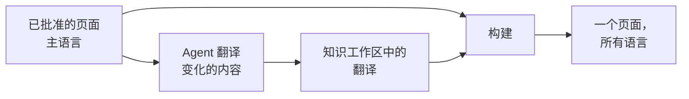

# 多语言站点

<!-- context:section id="goal" -->
Context 站点可以在同一地址下用多种语言显示每个页面。你声明读者语言；Agent 在每一轮中翻译已批准的页面和导航标题；站点为每位读者显示其语言，缺少翻译时则回退到原文。主语言中已批准的知识始终是唯一的真源：翻译只面向读者，绝不会改变审核、验证或知识包。


<!-- /context:section -->

<!-- context:section id="declare" -->
## 声明语言

例如，可以这样告诉 Agent：

> 为站点添加简体中文版本，标题为 项目知识。

它会把该语言加入站点设置：

```ts
site: {
  lang: "en-US",
  locales: { "zh-CN": { title: "项目知识" } },
}
```

每种语言都可以覆盖站点的标签、标题、描述和首页。只需设置不同的部分：未设置的首页字段会先沿用主语言的首页，再回退到内置默认值，因此只翻译标题时，仍会保留主语言的操作按钮和资源卡片。链接、导航和自定义页面都不需要按语言区分路由，因为每个页面都包含所有语言。

读者保存的选择优先，其次是浏览器语言，最后是站点的主语言。该选择对整个源站生效，因此除非另行配置，同一源站下的站点会共享它。即使没有额外的语言，语言按钮仍可在中文和英文之间切换界面。所有语言选项见 [Project API](../../product/reference/context/project-api.md)。
<!-- /context:section -->

<!-- context:section id="workflow" -->
## 翻译在每一轮中的位置

添加语言后，Agent 会在每一轮中、页面批准之后、记录版本之前进行翻译：

- **第一轮**——翻译每个已批准的页面和导航标题。
- **后续各轮**——只更新自上次翻译以来发生变化的内容，并以现有译文为起点。每轮的已批准页面和译文都已提交时效果最好，Agent 会在一轮结束时完成提交。
- **跳过一轮**——告诉 Agent“本轮跳过翻译”。待翻译的页面暂时以主语言发布，下一轮会再次询问。

翻译会保持页面结构、代码块、命令、路径和链接目标不变；只翻译说明文字、标题和图表标签。只要有任何一个翻译页面未通过这些检查，该批次的内容就都不会保存。底层命令列在 [CLI 命令](../../product/reference/context/cli-commands.md)中。
<!-- /context:section -->

<!-- context:section id="storage" -->
## 翻译存放在哪里

翻译按语言存放在知识工作区的 `translations/` 文件夹中，与翻译后的导航标题放在一起。它们是知识工作区的正式内容：会被提交、纳入版本，修改任何一项翻译都会重新构建网站。
<!-- /context:section -->

<!-- context:section id="freshness" -->
## 时效性

每份翻译都会记住它依据的是已批准页面的哪个版本：

| 状态 | 含义 | 站点上的表现 |
| --- | --- | --- |
| 最新 | 与已批准的页面一致 | 显示翻译 |
| 过期 | 已批准的页面此后发生了变化 | 显示翻译，并附带过期提示和一个切换到原文的按钮 |
| 缺失 | 尚未翻译 | 显示原文并附带提示 |

不涉及页面标题、描述或正文的变化不会让翻译过期。对应页面已不存在的翻译会在下次保存翻译时移除。构建报告会列出每种语言已翻译、已过期和缺失的数量。
<!-- /context:section -->

<!-- context:section id="reading" -->
## 读者看到什么

每个页面只发布一次，包含所有语言，由读者的语言决定显示哪一种。没有翻译的导航标题会使用翻译后的页面标题，再没有则使用原文。搜索覆盖所有语言，打开另一种语言的搜索结果时会切换到该语言。指向标题的链接，无论在同一页还是其他页面，都会保持读者的语言并滚动到对应标题，使用浏览器的前进和后退按钮时也是如此。LLM Docs 和 Changelog 保持主语言。关于其他站点选项，请参阅[文档站](documentation-sites.md)；关于支持多语言的自定义组件，请参阅[页面与主题定制](page-and-theme-customization.md)。
<!-- /context:section -->
